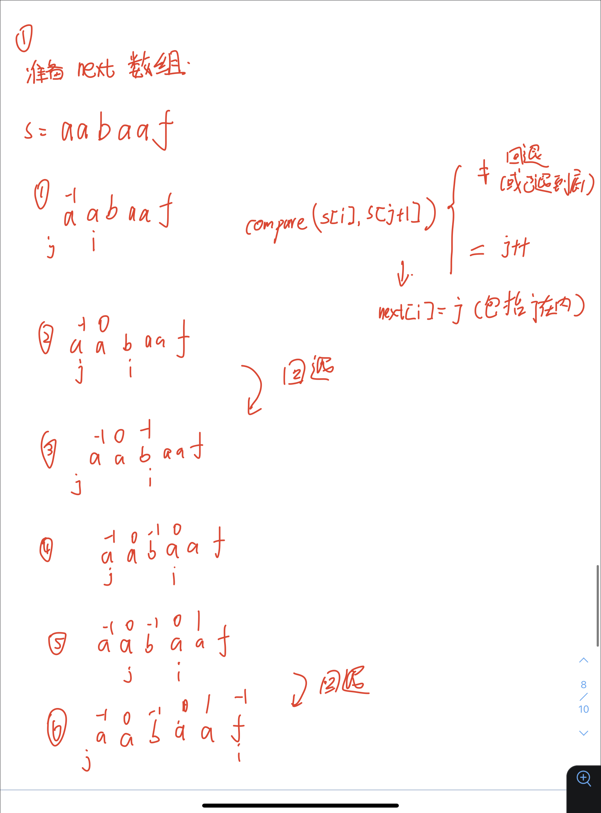
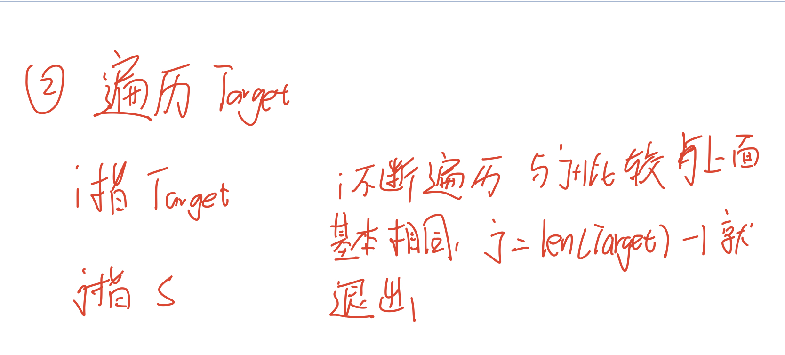
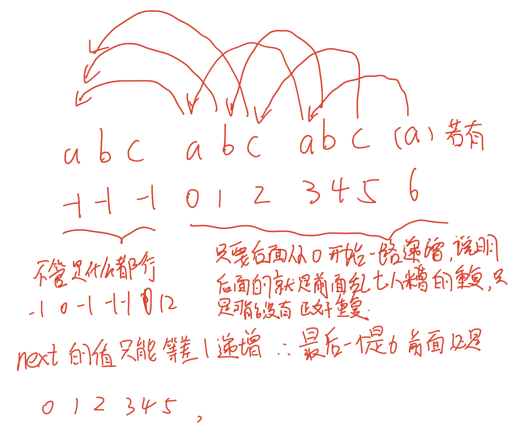

## 字符串

[剑指offer 5](https://leetcode.cn/problems/ti-huan-kong-ge-lcof/)

> 请实现一个函数，把字符串 s 中的每个空格替换成"%20"。

题目不难

1.  要注意首先拓展长度,必须遍历,无论怎么样都是O(n),所以不要怕,大胆遍历
2.  双指针从后往前替换，这样不会覆盖，因为新的空间是在后面的。

```go
func replaceSpace(s string) string {
    b := []byte(s)
    length := len(b)
    spaceCount := 0
    // 计算空格数量
    for _, v := range b {
        if v == ' ' {
            spaceCount++
        }
    }
    // 扩展原有切片
    resizeCount := spaceCount * 2
    tmp := make([]byte, resizeCount)
    b = append(b, tmp...)
    i := length - 1
    j := len(b) - 1
    for i >= 0 {
        if b[i] != ' ' {
            b[j] = b[i]
            i--
            j--
        } else {
            b[j] = '0'
            b[j-1] = '2'
            b[j-2] = '%'
            i--
            j = j - 3
        }
    }
    return string(b)
}
```

[151 反转单词](https://leetcode.cn/problems/reverse-words-in-a-string/solution/fan-zhuan-zi-fu-chuan-li-de-dan-ci-by-leetcode-sol/)

> 给你一个字符串 s ，请你反转字符串中 单词 的顺序。

> 单词 是由非空格字符组成的字符串。s 中使用至少一个空格将字符串中的 单词 分隔开。

> 返回 单词 顺序颠倒且 单词 之间用单个空格连接的结果字符串。

> 注意：输入字符串 s中可能会存在前导空格、尾随空格或者单词间的多个空格。返回的结果字符串中，单词间应当仅用单个空格分隔，且不包含任何额外的空格。

```go
func reverseWords(s string) string {
    s=strings.Trim(s," ")
    cnt:=0
    for i:=0;i<len(s);i++{
        if s[i]!=' '{
            cnt++
        }else{
            if s[i-1]!=' '{
                cnt++
            }
        }
    }
    str:=make([]byte,0,cnt)
    var i int
    for j:=len(s)-1;j>=0;{
        for i=j;i>=0;i--{
            if s[i]==' '{
                break
            }
        }
        str=append(str,[]byte(s[i+1:j+1])...)
        str=append(str,' ')
        for i>=0{
            if s[i]==' '{
                i--
            }else{
                break
            }
        }
        j=i
    }
    
    return string(str[:len(str)-1])
}
```

- 我的方法是去首尾空格，然后从后遍历填入新字符串。
- 但是如果考虑O(1)的空间复杂的话，还是应该像题解那样全部反转然后再每个每个单词反转。

[leetcode 剑指offer 58](https://leetcode.cn/problems/zuo-xuan-zhuan-zi-fu-chuan-lcof/)

> 字符串的左旋转操作是把字符串前面的若干个字符转移到字符串的尾部。请定义一个函数实现字符串左旋转操作的功能。比如，输入字符串"abcdefg"和数字2，该函数将返回左旋转两位得到的结果"cdefgab"。

我的

```go
func reverseLeftWords(s string, n int) string {
    str:=[]byte (s)
    subStr:=str[:n]
    str=append(str[n:],subStr...)
    return string(str)
}
```

进阶:

```go
func reverseLeftWords(s string, n int) string {
    b := []byte(s)
    // 1. 反转前n个字符
    // 2. 反转第n到end字符
    // 3. 反转整个字符
    reverse(b, 0, n-1)
    reverse(b, n, len(b)-1)
    reverse(b, 0, len(b)-1)
    return string(b)
}
// 切片是引用传递
func reverse(b []byte, left, right int){
    for left < right{
        b[left], b[right] = b[right],b[left]
        left++
        right--
    }
}
```

这样就不会浪费空间，都是inplace的操作，但是我的队列的方法其实也不错的。

[28 找出字符串中第一个匹配项的下标](https://leetcode.cn/problems/find-the-index-of-the-first-occurrence-in-a-string/)

> 给你两个字符串 haystack 和 needle ，请你在 haystack 字符串中找出 needle 字符串的第一个匹配项的下标（下标从 0 开始）。如果 needle 不是 haystack 的一部分，则返回  -1 。

实在是有点难的,KMP算法。

- 核心思想：通过挖掘needle本身的信息，在遍历到不符合的情况的时候回退到下一个匹配的地方。
- 实现:
  - 前缀表*next*:与needle长度一样的数组记录当i的下一个不匹配的时候回退到哪里。

在理解了以后自己写的解法，next以-1为不匹配。

```go
func strStr(haystack string, needle string) int {
    next:=make([]int,len(needle),len(needle))
    j:=-1
    next[0]=j
    for i:=1;i<len(needle);i++{
        for j>=0&&needle[i]!=needle[j+1]{
            j=next[j]
        }
        
        if needle[i]==needle[j+1]{
           j++
        }
        next[i]=j
    }
    for j,i:=-1,0;i<len(haystack);i++{
        for j>=0&&haystack[i]!=needle[j+1]{
            j=next[j]
        }
        if haystack[i]==needle[j+1]{
            j++
        }
        
        if j==len(needle)-1{
            return i-j
        }
    }
    return -


}
```

 

差不多也是用KMP的一道题: [459. 重复的子字符串](https://leetcode.cn/problems/repeated-substring-pattern/)

> 给定一个非空的字符串 s ，检查是否可以通过由它的一个子串重复多次构成。

```go
func repeatedSubstringPattern(s string) bool {
    next:=make([]int,len(s),len(s))
    j:=-1
    next[0]=-1
    for i:=1;i<len(s);i++{
        for j>=0&&s[j+1]!=s[i]{
            j=next[j]
        }
        if s[j+1]==s[i]{
            j++
        }
        next[i]=j
    }
    if next[len(next)-1]!=-1&&len(next)%(len(next)-(next[len(next)-1]+1))==0{
        return true
    }else{
        return false
    }
}
```

学到的东西

- 在这里KMP的next数组在遇到true的情况下一般是
  | a | b | c | a | b | c | a | b | c | a | b | c |
  |----|----|----|----|----|----|----|----|----|----|----|----|
  | -1 | -1 | -1 | 0 | 1 | 2 | 3 | 4 | 5 | 6 | 7 |  |
  | 可以发现的在第一个重复之后后面的都是不断增加，因为前后缀都是一样的，所以如果是true的情况，最后一个的next\[len(next)-1\]后面的就是最小子字符串。 |  |  |  |  |  |  |  |  |  |  |  |
- 正确性分析: 一些数学的验证在[代码随想录](https://programmercarl.com/0459.%E9%87%8D%E5%A4%8D%E7%9A%84%E5%AD%90%E5%AD%97%E7%AC%A6%E4%B8%B2.html#kmp)
- 我说说我的理解:
  - next\[len(next)-1\]==-1:直接否定
  - next\[len(next)-1\]\<len(next): 按照上面的假设(next\[len(next)-1\]后面的就是最小子字符串)这样的话len(s)整除不了这个最小子字符串
  - next\[len(next)-1\]\>=len(next): 按照上面的假设(next\[len(next)-1\]后面的就是最小子字符串) 
