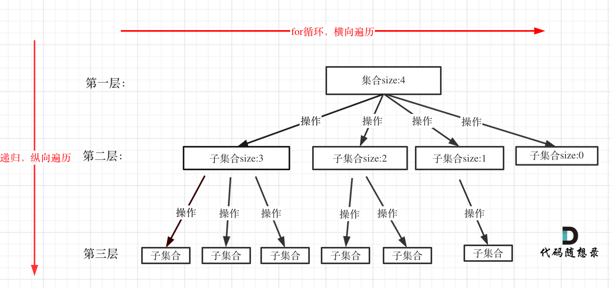
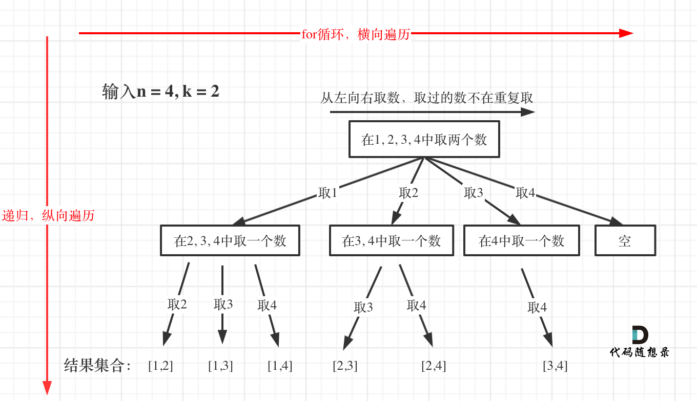
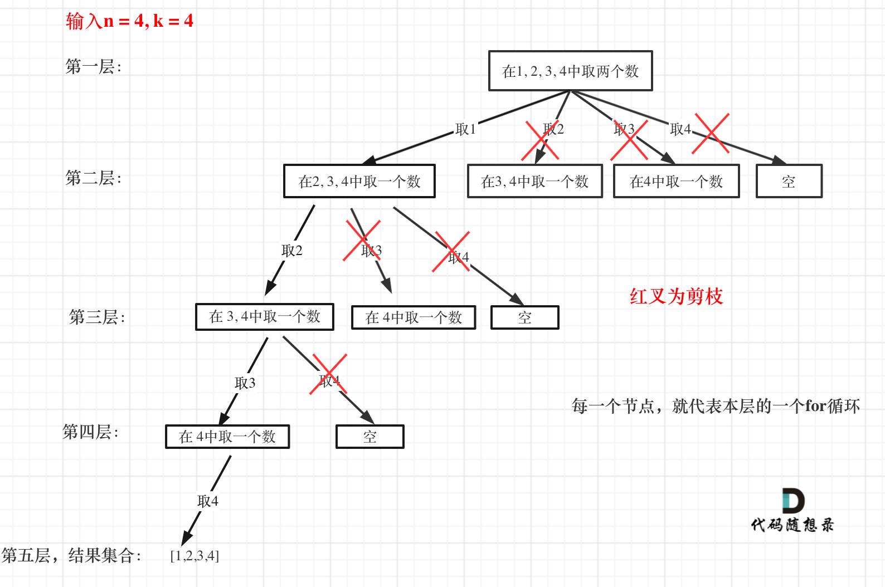
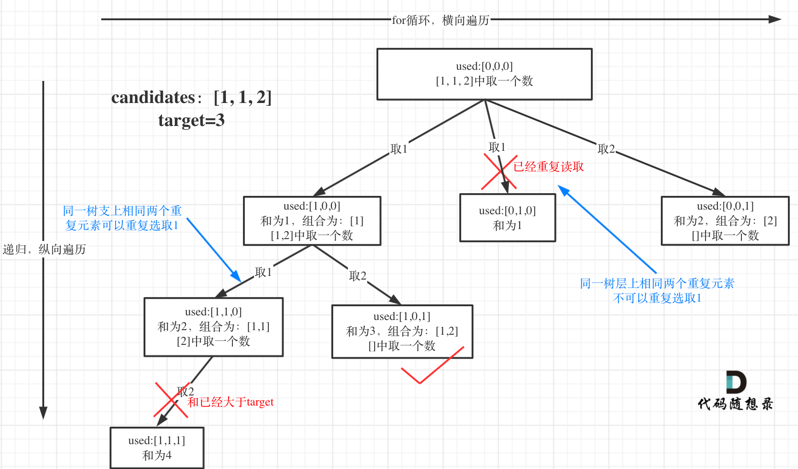

# 回溯 {#回溯}

## 思想 {#思想}

回溯其实就是穷举的一种方式，但是这种穷举可以把之前举过的信息保存(传递)给后面使用。

## 适用范围 {#适用范围}

- 组合问题：N个数里面按一定规则找出k个数的集合
- 切割问题：一个字符串按一定规则有几种切割方式
- 子集问题：一个N个数的集合里有多少符合条件的子集
- 排列问题：N个数按一定规则全排列，有几种排列方式
- 棋盘问题：N皇后，解数独等等

## 理解 {#理解}

把他当成数形结构的遍历



```c++
void backtracking(参数) {
    if (终止条件) {
        存放结果;
        return;
    }

    for (选择：本层集合中元素（树中节点孩子的数量就是集合的大小）) {
        处理节点;
        backtracking(路径，选择列表); // 递归
        回溯，撤销处理结果
    }
}
```

基本上图片加这个模板就可以

#### [77. 组合](https://leetcode.cn/problems/combinations/) {#77-组合httpsleetcodecnproblemscombinations}

> *给定两个整数 n 和 k，返回范围 \[1, n\] 中所有可能的 k 个数的组合。*

> *你可以按 任何顺序 返回答案。*

我的方法是：将6取3 降低规模到 (6+5取2) + (5取3)

但是这样的话，会有很多重复。

```go
func combine(n int, k int) [][]int {
    if k==1{
        ans:=[][]int{}
        for i:=1;i<=n;i++{
            ans=append(ans,[]int{i})
        }
        return ans
    }
    if n==k{
        ans:=[][]int{}
        subAns:=[]int{}
        for i:=1;i<=n;i++{
            subAns=append(subAns,i)
        }
        ans=append(ans,subAns)
        return ans
    }
    ans:=combine(n-1,k)
    subAns:=combine(n-1,k-1)
    for i,_:=range(subAns){
        subAns[i]=append(subAns[i],n)
    }
    ans=append(ans,subAns...)
    return ans
    
}
```

好的做法：



```c++
class Solution {
private:
    vector<vector<int>> result; // 存放符合条件结果的集合
    vector<int> path; // 用来存放符合条件结果
    void backtracking(int n, int k, int startIndex) {
        if (path.size() == k) {
            result.push_back(path);
            return;
        }
        for (int i = startIndex; i <= n; i++) {
            path.push_back(i); // 处理节点 
            backtracking(n, k, i + 1); // 递归
            path.pop_back(); // 回溯，撤销处理的节点
        }
    }
public:
    vector<vector<int>> combine(int n, int k) {
        result.clear(); // 可以不写
        path.clear();   // 可以不写
        backtracking(n, k, 1);
        return result;
    }
};
```



### 组合 {#组合}

#### [组合总和](https://leetcode.cn/problems/combination-sum/) {#组合总和httpsleetcodecnproblemscombination-sum}

#### [组合总和II](https://leetcode.cn/problems/combination-sum-ii/) {#组合总和iihttpsleetcodecnproblemscombination-sum-ii}

#### [216.组合总和III](https://leetcode.cn/problems/combination-sum-iii/) {#216组合总和iiihttpsleetcodecnproblemscombination-sum-iii}

#### [17.电话号码的字母组合](https://leetcode.cn/problems/letter-combinations-of-a-phone-number/) {#17电话号码的字母组合httpsleetcodecnproblemsletter-combinations-of-a-phone-number}

### 分割 {#分割}

#### [分割回文字符串](https://leetcode.cn/problems/palindrome-partitioning/) {#分割回文字符串httpsleetcodecnproblemspalindrome-partitioning}

#### [93.复原IP地址](https://leetcode.cn/problems/restore-ip-addresses/) {#93复原ip地址httpsleetcodecnproblemsrestore-ip-addresses}

这几题用上面的方法都是比较简单的。

### 子集 {#子集}

> 代码随想录总结得比较好: 求子集问题和77.组合 和131.分割回文串 又不一样了。

> 如果把 子集问题、组合问题、分割问题都抽象为一棵树的话，那么组合问题和分割问题都是收集树的叶子节点，而子集问题是找树的所有节点！

> 其实子集也是一种组合问题，因为它的集合是无序的，子集{1,2} 和 子集{2,1}是一样的。

> 那么既然是无序，取过的元素不会重复取，写回溯算法的时候，for就要从startIndex开始，而不是从0开始！

> 有同学问了，什么时候for可以从0开始呢？

> 求排列问题的时候，就要从0开始，因为集合是有序的，{1, 2} 和{2, 1}是两个集合，排列问题我们后续的文章就会讲到的。

具体的区别在于，组合和分割是在终止的时候把这次的添加到集合，而集合问题是每次开始前都添加到集合也就是所有的节点不止叶子节点。

之前我的写法是添加递归一遍，不添加递归一遍，所以会很多重复。(很别扭)

> *比较重要的一道题*

#### [90.子集II](https://leetcode.cn/problems/subsets-ii/) {#90子集iihttpsleetcodecnproblemssubsets-ii}

重要的点在于“数层剪枝”

首先讲讲[40.组合总和II](https://leetcode.cn/problems/combination-sum-ii/)

> 给定一个数组 candidates 和一个目标数 target ，找出 candidates 中所有可以使数字和为 target 的组合。

> candidates 中的每个数字在每个组合中只能使用一次。

> 说明： 所有数字（包括目标数）都是正整数。解集不能包含重复的组合。

这里面也是树层剪枝 

我的方法是对排序后在层间的for循环时先找到相同的最后一个,然后再跳过。其实是一样的只是之前没有总结成方法论。

```go
for i:=index;i<len(candidates);i++{
        
        subAns=append(subAns,candidates[i])
        sum+=candidates[i]
        combination(candidates,target,i+1)
        subAns=subAns[:len(subAns)-1]
        sum-=candidates[i]
        for i!=len(candidates)-1 && candidates[i]==candidates[i+1]{
            i++
        }
    }
```

现在总结一下，树层剪枝其实是因为，同样深度的同一个值的情况其实已经被第一次遇到的那个节点的子树包括了。所以只需要第一个子树的情况就可以。

回到[90. 子集 II](https://leetcode.cn/problems/subsets-ii/)

```go
var res  [][]int
var subRes []int
func subsetsWithDup(nums []int) [][]int {
    res=[][]int{}
    subRes=[]int{}
    sort.Sort(sort.IntSlice(nums))
    sub(nums,0)
    return res
}

func sub(nums []int, index int){
    if index==len(nums){
        slice:=make([]int,len(subRes))
        copy(slice,subRes)
        res=append(res,slice)
        return
    }
    i:=index
    for ;i<len(nums)-1&&nums[i]==nums[i+1];i++{

    } 
    length:=i-index+1
    // fmt.Println(length)
    // fmt.Println("===",subRes)
    for length>=0{
        for k:=0;k<length;k++{
            subRes=append(subRes,nums[index])
        }
        // fmt.Println(subRes)
        sub(nums,i+1)
        subRes=subRes[:len(subRes)-length]
        length--
    }
}
```

我使用length记录，同样的数字的长度然后递减再递归只能说重复太多，没有理解到子集。

```c++
class Solution {
private:
    vector<vector<int>> result;
    vector<int> path;
    void backtracking(vector<int>& nums, int startIndex, vector<bool>& used) {
        result.push_back(path);
        for (int i = startIndex; i < nums.size(); i++) {
            // used[i - 1] == true，说明同一树枝candidates[i - 1]使用过
            // used[i - 1] == false，说明同一树层candidates[i - 1]使用过
            // 而我们要对同一树层使用过的元素进行跳过
            if (i > 0 && nums[i] == nums[i - 1] && used[i - 1] == false) {
                continue;
            }
            path.push_back(nums[i]);
            used[i] = true;
            backtracking(nums, i + 1, used);
            used[i] = false;
            path.pop_back();
        }
    }

public:
    vector<vector<int>> subsetsWithDup(vector<int>& nums) {
        result.clear();
        path.clear();
        vector<bool> used(nums.size(), false);
        sort(nums.begin(), nums.end()); // 去重需要排序
        backtracking(nums, 0, used);
        return result;
    }
};
```

这是好的做法

#### [491. 递增子序列](https://leetcode.cn/problems/non-decreasing-subsequences/) {#491-递增子序列httpsleetcodecnproblemsnon-decreasing-subsequences}

这题算是比较难

> 给你一个整数数组 nums ，找出并返回所有该数组中不同的递增子序列，递增子序列中 至少有两个元素 。你可以按 任意顺序 返回答案。

> 数组中可能含有重复元素，如出现两个整数相等，也可以视作递增序列的一种特殊情况。

我一开始用层间剪枝的方法，必须要用一个hash map或者数组来保存同一层中见过的其他数字。 这是因为他这里是不能排序的，很难知道是否见过了相同的。

力扣官方题解有个比较好的去重思路。其实总的来说这类重复问题其实都是说，有n个重复的数字，在你的集合中你要用n，n-1,n-2….1个来进行递归。

之前代码随想录是把这种选择单放到一个树的深度来考虑。

这里官方题解是把他n个放到第一个棵子树，n-1放到第二颗。。。

这样就必须让子树中相同数值都选中，

> 那如何保证没有重复呢？我们需要给「不选择」做一个限定条件，只有当当前的元素不等于上一个选择的元素的时候，才考虑不选择当前元素，直接递归后面的元素。因为如果有两个相同的元素，我们会考虑这样四种情况：

> - 前者被选择，后者被选择
> - 前者被选择，后者不被选择
> - 前者不被选择，后者被选择
> - 前者不被选择，后者不被选择 其中第二种情况和第三种情况其实是等价的，我们这样限制之后，舍弃了第二种，保留了第三种，于是达到了去重的目的。

```c++
var (
    temp []int
    ans [][]int
)

func findSubsequences(nums []int) [][]int {
    ans = [][]int{}
    dfs(0, math.MinInt32, nums)
    return ans
}

func dfs(cur, last int, nums []int) {
    if cur == len(nums) {
        if len(temp) >= 2 {
            t := make([]int, len(temp))
            copy(t, temp)
            ans = append(ans, t)
        }
        return
    }
    if nums[cur] >= last {
        temp = append(temp, nums[cur])
        dfs(cur + 1, nums[cur], nums)
        temp = temp[:len(temp)-1]
    }
    if nums[cur] != last {
        dfs(cur + 1, last, nums)
    }
}
```

注意他这里选的方法是和我之前那个一样，一个函数里面push的递归一次，不push的递归一次。模拟选和不选

#### [全排列](https://leetcode.cn/problems/permutations/) {#全排列httpsleetcodecnproblemspermutations}

排列和组合比较像，同样是取叶子节点。不同点在于：全排列的i是从0开始选没有被选过的。 这样的话需要一个数组记录是否被选过。 而不需要额外空间的方法是，每次选了之后做一个划分，划分后变成两部分，一部分是已经被选过，一部分是还没有被选。

```go
var res [][]int
var subRes []int
func permute(nums []int) [][]int {
    res=[][]int{}
    subRes=[]int{}
    subFunc(nums,0)
    return res
}

func subFunc(nums []int,startIndex int){
    if len(subRes)==len(nums){
        slice:=make([]int,len(subRes))
        copy(slice,subRes)
        res=append(res,slice)
        return
    }

    for i:=startIndex;i<len(nums);i++{
        subRes=append(subRes,nums[i])
        nums[startIndex],nums[i]=nums[i],nums[startIndex]
        subFunc(nums,startIndex+1)
        nums[startIndex],nums[i]=nums[i],nums[startIndex]
        subRes=subRes[:len(subRes)-1]
    }
}
```

#### [47. 全排列](https://leetcode.cn/problems/permutations-ii/) {#47-全排列httpsleetcodecnproblemspermutations-ii}

```go
var res [][]int
var subRes []int
func permuteUnique(nums []int) [][]int {
    state :=make([]int,len(nums))
    res=[][]int{}
    subRes=[]int{}
    sort.Sort(sort.IntSlice(nums))
    permute(nums,state)
    return res
    

}

func permute(nums []int,state []int){
    if len(subRes)==len(nums){
        slice:=make([]int,len(nums))
        copy(slice,subRes)
        res=append(res,slice)
        return
    }


    for i:=0;i<len(nums);i++{
       
        if state[i]!=0{
            continue
        }
        state[i]=1
        subRes=append(subRes,nums[i])
        permute(nums,state)
        subRes=subRes[:len(subRes)-1]
        state[i]=0
        for i<len(nums)-1&&nums[i]==nums[i+1]{
            i++
        }
    }
}
```

注意，一开始我把

```go
for i<len(nums)-1&&nums[i]==nums[i+1]{
    i++
}
```

写在前面是不行的 写在前面的写法是和前面的比较而不是和后面的比较 写在前面的写法

```c++
if (i > 0 && nums[i] == nums[i - 1]) {
    continue;
}
```

#### [332. 重新安排行程](https://leetcode.cn/problems/reconstruct-itinerary/) {#332-重新安排行程httpsleetcodecnproblemsreconstruct-itinerary}

这题是能写出来，但是有点曲折。

先贴代码:

```go
var  res []string
var subRes []string
func findItinerary(tickets [][]string) []string {
    list,table:=makeList(tickets)
    subRes=[]string{"JFK"}
    res=[]string{}
    target:="JFK"
    find(list,table,target,len(tickets)+1)
    return res

}

func find(list map[string][]string ,table map[string][]bool , target string,length int){
    if len(subRes)==length{
        slice:=make([]string,length)
        copy(slice,subRes)
        res=slice
        return
    }
    for i,s:=range(list[target]){
        if table[target][i]==false{
            subRes=append(subRes,list[target][i])
            table[target][i]=true
            find(list,table,s,length)
            subRes=subRes[:len(subRes)-1]
            table[target][i]=false
            if len(res)!=0{
                return
            }
        }
    }
}


func makeList(tickets [][]string) (map[string][]string,map[string][]bool){
    list:=make(map[string][]string)
    for _,v:=range(tickets){
        if _,ok:=list[v[0]];ok{
            list[v[0]]=append(list[v[0]],v[1])
            continue
        }
        list[v[0]]=[]string{v[1]}
    }
    table :=make(map[string][]bool)

    for k,_:=range(list){
        sort.Sort(sort.StringSlice(list[k]))
        table[k]=make([]bool,len(list[k]))
    }
    return list,table
}
```

比较好的做法:

```c++
class Solution {
private:
// unordered_map<出发机场, map<到达机场, 航班次数>> targets
unordered_map<string, map<string, int>> targets;
bool backtracking(int ticketNum, vector<string>& result) {
    if (result.size() == ticketNum + 1) {
        return true;
    }
    for (pair<const string, int>& target : targets[result[result.size() - 1]]) {
        if (target.second > 0 ) { // 记录到达机场是否飞过了
            result.push_back(target.first);
            target.second--;
            if (backtracking(ticketNum, result)) return true;
            result.pop_back();
            target.second++;
        }
    }
    return false;
}
public:
    vector<string> findItinerary(vector<vector<string>>& tickets) {
        targets.clear();
        vector<string> result;
        for (const vector<string>& vec : tickets) {
            targets[vec[0]][vec[1]]++; // 记录映射关系
        }
        result.push_back("JFK"); // 起始机场
        backtracking(tickets.size(), result);
        return result;
    }
};
```

学到的几点:

- 当只需要遍历找到某一个叶子节点时，可以设置递归函数的返回值，一旦条件满足就返回标志，这样就可以向上不断返回。
