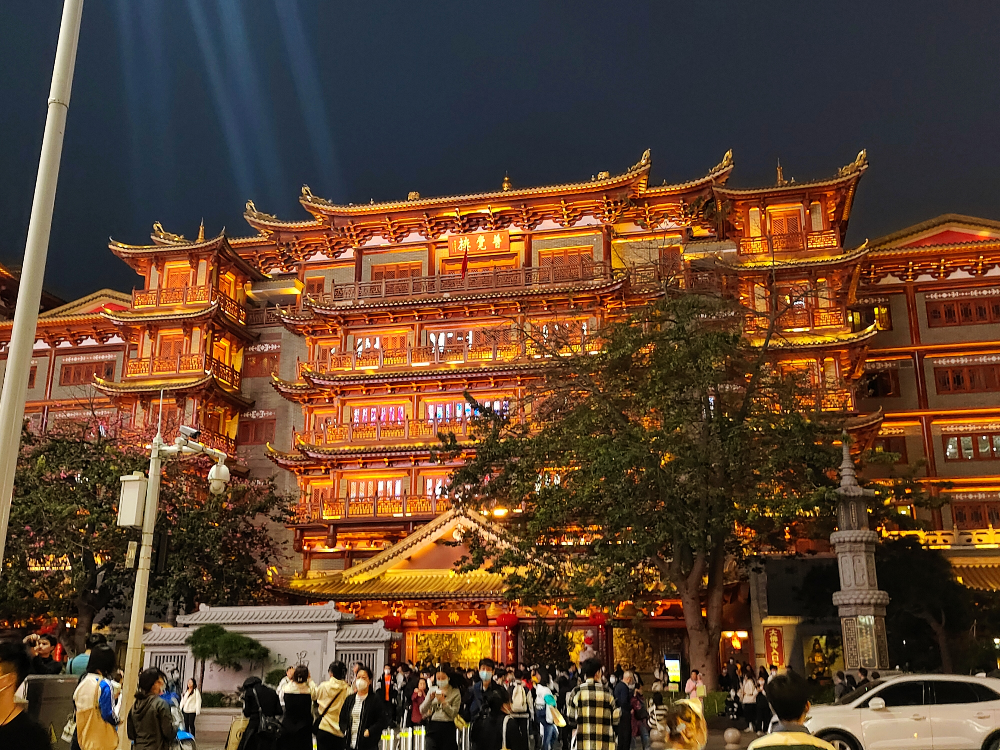
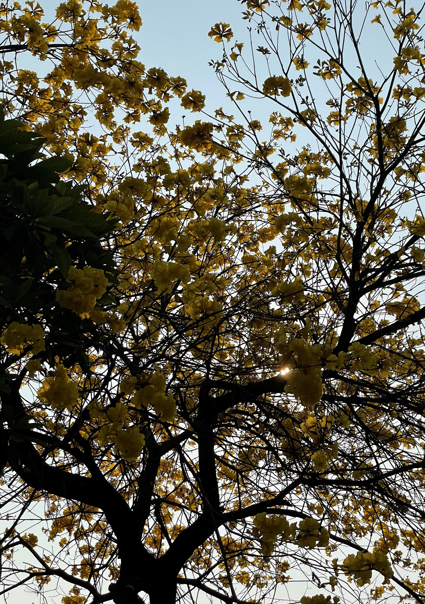
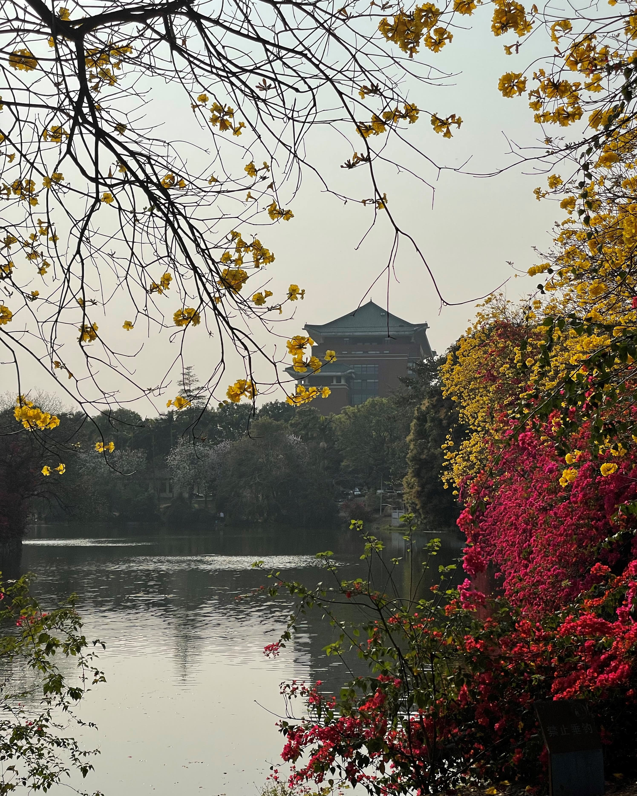
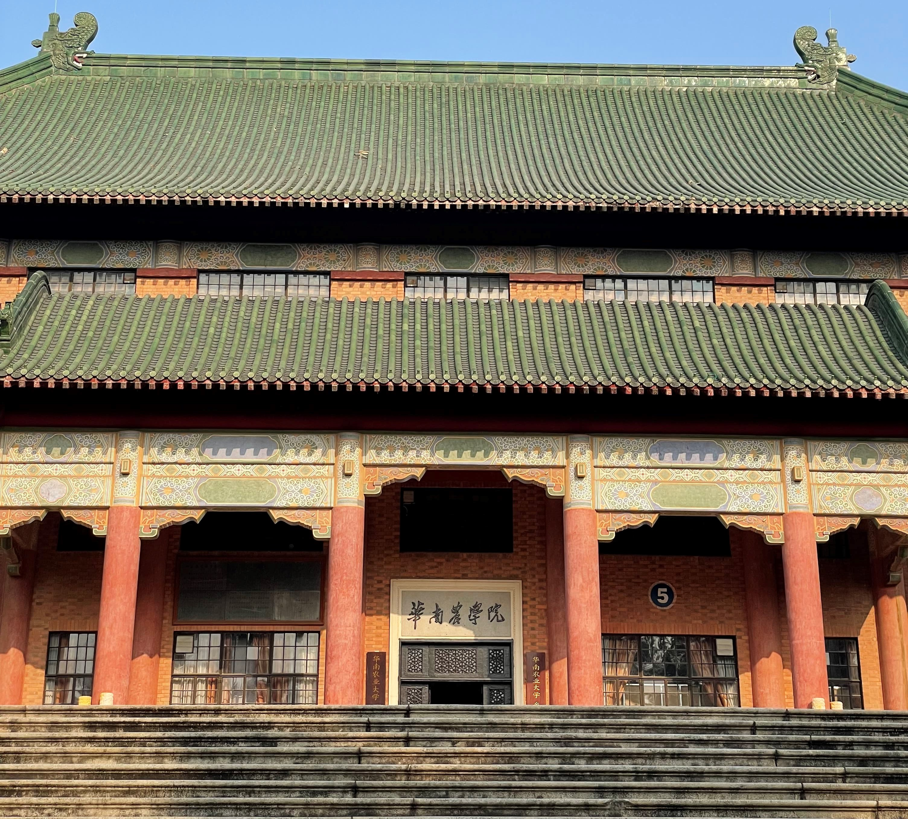
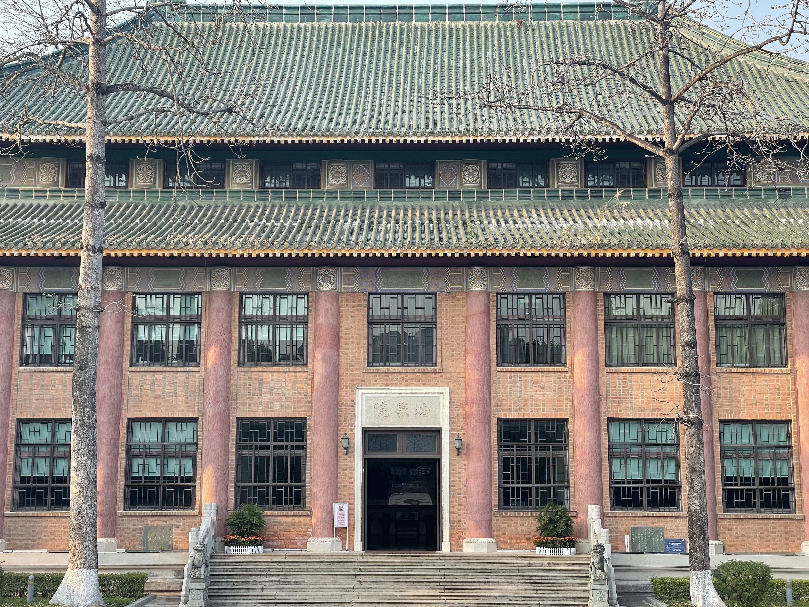

## 概览 {#概览}

第一周主要是复习和考试，要考的科目有Java，计概，还有雅思英语。这几门课都不难，浅浅复习都足以解决考试。 有意思的是：Java考试的时候题目有个错误的地方，把comparaTo的函数签名写错了，我记得应该是泛型接口的实现方法，但是没有和老师说()，后面竟然也没人提hhh。

后续的话白天的主要时间都基本在刷题，刷的题基本也有记录下来。对我来说，刷题倒不是非常难的事，见过了差不多类型的题目之后类似的题目基本都能AC。

MiT6.824: 在上学期完成lab1后便中断了，寒假断断续续地捡起来。最近算是第二遍看Raft论文，结合[visualization](http://thesecretlivesofdata.com/raft/)第二遍看对实现的很多细节都理解得比较好了。

但是对于lab2，其中的模拟网络和labgob包我还希望先看明白再去写。

## 运动⛹️ {#运动}

基本会每天保持一定量的运动，无论是basketball还是和郭老师打Pingpong或者是去跑跑步。

## 其他 {#其他}

开学两周出去的次数还是很多(钱包都空了)。

- 首先是周五，郭老师和祥睿考完PM，大家的考试基本都告一段落，机缘巧合下，黎根廷和顾伟正都一起去了北京路。 

- 然后是机械的朋友们也考完试，王导也刚刚生日完。我想着以前出来聚都只是吃个饭，要么唱个K或者打打台球，这次不如去趟华农，也算一次春游了。

- 接着周日又去了小姨家，陪他们逛了下广州的高中,让琪琪看看高中，确立一下目标。

> 图片正在来的路上

八十六中:听说是办学20来年，直到最近黄冈来的欧阳校长上任之后成绩才比较有起色。22年的话大约有30个985，60个600+这样。算不上特别顶尖的学校，但是就“加工”能力而言在生源较差的基础上能取得这样的成绩作为学校来说不能算失败。

有点感悟就是，在大城市读书所谓的好的教育资源到底指的是什么？

好的高中(/初中)？ 从我的视角看，大城市有好高中，但不一定是你有好高中。对于顶尖的资源来说，大城市的竞争也大，而同时在小县城，就拿我来说，成绩好你依然可以获得好的资源，至少上升的渠道并没有完全阻断。而对于上了高中之后的高考，大城市的补习班确实琳琅满目，就补习的效果而言我认为只要是你人是想学的，并且钱到位了，效果是肯定有的。但是在小地方，很多家庭并不一定能支撑补习班的费用，学习的过程可能会走一些弯路，但是毕竟是自己走过来的，对于学习方法什么的会逐渐形成自己的一套体系。无法论孰优孰劣，毕竟在考试这件事上，个体差异占主导因素。(回过头来看，这一段似乎有点既得利益者的看法。如果看中下段的学生的话，两个地方的资源是天差地别的)

或者我们把格局打开，不局限于高考。

好的教育资源在于什么？

> *TODO…*

###  {#heading}

## 输入 {#输入}

### 书 {#书}

《被讨厌的勇气》: 娓娓道来阿德勒心理学，教你如何活得不那么累。30%

### 影视剧 {#影视剧}

只有芸知道: 冯小刚的青春电影，值得一提的是改编自真实事件。

其实这部电影似乎是高中的时候看《看天下》的时候有瞥过一眼。前段时间刷题刷累了看B站的时候，无意中看到有这部电影的解说，看解说的时候被解说的叙述节奏和大部分时候恰到好处的BGM感到到了，立马去下了原片。结果，原片通过回忆和倒叙的方式展开反而显得情感的发展不那么自然。感觉就是男女主的颜值以及异国他乡的美丽风景在硬撑。
