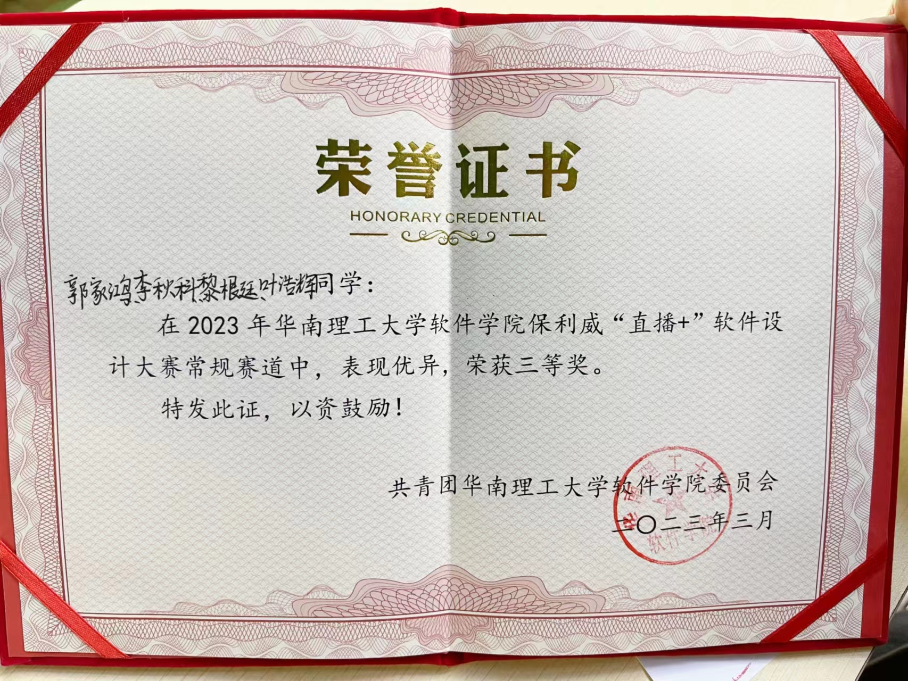
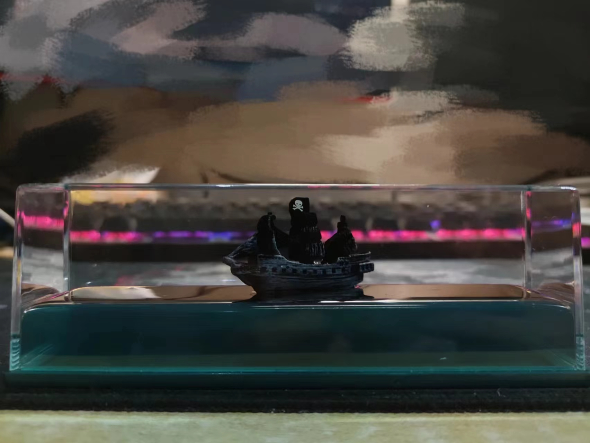

## 平淡的两周 {#平淡的两周}

这段时间心里总是很急躁，可能是外界(身边的负能量)也可能是自己的原因。希望借周记和自己对话的机会让自己平静下来。

## Polyv {#polyv}

前几个月报名的保利威直播+比赛在第四周的周六答辩，经过秋科和郭老师的临阵磨枪算是能交出一份答辩。但是郭老师答辩的问答部分表现得微微怯场了一点，加上后面几个答辩都很不错，我认为我们只能拿个优胜奖了。没想到最后竟然能拿个三等奖。

其实我是觉得比较愧疚的，当时想搞科研所以这边没有怎么帮上忙。

## mit6.824 {#mit6824}

这算是这两周的重点，比较多时间都花在了lab2和lab3上。lab2目前是bug-free，lab3还在努力。同时lab2和raft的博文也提上日程了。

## 记一次相遇 {#记一次相遇}

去小姨家那天的晚上，走到c9的时候遇到了聂昀和小贤。小贤倒是见过几次，聂昀的话见得比较少。围着c10，c9逛了一圈又一圈，也许是蕴含着对过去生活的怀念，聊到初中的同学时心里总是兴奋不已。

男生的话题无非是最近有没谈女朋友，以前的女同学怎么样，分享知道的逆天事迹。话题本身没多大意思，我也不是很在乎。相遇的魔力在我们身边流转，初三的同学在几乎没有联系的高中以及两年大学后再次获得来之不易的闲聊机会。

## birthday {#birthday}

差点忘记了生日的事情，算是一个平淡的生日吧。

郭老师送的礼物，算是近年来比较喜欢的礼物了。 

还有秋科的蛋糕，祥睿的饼干。

## 输入 {#输入}

无。。。 希望能看看书。
