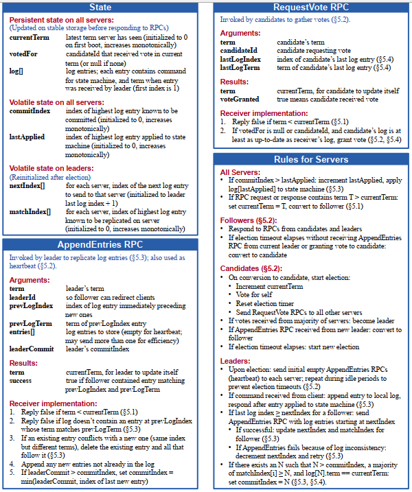

## 本文记录一下搭建MiT6.824 Raft的实现过程 {#本文记录一下搭建mit6824-raft的实现过程}

注意本文基于6.824 2020年版。

写下此文主要是为了记录一下自己的实现过程，以及一些遇到的问题(不然到时候面试的时候都忘了)。

写下此文的时间点在完成lab3，但不能完成千次测试，记录的同时尝试优化一下之前的实现。

### Raft是什么 {#raft是什么}

> Raft is a consensus algorithm that is designed to be easy to understand. It’s equivalent to Paxos in fault-tolerance and performance. The difference is that it’s decomposed into relatively independent subproblems, and it cleanly addresses all major pieces needed for practical systems. We hope Raft will make consensus available to a wider audience, and that this wider audience will be able to develop a variety of higher quality consensus-based systems than are available today.

### lab 2A {#lab-2a}

2A主要实现的是选举和心跳机制。 具体来说需要实现Raft结构体内的 Make Start Getstate方法

下面介绍一下我的实现：

#### Raft结构体 {#raft结构体}

基本是按照paper中figure2来实现，其中 lastIncludedIndex和lastIncludedTerm是snapshot中的实现，读者目前可以忽略。 

```go

type Raft struct {

	// Your data here (2A, 2B, 2C).
	// Look at the paper's Figure 2 for a description of what
	// state a Raft server must maintain.
	mu          sync.Mutex          // Lock to protect shared access to this peer's state
	peers       []*labrpc.ClientEnd // RPC end points of all peers
	persister   *Persister          // Object to hold this peer's persisted state
	me          int                 // this peer's index into peers[]
	dead        int32               // set by Kill()
	log         []Entry
	currentTerm int
	votedFor    int

	commitIndex int
	lastApplied int

	state          int
	elecTimer      *RandomTimer
	heartBeatTimer *time.Timer
	//for test
	applyCh chan ApplyMsg
	//for Leader
	//Reinitialized after election

	newIndex          int //track the newest index used to append log rather than len(log)
	lastIncludedIndex int
	lastIncludedTerm  int

	nextIndex  []int //(initialized to leader last log index + 1)
	matchIndex []int //initalized to 0

}
```

## Reference {#reference}

[Raft Paper](http://nil.csail.mit.edu/6.824/2020/papers/raft-extended.pdf)

[Raft 动画 非常有用](https://raft.github.io/)

[11大佬的博客 画了很多图易于理解](https://blog.eleven.wiki/posts/mit6.824-lab2-raft/)

[mit6.824 2020](https://pdos.csail.mit.edu/6.824/index.html)

[这门课的助教编写的debug工具，非常非常重要](https://blog.josejg.com/debugging-pretty/)
