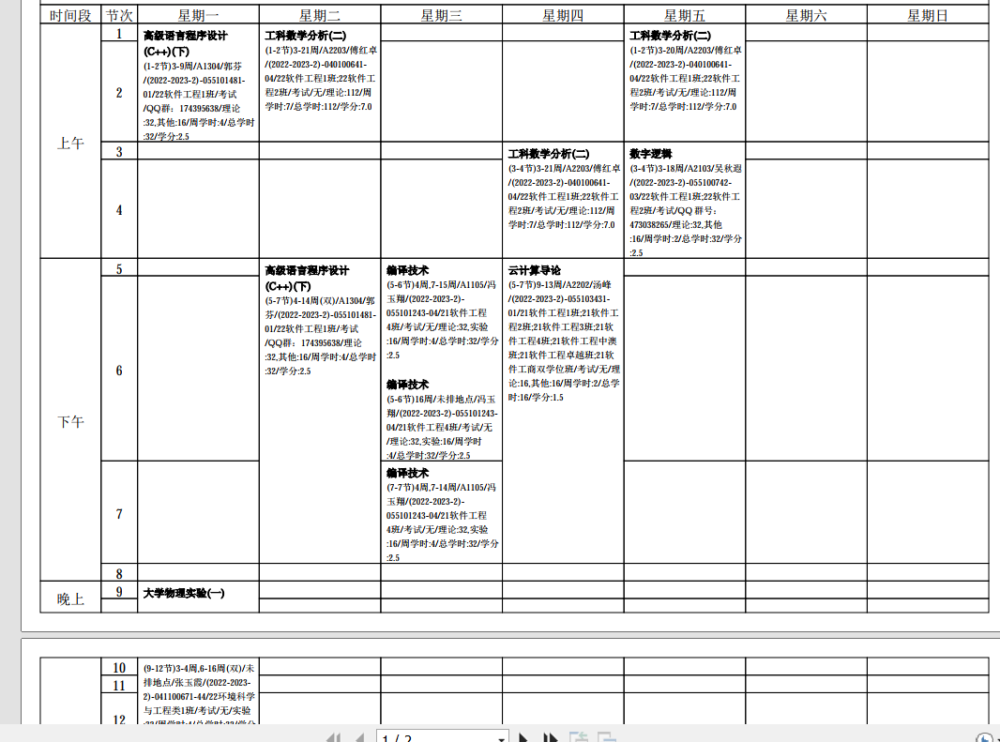



# 不知不觉就到了13周！！！ {#不知不觉就到了13周}

## 概览 {#概览}

总得来说，这两个月过得不咸不淡。力扣力扣没刷多少八股八股也没做多少，公开课lab也没做完。算是各有涉猎但是还是没有完成。

离开科研后生活似乎也没有我想得轻松，完成课业再做点自己的事情已经有点让我喘不过气。

### 学业 {#学业}

这学期课其实不算多:  而且课程基本上是大一的课，难度不算大，基本上上课认真听讲基本都没问题。近一个月的时间主要是花在了C++实训上。

C++实训是做一个俄罗斯方块，用Qt完成，本来还以为要学很多东西。但是郭老师找到了一个南大的大作业里面用到的技术基本足够解决这次的问题了，我把他的看懂抄抄改改就完成基本要求了。

### 生活 {#生活}

最近总是感觉生活很紧绷，对未来很焦虑。以前觉得成绩好能保研就好了，现在发现保研也就那么回事。以前觉得找一份体面的工作很简单，虽然说是受限于形式，但是不可否认的是越来越难了。而且就算能找到大厂工作又怎么样呢？996的工作不过从研究生这个粪坑跳入另一个粪坑罢了。

### relation {#relation}

无(XXXXXXXXXXX) 开启一段新的relation实在是太难了。

### 运动与健康 {#运动与健康}

值得一提的是开始健身了，但是最近出现一个问题就是每次健完之后晚上就睡不着。而且最近睡觉都会有胀气，比较难入睡。

### 阅读与思考 {#阅读与思考}

最近没有新读什么书，重读《挪威的森林》还是不禁感慨渡边20岁就已经经历过这么多事情了，而我21岁却还像在温室里读书学习，做什么都畏手畏脚。是啊，相比18岁我到底学到了什么。

重读《潮骚》，那是多美的一个世界啊。三岛由纪夫的桃花源真是令人向往。只要读一页就能闻到咸咸的海风，质朴的男孩，天真的爱情。一下子就置身上世纪90年代的古朴海边村落，那是多好一个世界啊。 下次抄录几句话上来。

希望21岁的这剩下的日子里能越来越好。
