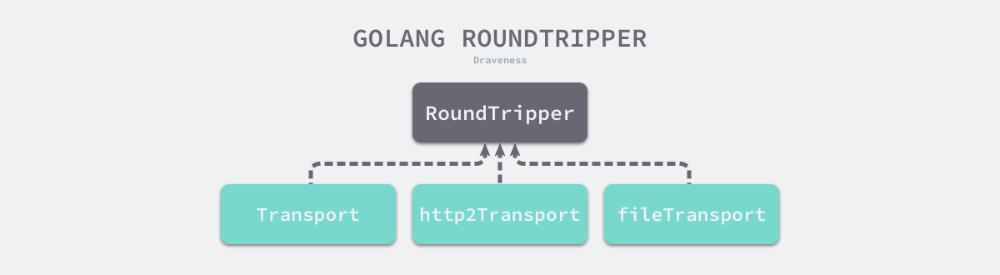

# learn http {#learn-http}

## 前置知识: {#前置知识}

HTTP 1.1 / 2 基于TCP ， HTTP/3 可以基于TCP UDP 和QUIC.

## HTTP {#http}

### HTTP 报文的常见格式: {#http-报文的常见格式}

```http
GET / HTTP/1.1
User-Agent: Mozilla/4.0 (compatible; MSIE5.01; Windows NT)
Host: draveness.me
Accept-Language: en-us
Accept-Encoding: gzip, deflate
Content-Type: text/html; charset=UTF-8
Content-Length: 138
Connection: Keep-Alive

<html>
    ...
</html>
```

### TCP 粘包 {#tcp-粘包}

TCP 协议是面向连接的、可靠的、基于字节流的传输层通信协议，上层协议一般都需要自己划分消息边界

1.  基于长度 如上图，解析完头部之后就可以划分数据边界了。

2.  基于Delimiter

    > 当 HTTP 使用块传输（Chunked Transfer）机制时，HTTP 头中就不再包含 Content-Length 了，它会使用负载大小为 0 的 HTTP 消息作为终结符表示消息的边界。

## net/http {#nethttp}

net/http 实现了 HTTP 客户端和服务端，分别对应 http.RoundTripper 和 http.Handler 两个接口。

- http.RoundTripper：用来表示执行 HTTP 请求的接口，调用方将请求作为参数可以获取请求对应的响应
- http.Handler 主要用于 HTTP 服务器响应客户端的请求

`http.RoundTripper` 是用来表示执行 HTTP 请求的接口，而 HTTP 请求的接收方可以实现 `http.Handler` 接口，其中实现了处理 HTTP 请求的逻辑，处理的过程中会调用 `http.ResponseWriter` 接口的方法构造 HTTP 响应，它提供的三个接口 Header、Write 和 WriteHeader 分别会获取 HTTP 响应、将数据写入负载以及写入响应头，如下

```go
type RoundTripper interface {
    RoundTrip(*Request) (*Response, error)
}

type Handler interface {
    ServeHTTP(ResponseWriter, *Request)
}

type ResponseWriter interface {
	Header() Header
	Write([]byte) (int, error)
	WriteHeader(statusCode int)
}
```

客户端和服务端面对的都是双向的 HTTP 请求与响应，客户端构建请求并等待响应，服务端处理请求并返回响应。HTTP 请求和响应在标准库中不止有一种实现，它们都包含了层级结构，标准库中的 `net/http.RoundTripper` 包含如下所示的层级结构：

标准库也为net/http.handler提供了多种实现

### 客户端 {#客户端}

HTTP 的客户端中包含几个比较重要的结构体，

- http.Client：HTTP 客户端，它的默认值是使用 net/http.DefaultTransport 的 HTTP 客户端
- http.Transport：是 http.RoundTripper 接口的实现，主要作用就是支持 HTTP/HTTPS 请求和 HTTP 代理
- http.persistConn：封装了一个 TCP 的持久连接，是与远程交换消息的句柄（Handle）

客户端 http.Client 是级别较高的抽象，提供了 HTTP 的一些细节，包括 Cookies 和重定向；而 http.Transport 会处理 HTTP/HTTPS 协议的底层实现细节，其中会包含连接重用、构建请求以及发送请求等功能。

RoundTripper的接口实现都是一个对远程发起请求的过程 

#### http.Client {#httpclient}

[Go 语言设计与实现](https://draveness.me/golang/)

[Golang 标准库：net/http 分析（一）](https://pandaychen.github.io/2020/10/01/GOLANG-NETHTTP-ANALYSIS/)

[QUIC](https://www.cnblogs.com/harrypotterjackson/p/15977660.html)
