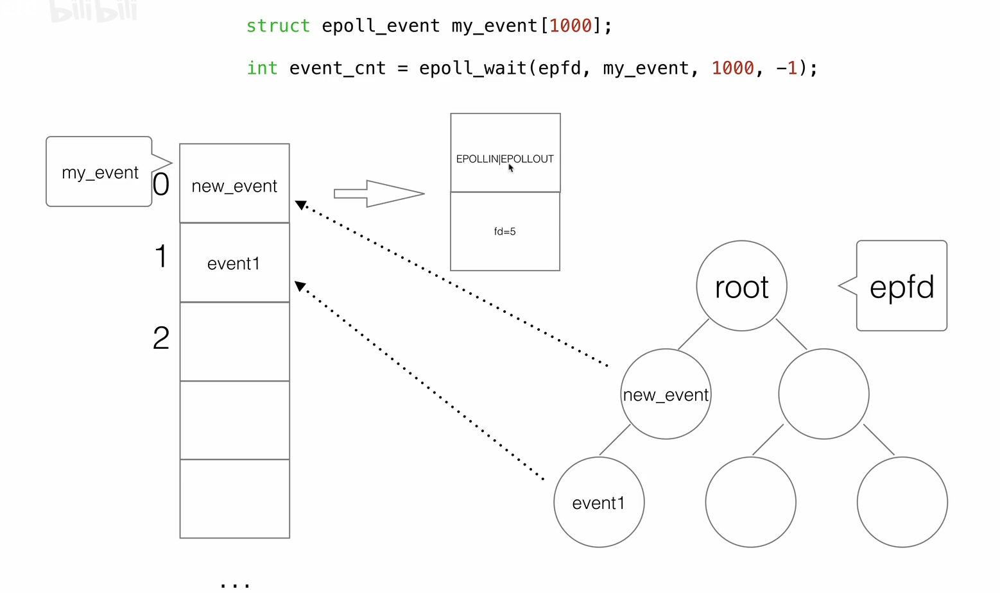
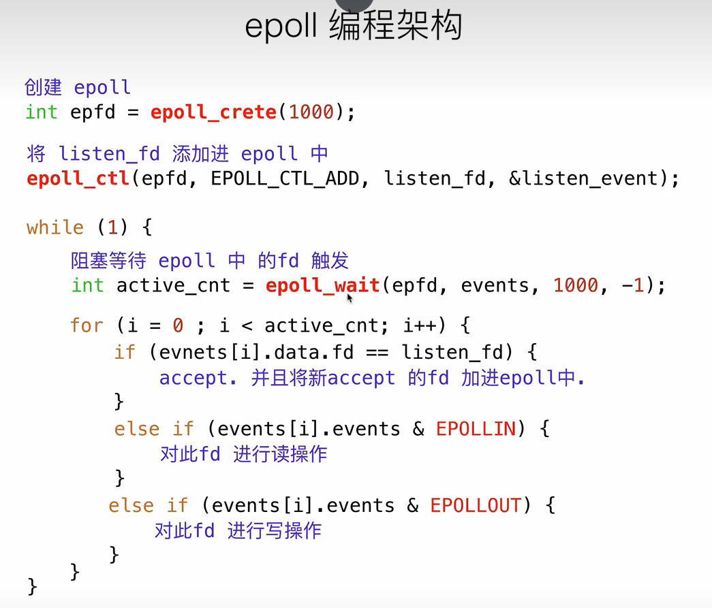
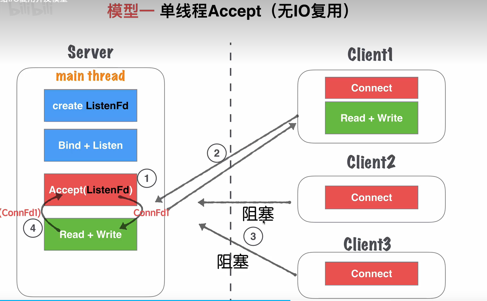
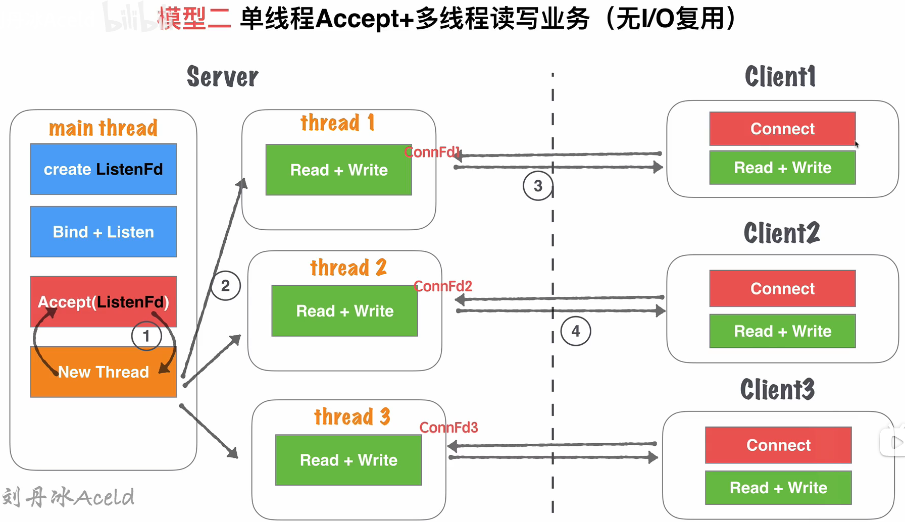
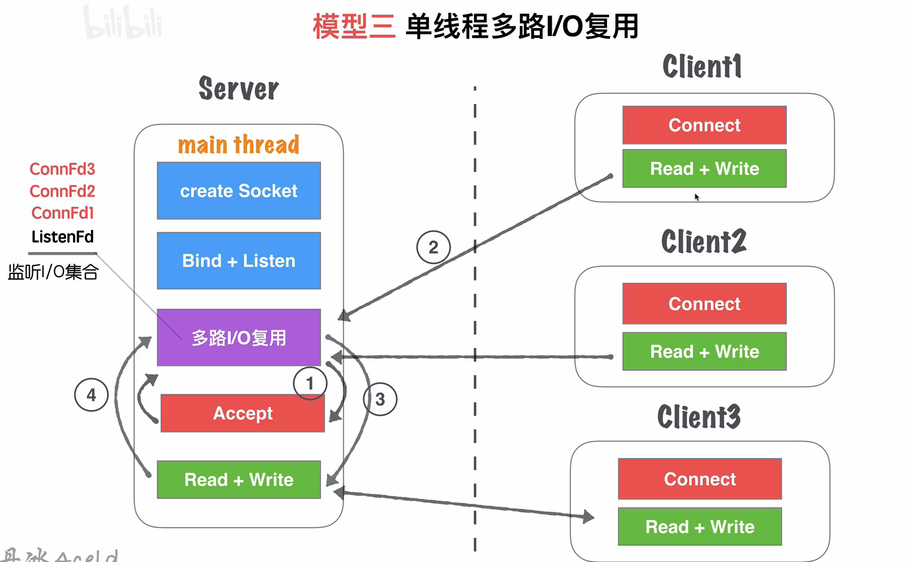
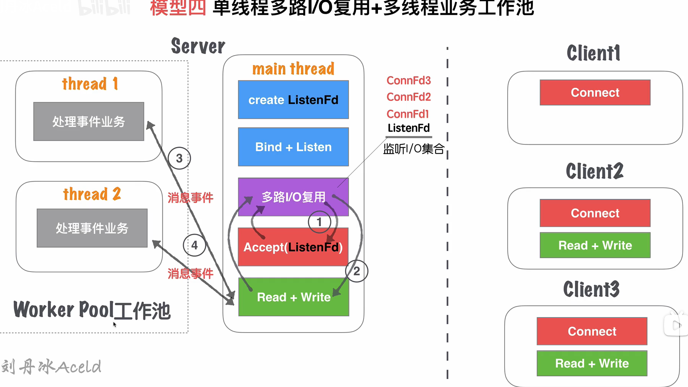
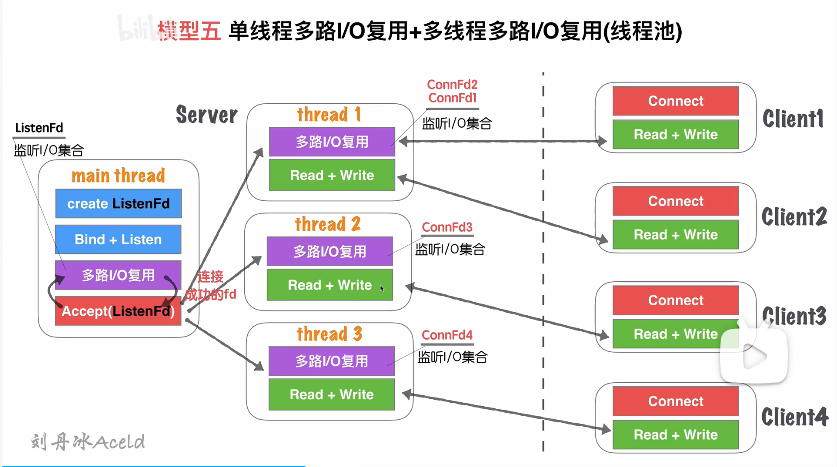
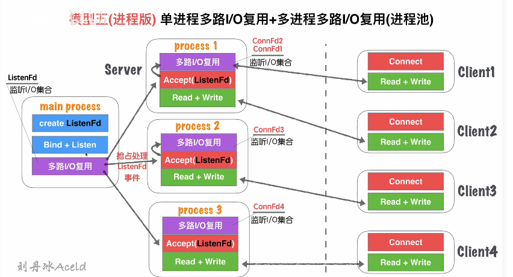

# Linux面试题 {#linux面试题}

## io多路复用 {#io多路复用}

1.  [epoll poll select](https://zhuanlan.zhihu.com/p/272891398)

2.  [这个讲的很详细非常好](https://mp.weixin.qq.com/s?__biz=MzUyNzgyNzAwNg==&mid=2247483925&idx=1&sn=1ac3e863594745c7466b0e88a688b203&scene=21#wechat_redirect)

### 为什么要使用io多路复用 {#为什么要使用io多路复用}

- 既能阻塞等待不占用cpu，又能在同一时刻监听多个IO请求。

### 几个概念 {#几个概念}

- 流：流是一个抽象的概念，是对数据传输的总称，可以是文件，socket，管道等。流的入口是，文件描述符:fd.
- 阻塞分为：
  1.  阻塞等待:不占用cpu，直到数据到来。(缺点：对多个I/O请求的处理不好)
  2.  非阻塞轮询:poll 占用cpu。

### 粗浅的理解 {#粗浅的理解}

1.  select
    - 只知道有数据到来但不知道哪些所以要通过轮询的方式，遍历所有的fd。
    - 缺点：fd的数量有限，每次都要遍历**所有的fd**，效率低。
2.  epoll
    - 通过回调的方式，当有数据到来时，触发回调函数（关注活跃的数据）。
    - 优点：fd的数量不受限制，只有有数据到来，就触发回调函数,知道是哪些fd。
    - 缺点：只能在linux上使用。

### epoll api {#epoll-api}

```c
/*
 * @param size:监听fd的数量
 * @return:返回一个epoll的句柄(也是一个fd)
 * 在内核中创建一个红黑树，用来存放fd，返回的是根节点的fd，size是节点最大的数量。
 */
int epoll_create(int size)


/**
 * @param epfd:epoll的句柄
 * @param op:操作类型 
 *          EPOLL_CTL_ADD:添加fd到红黑树中(添加新的fd到epfd)
 *          EPOLL_CTL_MOD:(修改已经注册的fd的监听事件)
 *          EPOLL_CTL_DEL:(epfd删除一个fd)
 * @param fd:要监听的fd
 * @param event:要监听的事件
 * @return:成功返回0，失败返回-1
 */
int epoll_ctl(int epfd, int op, int fd, struct epoll_event *event)


struct epoll_event{
    __uint32_t events;//epoll事件 EPOLLIN EPOLLOUT
    epoll_data_t data;//用户数据
}

type union epoll_data{
    void *ptr;
    int fd;
    __uint32_t u32;
    __uint64_t u64;
}epoll_data_t;


/**
 * @param epfd:epoll的句柄
 * @param events:用来存放活跃的fd
 * @param maxevents:events的最大数量(不能超过epoll_create的size)
 * 
 * @param timeout:超时时间
 *                -1: 永久阻塞
 *                 0: 立即返回，非阻塞
 *                >0: 等待指定的时间
 *
 * @return: 成功:有多少文件描述符就绪，时间到了没有文件描述符就是0
 *          失败:-1 error
 */
 int epoll_wait(int epfd, struct epoll_event *events, int maxevents, int timeout)
```

 

listen_fd event是建立连接fd(有些叫server readable事件) fd读也叫client writable 就是client写命令 fd 写也叫client read 就是把对应命令的结果写回

### epoll 触发模式 {#epoll-触发模式}

1.  level Triggered 只有fd被处理后续才不会发
2.  edge Triggered 每次有事件只会发一次

### I/O复用模型 {#io复用模型}

1.  单线程Accept(无I/O复用) 

2.  单线程Accept，多线程读写业务 

优点:

- 对业务的内聚性高 缺点:
- 线程数和客户端的数量成正比，线程太多cpu利用率下降(线程切换).
- 长连接服务，只要不关闭server需要保持对连接状态的检测(心跳，健康检查)，占用连接资源。

3.  单线程 多路I/O复用  优点:

- 单流程提解决了可以同时监听多个客户端读写状态的模型，不需要1：1线程。
- 多路I/O复用，阻塞，非忙询状态不浪费cpu资源，对cpu利用率高。 缺点:
- 虽然可以监听多个客户端的读写状态，但是同一时间内只能处理一个客户端的读写操作。
- 当多个客户端访问server，业务是串行执行。比如client3 占据main thread线程时，client1和client2流程会卡在IO复用等待下一次监听触发事件。

4.  单线程多路IO复用+多线程业务工作池 

优点：

- 将业务处理的部分通过工作池分离出来，减少客户端访问server导致业务串行执行 缺点：
- 最后返回客户端的写也要排队。

5.  单线程多路I/O复用+多线程多路I/O复用（线程池） 

减少了阻塞的概率

优点：

- 增加了并发通道，减少了阻塞概率
- 能监听的Conn套接字的数量成倍增加（N\*单Epoll的数量）
- 降低CPU切换频率，通过和核的数量进行绑定

缺点：

- 最高的并行读写还是1

6.  model5 plus（thread-\> process） 

### Reference {#reference}

[1](https://www.bilibili.com/video/BV1jK4y1N7ST/?spm_id_from=333.337.search-card.all.click&vd_source=7d9aad84add3e8bea9beb1d04c53f57e)

[2](https://www.bilibili.com/video/BV1xP4y1y7d6/?spm_id_from=333.337.search-card.all.click&vd_source=7d9aad84add3e8bea9beb1d04c53f57e)

[c union的用法](https://www.cnblogs.com/shirishiqi/p/5416935.html)

[reactor模型](https://zhuanlan.zhihu.com/p/577984353)

## 进程通信 {#进程通信}

### 共享内存 {#共享内存}

流程： 先shmget再shmat,不用了再shmdt。

```c
//返回内存标识符
int shmget(key_t key, size_t size,int shmflg);
```

```c
//将指针指向一块共享内存
// @param shmid 上面返回的标识符
// @param shmaddr 一般用null
void *shmat(int shmid, const void *shmaddr, int shmflg);
```

解除映射

```c
// @param shmaddr 上面返回的地址
int shmdt(const void *shmaddr);
```

共享内存的控制

```c
int shmctl(int shmid, int cmd, struct shmid_ds *buf);
```

shmid：共享内存标识符。

cmd：函数功能的控制，其取值如下：

IPC_RMID：删除。(常用 )

IPC_SET：设置 shmid_ds 参数，相当于把共享内存原来的属性值替换为 buf 里的属性值。

IPC_STAT：保存 shmid_ds 参数，把共享内存原来的属性值备份到 buf 里。

SHM_LOCK：锁定共享内存段( 超级用户 )。

SHM_UNLOCK：解锁共享内存段。

SHM_LOCK 用于锁定内存，禁止内存交换。并不代表共享内存被锁定后禁止其它进程访问。其真正的意义是：被锁定的内存不允许被交换到虚拟内存中。这样做的优势在于让共享内存一直处于内存中，从而提高程序性能。

buf：shmid_ds 数据类型的地址(具体类型请点此链接 )，用来存放或修改共享内存的属性。

------------------------------------------------------------------------

再介绍一个辅助函数：

```c
  key_t ftok(const char *pathname, int proj_id);
```

这个函数是通过文件系统中的唯一性来返回一个key值，可以通过这个函数在不同进程中来标识共享内存。

### 参考 {#参考}

[进程间的通信方式（一）：共享内存](https://zhuanlan.zhihu.com/p/37808566)

## 用户栈和系统栈 {#用户栈和系统栈}

事实上看了很多文章后，系统栈是用来保存因为要让出cpu时的保存现场用到的每个线程一个的内存空间。

### 简介 {#简介}

在虚拟地址中我们知道，32位的话，1G系统空间，3G用户空间。64位的话，128T系统空间，128T用户空间。

内核在创建进程的时候，在创建task_struct的同时，会为进程创建相应的堆栈。每个进程会有两个栈，一个用户栈， 存在于用户空间，一个内核栈，存在于内核空间。记住，进程对应的用户栈和内核栈都是进程私有的。当进程在用户空间 运行时，cpu堆栈指针寄存器里面的内容是用户堆栈地址，使用用户栈；当进程在内核空间时，cpu堆栈指针寄存器里面 的内容是内核栈空间地址，使用内核栈。

### 内核栈 {#内核栈}

在每一个进程的生命周期中，如果使用了系统调用，那么，进程就会从用户态陷入内核态。在执行系统调用陷入内核之后，这些内核代码所使用的栈并不是原先用户空间中的栈（用户栈），而是一个内核空间的栈，这个称作进程的“内核栈”。即进程的用户栈和内核栈的发送了切换。 进程陷入内核态后，先把用户态堆栈的地址保存在内核栈之中，然后设置堆栈指针寄存器的内容为内核栈的地址，这样就完成了用户栈向内核栈的转换；当进程从内核态恢复到用户态之行时，在内核态执行的最后将保存在内核栈里面的用户栈的地址恢复到堆栈指针寄存器即可。这样就实现了内核栈和用户栈的互相转换。

那么，我们知道从内核转到用户态时用户栈的地址是在陷入内核的时候保存在内核栈里面的，但是在陷入内核的时候，我们是如何知道内核栈的地址的呢？

关键在进程从用户态转到内核态的时候，进程的内核栈总是空的。这是因为，当进程在用户态运行时，使用的是用户栈，当进程陷入到内核态时，内核栈保存进程在内核态运行的相关信息，但是一旦进程返回到用户态后，内核栈中保存的信息无效，会全部恢复，因此每次进程从用户态陷入内核的时候得到的内核栈都是空的。所以在进程陷入内核的时候，直接把内核栈（此时是全局的）的栈顶地址给堆栈指针寄存器就可以了。

### 内核栈的实现 {#内核栈的实现}

内核栈在kernel-2.4和kernel-2.6里面的实现方式是不一样的。

在kernel-2.4内核里面，内核栈的实现是：

```c
Union task_union {
    Struct task_struct task; // 进程描述符
    Unsigned long stack[INIT_STACK_SIZE/sizeof(long)];
};
```

其中，INIT_STACK_SIZE的大小只能是8K。

内核为每个进程分配task_struct结构体的时候，实际上分配两个连续的物理页面，底部用作task_struct结构体，结构上面的用作堆栈。使用current()宏能够访问当前正在运行的进程描述符。

注意：这个时候task_struct结构是在内核栈里面的，内核栈的实际能用大小大概有7K。

内核栈在kernel-2.6里面的实现是（kernel-2.6.32）：

```c
Union thread_union {
    Struct thread_info thread_info；
    Unsigned long stack[THREAD_SIZE/sizeof(long)];
};
```

其中THREAD_SIZE的大小可以是4K，也可以是8K，thread_info占52bytes。

当内核栈为8K时，Thread_info在这块内存的起始地址，内核栈从堆栈末端向下增长。所以此时，kernel-2.6中的current宏是需要更改的。要通过thread_info结构体中的task_struct类型指针thread_info 来获得相关联的task_struct。

```c
struct thread_info {
    struct task_struct *task；
    struct exec_domain *exec_domain；
    __u32 flags；
    __u32 status;
    __u32 cpu;
  
    ......
};
```

注意：此时（2.6以后的内核）的task_struct结构体已经不在内核栈空间里面了。

内核栈主要是用于进程陷入内核时使用的栈，主要用于进程切换时保存用户态进程信息（寄存器值，一部分硬件上下文等），以及进程在内核执行时分配空间使用。

### 为什么每个进程有各自的内核栈 {#为什么每个进程有各自的内核栈}

假设某个进程通过系统调用运行在内核态（使用这个全局内核堆栈），此时如果被抢占，发生一次切换，另一个进程开始运行，如果这个当前进程又通过系统调用陷入内核，那么这个进程也将使用这个全局内核堆栈，这样的话就把以前那个进程的内核空间堆栈给破坏了。 而如果进程使用独立的内核栈，就避免了这种情况的发生。

### 参考 {#参考-1}

[用户空间栈 & 系统空间栈](https://www.cnblogs.com/Seiyagoo/archive/2012/05/26/2518849.html)

## 信号 {#信号}

### 参考 {#参考-2}

1.  [Linux 高级编程 - 信号 Signal](https://dlonng.com/posts/signal)
