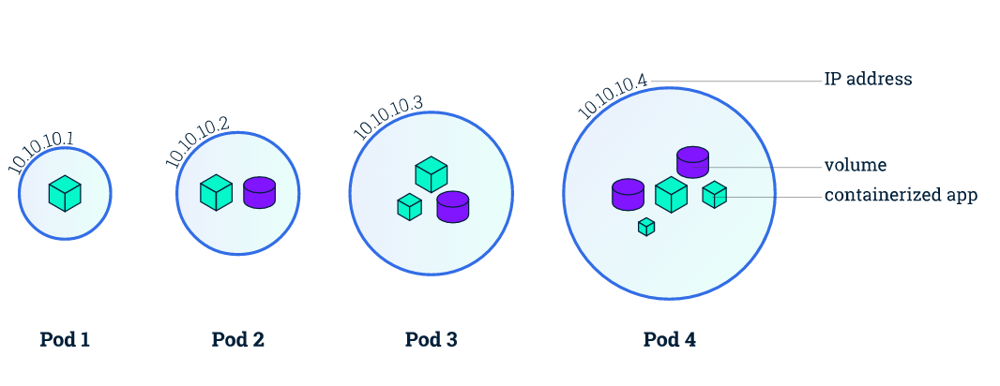
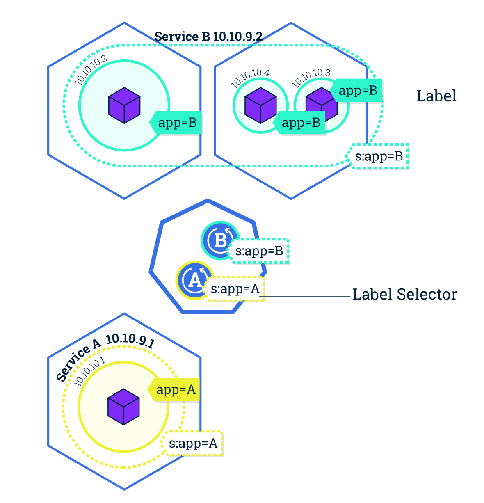
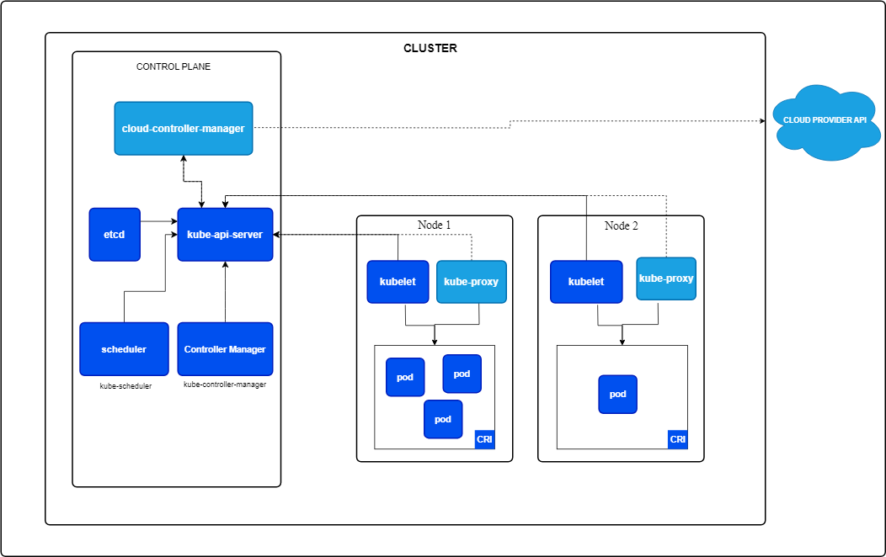
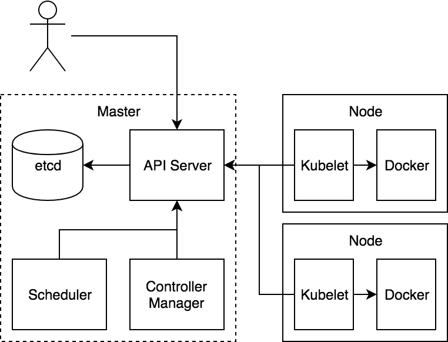

## 学习k8s {#学习k8s}

### 概念 {#概念}

#### Master {#master}

Master 负责管理集群, master 协调集群中的所有活动，例如调度应用程序、维护应用程序的所需状态、扩展应用程序和滚动更新。 节点是 Kubernetes 集群中的工作机器，可以是物理机或虚拟机。每个工作节点都有一个 kubelet，它是管理节点并与 Kubernetes Master 节点进行通信的代理。节点上还应具有处理容器操作的容器运行时，例如 Docker 或 rkt。一个 Kubernetes 工作集群至少有三个节点。 Master 管理集群，而 节点 用于托管正在运行的应用程序。

#### Pod {#pod}

Pod 是一组紧密关联的容器集合，它们共享 PID、IPC、Network 和 UTS namespace，是Kubernetes 调度的基本单位。Pod 的设计理念是支持多个容器在一个 Pod 中**共享网络和文件系统**，可以通过进程间通信和文件共享这种简单高效的方式组合完成服务。 

pod的用法主要有两种：

- 运行单个容器的 Pod。“每个 Pod 一个容器” 模型是最常见的 Kubernetes 用例； 在这种情况下，可以将 Pod 看作单个容器的包装器，并且 Kubernetes 直接管理 Pod，而不是容器。

- 运行多个协同工作的容器的 Pod。 Pod 可能封装由多个紧密耦合且需要共享资源的共处容器组成的应用程序。 这些位于同一位置的容器可能形成单个内聚的服务单元 —— 一个容器将文件从共享卷提供给公众， 而另一个单独的 “边车”（sidecar）容器则刷新或更新这些文件。 Pod 将这些容器和存储资源打包为一个可管理的实体。

pod的生成是使用pod模板（template）来生成的

##### 资源共享和通信 {#资源共享和通信}

存储

一个 Pod 可以设置一组共享的存储卷。 Pod 中的所有容器都可以访问该共享卷，从而允许这些容器共享数据。 卷还允许 Pod 中的持久数据保留下来，即使其中的容器需要重新启动。

联网

每个 Pod 都在每个地址族中获得一个唯一的 IP 地址。 Pod 中的每个容器共享网络名字空间，包括 IP 地址和网络端口。 Pod 内的容器可以使用 localhost 互相通信。 当 Pod 中的容器与 Pod 之外的实体通信时，它们必须协调如何使用共享的网络资源（例如端口）。

在同一个 Pod 内，所有容器共享一个 IP 地址和端口空间，并且可以通过 localhost 发现对方。 他们也能通过如 SystemV 信号量或 POSIX 共享内存这类标准的进程间通信方式互相通信。 不同 Pod 中的容器的 IP 地址互不相同，如果没有特殊配置，就无法通过 OS 级 IPC 进行通信。 如果某容器希望与运行于其他 Pod 中的容器通信，可以通过 IP 联网的方式实现。

#### Label {#label}

Label 是识别 Kubernetes 对象的标签，以 key/value 的方式附加到对象上（key最长不能超过63字节，value 可以为空，也可以是不超过253字节的字符串）。 Label 不提供唯一性，并且实际上经常是很多对象（如Pods）都使用相同的 label 来标志具体的应用。 Label 定义好后其他对象可以使用 Label Selector 来选择一组相同 label 的对象（比如Service 用 label 来选择一组 Pod）。Label Selector支持以下几种方式：

- 等式，如app=nginx和env!=production
- 集合，如env in (production, qa)
- 多个label（它们之间是AND关系），如app=nginx,env=test

标签很重要：

1.  使用service管理pod，就是用标签来标识pod完成网络的无痕切换
2.  用来选择对应的子集

标签的作用

1.  是标签旨在用于指定对用户有意义且相关的对象的标识属性，但不直接对核心系统有语义含义。
2.  是标签可以用于组织和选择对象的子集。

标签的特点主要有如下三点：

1.  每个对象都可以定义一组键值标签。
2.  每个键对于给定对象必须是唯一的。
3.  标签能够支持高效的查询和监听操作，对于用户界面和命令行是很理想的。

##### 语法 {#语法}

1、前缀：

1.  前缀是可选的；
2.  如果指定，前缀必须是DNS子域：由点“.”分割的一系列DNS标签，总共不超过253个字符，后跟斜杠“/”；
3.  如果省略前缀，则假定标签键对用户是私有的。向最终用户对象添加标签的自动系统组件（例如：kube-scheduler、kube-controller-manager、kube-apiserver、kubctl或其他第三方自动化工具）必须指定前缀

2、名称：

1.  名称段是必需的
2.  必须小于等于63个字符，以字母数字字符“\[a-z0-9A-Z\]”开头和结尾，带有破折号“—”，下划线“\_”，点“.”和之前的字母数字

##### 标签选择运算符 {#标签选择运算符}

1.  基于等值的需求：基于等值或基于不等值的需求允许按标签键和值进行过滤。 可接受的运算符有“=”、“==”、“！=”。
2.  基于集合的需求：基于集合的标签需求允许你通过一组值来过滤键。 持有三种操作符：“in”、“notin”、“exists”。

#### Namespace {#namespace}

Namespace 是对一组资源和对象的抽象集合，比如可以用来将系统内部的对象划分为不同的项目组或用户组。常见的 pods, services,deployments 等都是属于某一个 namespace 的（默认是default），而 Node, PersistentVolumes 等则不属于任何 namespace。

#### Deployment {#deployment}

是否手动创建 Pod，如果想要创建同一个容器的多份拷贝，需要一个个分别创建出来么，能否将Pods划到逻辑组里？

Deployment 确保任意时间都有指定数量的 Pod“副本”在运行。如果为某个 Pod 创建了Deployment 并且指定3个副本，它会创建3个 Pod，并且持续监控它们。如果某个 Pod 不响应，那么 Deployment 会替换它，保持总数为3.

如果之前不响应的 Pod 恢复了，现在就有4个 Pod 了，那么 Deployment 会将其中一个终止保持总数为3。如果在运行中将副本总数改为5，Deployment 会立刻启动2个新 Pod，保证总数为5。Deployment 还支持回滚和滚动升级。

当创建 Deployment 时，需要指定两个东西：

Pod模板：用来创建 Pod 副本的模板 Label标签：Deployment 需要监控的 Pod 的标签。 现在已经创建了 Pod 的一些副本，那么在这些副本上如何均衡负载呢？我们需要的是 Service。

#### Service {#service}

Service 是应用服务的抽象，通过 labels 为应用提供负载均衡和服务发现。匹配 labels 的Pod IP 和端口列表组成 endpoints，由 kube-proxy 负责将服务 IP 负载均衡到这些endpoints 上。

每个 Service 都会自动分配一个 cluster IP（仅在集群内部可访问的虚拟地址）和 DNS 名，其他容器可以通过该地址或 DNS 来访问服务，而不需要了解后端容器的运行。



#### 对象 {#对象}

按照官方文档的说法：Kubernetes 对象是持久化的实体。他们包含1. Spec 2. Status

下面是一个描述deployment对象的yaml文件,而且可以发现对象的定义是递归的

```yaml
apiVersion: apps/v1
kind: Deployment
metadata:
  name: nginx-deployment
spec:
  selector:
    matchLabels:
      app: nginx
  replicas: 2 # 告知 Deployment 运行 2 个与该模板匹配的 Pod
  template:
    metadata:
      labels:
        app: nginx
    spec:
      containers:
      - name: nginx
        image: nginx:1.14.2
        ports:
        - containerPort: 80
```

必备字段

- apiVersion - 创建该对象所使用的 Kubernetes API 的版本
- kind - 想要创建的对象的类别
- metadata - 帮助唯一标识对象的一些数据，包括一个 name 字符串、UID 和可选的 namespace
- spec - 你所期望的该对象的状态

### 架构 {#架构}





#### Kube-apiserver {#kube-apiserver}

提供了资源对象的唯一操作入口，只有API-server会和etcd进行通信

#### kube-controller-manager {#kube-controller-manager}

##### Replication Controller {#replication-controller}

保证集群中一个RC所关联的Pod副本数始终和预设值一致

##### Node Controller {#node-controller}

定时获取node相关信息

##### ResourceQuota Controller {#resourcequota-controller}

保证资源对象不会超量占用物理资源

##### NameSpace Controller {#namespace-controller}

顾名思义

#### Kube-scheduler {#kube-scheduler}

1.  收集和分析当前k8s中所有节点的资源，然后依据资源占用分发新建的Pod到K8s集群中可用的节点。
2.  监测集群中未分发和已分发的pod
3.  监测Node信息
4.  在分发Pod到指定Node后，会把Pod相关的Binding信息写回API-server，方便别的使用

#### kubelet {#kubelet}

1.  负责Node节点上Pod的创建，修改，监控和删除
2.  定时上报Node状态
3.  通过API-server间接与ETCD交互获取集群配置信息
4.  在node上的主要工作：
    1.  起容器（绑定Port，创建network）
    2.  同步Pod
    3.  在容器中运行命令，杀死容器

#### Kube-proxy {#kube-proxy}

### 配置 {#配置}

通过读取KUBECONFIG环境变量来获取kubeconfig文件的路径，如果没有设置该环境变量，则默认使用\~/.kube/config文件。 在该文件中可以配置多个集群，每个集群可以有多个用户，每个用户可以有多个上下文，每个上下文可以指定一个集群和一个用户。 简单来说就是可以实现kubectl在多个集群之间切换。

### kubectl {#kubectl}

是一个命令行工具，用来与k8s集群进行交互，可以通过kubectl来部署应用，检查和更新集群资源，以及执行其他命令来帮助管理集群。

#### 常用命令 {#常用命令}

- kubectl get: 获取资源(获取信息) 一般可以get的资源有： node，pod，deployment等

- kubectl describe: 获取资源的详细信息

- kubectl create: 创建资源

- kubectl apply: 更新资源

### kube-proxy 和 service {#kube-proxy-和-service}

我本来只起了一个测试服务但是 kubectl get deployment 的时候发现还有一个kubernetes-proxy于是去查看了一下资料。

[kube-proxy 和 service](https://www.cnblogs.com/fuyuteng/p/11598768.html#:~:text=kube-proxy%E6%98%AFKubernetes%E7%9A%84%E6%A0%B8%E5%BF%83%E7%BB%84%E4%BB%B6%EF%BC%8C%E9%83%A8%E7%BD%B2%E5%9C%A8%E6%AF%8F%E4%B8%AANode%E8%8A%82%E7%82%B9%E4%B8%8A%EF%BC%8C%E5%AE%83%E6%98%AF%E5%AE%9E%E7%8E%B0Kubernetes,Service%E7%9A%84%E9%80%9A%E4%BF%A1%E4%B8%8E%E8%B4%9F%E8%BD%BD%E5%9D%87%E8%A1%A1%E6%9C%BA%E5%88%B6%E7%9A%84%E9%87%8D%E8%A6%81%E7%BB%84%E4%BB%B6%3B%20kube-proxy%E8%B4%9F%E8%B4%A3%E4%B8%BAPod%E5%88%9B%E5%BB%BA%E4%BB%A3%E7%90%86%E6%9C%8D%E5%8A%A1%EF%BC%8C%E4%BB%8Eapiserver%E8%8E%B7%E5%8F%96%E6%89%80%E6%9C%89server%E4%BF%A1%E6%81%AF%EF%BC%8C%E5%B9%B6%E6%A0%B9%E6%8D%AEserver%E4%BF%A1%E6%81%AF%E5%88%9B%E5%BB%BA%E4%BB%A3%E7%90%86%E6%9C%8D%E5%8A%A1%EF%BC%8C%E5%AE%9E%E7%8E%B0server%E5%88%B0Pod%E7%9A%84%E8%AF%B7%E6%B1%82%E8%B7%AF%E7%94%B1%E5%92%8C%E8%BD%AC%E5%8F%91%EF%BC%8C%E4%BB%8E%E8%80%8C%E5%AE%9E%E7%8E%B0K8s%E5%B1%82%E7%BA%A7%E7%9A%84%E8%99%9A%E6%8B%9F%E8%BD%AC%E5%8F%91%E7%BD%91%E7%BB%9C%E3%80%82)
