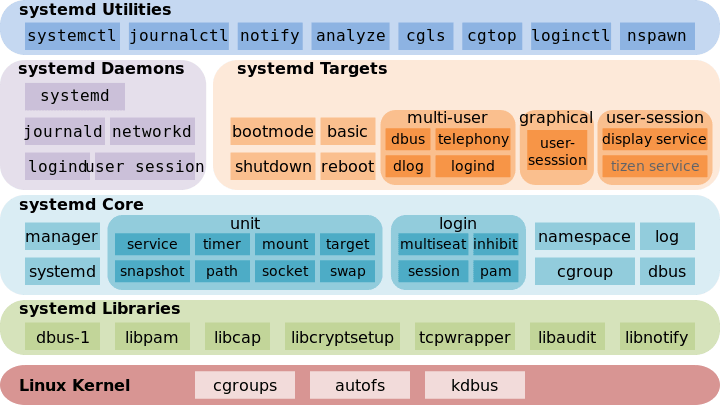

# Linux设置 {#linux设置}

## apt-get {#apt-get}

### 设置代理 {#设置代理}

1.  修改环境变量

```bash
export http_proxy=http://127.0.0.1:7890
sudo apt-get update
```

## Systemd 配置 {#systemd-配置}



### Unit {#unit}

- Service unit：系统服务
- Target unit：多个 Unit 构成的一个组
- Device Unit：硬件设备
- Mount Unit：文件系统的挂载点
- Automount Unit：自动挂载点
- Path Unit：文件或路径
- Scope Unit：不是由 Systemd 启动的外部进程
- Slice Unit：进程组
- Snapshot Unit：Systemd 快照，可以切回某个快照
- Socket Unit：进程间通信的 socket
- Swap Unit：swap 文件
- Timer Unit：定时器

### 配置文件的格式 {#配置文件的格式}

#### 区块 {#区块}

##### Unit区块 {#unit区块}

\[Unit\]区块通常是配置文件的第一个区块，用来定义 Unit 的元数据，以及配置与其他 Unit 的关系。

- Description：简短描述
- Documentation：文档地址
- Requires：当前 Unit 依赖的其他 Unit，如果它们没有运行，当前 Unit 会启动失败
- Wants：与当前 Unit 配合的其他 Unit，如果它们没有运行，当前 Unit 不会启动失败
- BindsTo：与Requires类似，它指定的 Unit 如果退出，会导致当前 Unit 停止运行
- Before：如果该字段指定的 Unit 也要启动，那么必须在当前 Unit 之后启动
- After：如果该字段指定的 Unit 也要启动，那么必须在当前 Unit 之前启动
- Conflicts：这里指定的 Unit 不能与当前 Unit 同时运行
- Condition…：当前 Unit 运行必须满足的条件，否则不会运行
- Assert…：当前 Unit 运行必须满足的条件，否则会报启动失败

##### install区块 {#install区块}

\[Install\]通常是配置文件的最后一个区块，用来定义如何启动，以及是否开机启动。

- WantedBy：它的值是一个或多个 Target，当前 Unit 激活时（enable）符号链接会放入/etc/systemd/system目录下面以 Target 名 + .wants后缀构成的子目录中
- RequiredBy：它的值是一个或多个 Target，当前 Unit 激活时，符号链接会放入/etc/systemd/system目录下面以 Target 名 + .required后缀构成的子目录中
- Alias：当前 Unit 可用于启动的别名
- Also：当前 Unit 激活（enable）时，会被同时激活的其他 Unit

##### Service区块 {#service区块}

\[Service\]区块用来 Service 的配置，只有 Service 类型的 Unit 才有这个区块。它的主要字段如下。

- Type：定义启动时的进程行为。它有以下几种值。
- Type=simple：默认值，执行ExecStart指定的命令，启动主进程
- Type=forking：以 fork 方式从父进程创建子进程，创建后父进程会立即退出
- Type=oneshot：一次性进程，Systemd 会等当前服务退出，再继续往下执行
- Type=dbus：当前服务通过D-Bus启动
- Type=notify：当前服务启动完毕，会通知Systemd，再继续往下执行
- Type=idle：若有其他任务执行完毕，当前服务才会运行
- ExecStart：启动当前服务的命令
- ExecStartPre：启动当前服务之前执行的命令
- ExecStartPost：启动当前服务之后执行的命令
- ExecReload：重启当前服务时执行的命令
- ExecStop：停止当前服务时执行的命令
- ExecStopPost：停止当其服务之后执行的命令
- RestartSec：自动重启当前服务间隔的秒数
- Restart：定义何种情况 Systemd 会自动重启当前服务，可能的值包括always（总是重启）、on-success、on-failure、on-abnormal、on-abort、on-watchdog
- TimeoutSec：定义 Systemd 停止当前服务之前等待的秒数
- Environment：指定环境变量
- EnviromentFile: 指定当前服务的环境参数文件。

### Target {#target}

传统的init启动模式里面，有 RunLevel 的概念，跟 Target 的作用很类似。不同的是，RunLevel 是互斥的，不可能多个 RunLevel 同时启动，但是多个 Target 可以同时启动。

### journald {#journald}

Systemd 统一管理所有 Unit 的启动日志。带来的好处就是，可以只用journalctl一个命令，查看所有日志（内核日志和应用日志）。日志的配置文件是/etc/systemd/journald.conf。

## shell脚本 {#shell脚本}

[脚本练习100](https://cloud.tencent.com/developer/article/1691052)
