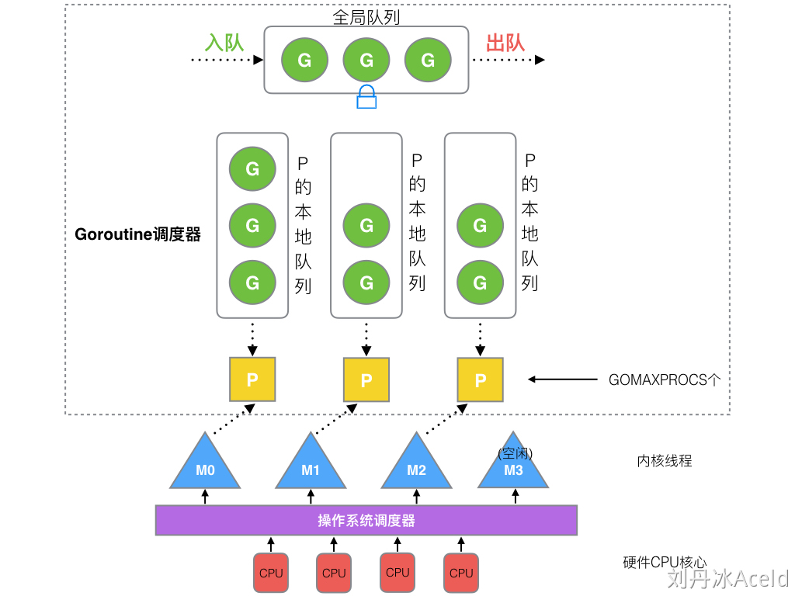

## golang 调度器的由来 {#golang-调度器的由来}

如果把并发交给os来完成，首先是CPU的调度消耗，其次进程占用4GB(虚拟内存)，线程占用4MB这些都是比较高的内存占用。

协程(其实也是用户态线程和内核态线程)

- N:1 N个协程1个进程，会有阻塞问题
- 1:1 实际上还是CPU负责切换，协程切换的时候需要保存上下文，这个过程也是比较耗时的
- M:N M个协程N个线程，协程切换的时候不需要保存上下文，只需要保存协程的栈信息，这个过程是比较快的

## GMP {#gmp}

1.  简介

G: goroutine 协程

M: thread 线程

P: processor 处理器

2.  设计策略

3.  go func()经历了什么

## Ref {#ref}

1.  [详解Go语言调度循环源码实现](https://www.luozhiyun.com/archives/448)
