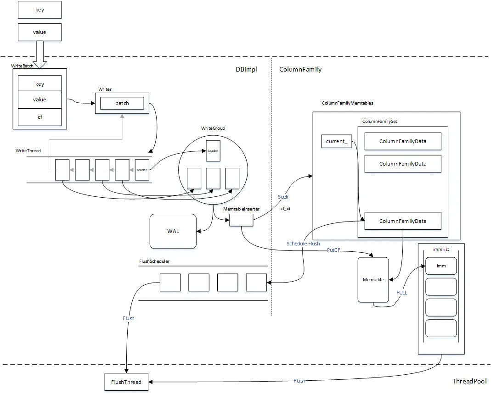
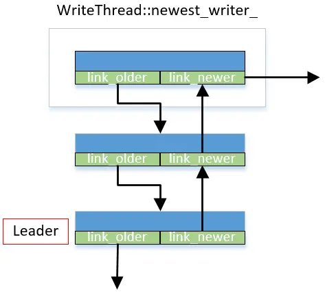

## rocksdb源码解读(一) {#rocksdb源码解读一}

本系列开始对rocksdb源码进行解读，主要是为了更好的理解rocksdb的设计思想，以及对rocksdb的使用有更深入的理解。 从用法开始一步步深入。

## rocksdb的基本使用 {#rocksdb的基本使用}

### option设置 {#option设置}

在打开一个rocksdb的时候需要提供设置选项,有[三种方法](https://github.com/facebook/rocksdb/wiki/Option-String-and-Option-Map)

1.  通过Options类

```c++
  rocksdb::DB *db;
  rocksdb::Options options;
  options.create_if_missing = true;
  rocksdb::Status status = rocksdb::DB::Open(options, "/tmp/testdb", &db);
  assert(status.ok());

//也可以使用leveldb相关接口的options并转变成rocksdb的options
  #include "rocksdb/utilities/leveldb_options.h"

  rocksdb::LevelDBOptions leveldb_options;
  leveldb_options.option1 = value1;
  leveldb_options.option2 = value2;
  ...
  rocksdb::Options options = rocksdb::ConvertOptions(leveldb_options);
```

[也可以通过options 文件](https://github.com/facebook/rocksdb/wiki/RocksDB-Options-File)

> In RocksDB 4.3, we add a set of features that makes managing RocksDB options easier.

> 1.  Each RocksDB database will now automatically persist its current set of options into a file on every successful call of DB::Open(), SetOptions(), and CreateColumnFamily() / DropColumnFamily().

> 2.  LoadLatestOptions() / LoadOptionsFromFile(): A function that constructs RocksDB options object from an options file.

> 3.  CheckOptionsCompatibility: A function that performs compatibility check on two sets of RocksDB options.

> With the above options file support, developers no longer need to maintain the full set of options of a previously-created RocksDB instance. In addition, when changing options is needed, CheckOptionsCompatibility() can further make sure the resulting set of Options can successfully open the same RocksDB database without corrupting the underlying data.

```c++
  // 一般来说的步骤就是 先load上次的
  LoadLatestOptions(cfg_opts, path_to_db, &loaded_db_opt, &loaded_cf_descs);
  //然后检查
  Status s = CheckOptionsCompatibility(cfg_opts, kDBPath, db_options, loaded_cf_descs);
  //接着打开
  s = DB::Open(loaded_db_opt, kDBPath, loaded_cf_descs, &handles, &db);
  // 要注意一些 新版本->旧版本和 一些用户定义的函数和指针类型的option需要特殊处理
```

[这是一个官方的示例ini配置文件](https://github.com/facebook/rocksdb/blob/main/examples/rocksdb_option_file_example.ini)

2.  Option String
3.  Option map

### Status {#status}

两种方法

1.  

```c++
 delete db; //会丢失错误信息
```

2.  

```c++
  ... do something with db ...
  Status s = db->Close();
  ... log status ...
  delete db;
```

## simple r/w example {#simple-rw-example}

```c++

    DB* db;
    Options options;
    // Optimize RocksDB. This is the easiest way to get RocksDB to perform well
    options.IncreaseParallelism();
    options.OptimizeLevelStyleCompaction();
    // create the DB if it's not already present
    options.create_if_missing = true;

    // open DB
    Status s = DB::Open(options, kDBPath, &db);
    assert(s.ok());

    // Put key-value
    s = db->Put(WriteOptions(), "key1", "value");
    assert(s.ok());
    std::string value;
    // get value
    s = db->Get(ReadOptions(), "key1", &value);
    assert(s.ok());
    assert(value == "value");

    // atomically apply a set of updates
    {
      WriteBatch batch;
      batch.Delete("key1");
      batch.Put("key2", value);
      s = db->Write(WriteOptions(), &batch);
    }

    s = db->Get(ReadOptions(), "key1", &value);
    assert(s.IsNotFound());

    db->Get(ReadOptions(), "key2", &value);
    assert(value == "value");

    {
      PinnableSlice pinnable_val;
      db->Get(ReadOptions(), db->DefaultColumnFamily(), "key2", &pinnable_val);
      assert(pinnable_val == "value");
    }

    {
      std::string string_val;
      // If it cannot pin the value, it copies the value to its internal buffer.
      // The intenral buffer could be set during construction.
      PinnableSlice pinnable_val(&string_val);
      db->Get(ReadOptions(), db->DefaultColumnFamily(), "key2", &pinnable_val);
      assert(pinnable_val == "value");
      // If the value is not pinned, the internal buffer must have the value.
      assert(pinnable_val.IsPinned() || string_val == "value");
    }

    PinnableSlice pinnable_val;
    s = db->Get(ReadOptions(), db->DefaultColumnFamily(), "key1", &pinnable_val);
    assert(s.IsNotFound());
    // Reset PinnableSlice after each use and before each reuse
    pinnable_val.Reset();
    db->Get(ReadOptions(), db->DefaultColumnFamily(), "key2", &pinnable_val);
    assert(pinnable_val == "value");
    pinnable_val.Reset();
    // The Slice pointed by pinnable_val is not valid after this point

    delete db;

    return 0;
```

#### WriteOption {#writeoption}

设置写入选项

- sync(是否刷盘)
- disableWAL
- ignore_missing_column_families(没有Column_family的时候忽略)
- no_slowdown(非阻塞写，否则立即返回错误)
- low_pri(等待优先级高的写入或者compaction完成)
- memtable_insert_hint_per_batch（记住该batch的最后写入位置提高效率）
- rate_limiter_priority（设置优先级）
- protection_bytes_per_key(\[0\|8\]设置保护字节，用于检测写入的错误)

readoption有点多遇到再看

#### PUT实现 {#put实现}

先贴一张dalao的图

入口:

```c++

  // Set the database entry for "key" to "value".
  // If "key" already exists, it will be overwritten.
  // Returns OK on success, and a non-OK status on error.
  // Note: consider setting options.sync = true.
  virtual Status Put(const WriteOptions& options,
                     ColumnFamilyHandle* column_family, const Slice& key,
                     const Slice& value) = 0;
  virtual Status Put(const WriteOptions& options,
                     ColumnFamilyHandle* column_family, const Slice& key,
                     const Slice& ts, const Slice& value) = 0;
  virtual Status Put(const WriteOptions& options, const Slice& key,
                     const Slice& value) {
    return Put(options, DefaultColumnFamily(), key, value);
  }
  virtual Status Put(const WriteOptions& options, const Slice& key,
                     const Slice& ts, const Slice& value) {
    return Put(options, DefaultColumnFamily(), key, ts, value);
  }

  //上面两个纯虚函数才是真正实现的地方，下面只是设置默认的column_family。而DBImpl也只是检查一下并调用父类的put函数
```

下面来看Put的实现

```c++
// Default implementations of convenience methods that subclasses of DB
// can call if they wish
Status DB::Put(const WriteOptions& opt, ColumnFamilyHandle* column_family,
               const Slice& key, const Slice& value) {
  // Pre-allocate size of write batch conservatively.
  // 8 bytes are taken by header, 4 bytes for count, 1 byte for type,
  // and we allocate 11 extra bytes for key length, as well as value length.
  WriteBatch batch(key.size() + value.size() + 24, 0 /* max_bytes */,
                   opt.protection_bytes_per_key, 0 /* default_cf_ts_sz */);
  Status s = batch.Put(column_family, key, value);
  if (!s.ok()) {
    return s;
  }
  return Write(opt, &batch);
}
// Write进入WriteImpl
Status DBImpl::Write(const WriteOptions& write_options, WriteBatch* my_batch) {
  Status s;
  if (write_options.protection_bytes_per_key > 0) {
    s = WriteBatchInternal::UpdateProtectionInfo(
        my_batch, write_options.protection_bytes_per_key);
  }
  if (s.ok()) {
    s = WriteImpl(write_options, my_batch, /*callback=*/nullptr,
                  /*log_used=*/nullptr);
  }
  return s;
}
```

这其实是DB PUT的一个默认实现，在DBImpl中下面两个PUT被重写，主要就是检查一下time-stamp然后调用DB::PUT，这里的put默认就是上面的实现（将单个PUT包装成一个Batch(软件复用)）,然后进入DBImpl::Write,,然后调用WriteImpl。

##### 接下来是最重要的WriteImpl，这里先介绍一些背景知识和术语。 {#接下来是最重要的writeimpl这里先介绍一些背景知识和术语}



> rocksdb支持多线程并发写入，在多个写线程中选出一个领导者，然后领导者负责为这一批线程进行统一的WAL写入，然后根据用户设置的不同（rocksdb允许在打开数据库时通过选项进行设置）。
>
> - 如果使用高并发度的设置，leader线程就会唤醒所有在等待的follower线程，然后所有线程一起并发写memtable，等到所有线程全部写入完成，leader线程就会唤醒组织下一批写入的正在等待的新leader线程，然后退出
> - 如果使用低并发度的设置，leader线程就会为整个批写入组的线程完成串行的memtable写入，然后按照与上述逻辑相同的方式退出。

```c++
//...检查option的一些条件
//生成Writer Writer是单次写入的一个抽象
WriteThread::Writer w(write_options, my_batch, callback, log_ref,
                        disable_memtable, batch_cnt, pre_release_callback,
                        post_memtable_callback);

//将此次Write加入队列中
write_thread_.JoinBatchGroup(&w);

//... 见下
```

首先会生成一个Writer，包含了此次写入的信息，然后WriteThread::JoinBatchGroup（这里的group是一串链表，每次写入都只会有一个group被写入）。

 两个指针实现双向链表，而且在DBImpl中唯一的WriteThread中是用`std::atomic<Writer*> newest_writer_;`来保存的，这样可以实现尾节点插入的原子性，可以多线程并发插入尾节点。(注意在插入节点的时候只有后指向前的单向链表，在leader写的时候才会从后往前建立另一个方向的连接)

而且WriteThread在初始化的时候，newest_writer_是初始化为null的所以第一个进入的一定是leader。

```c++
void WriteThread::JoinBatchGroup(Writer* w) {
  TEST_SYNC_POINT_CALLBACK("WriteThread::JoinBatchGroup:Start", w);
  assert(w->batch != nullptr);
  //linkOne 函数主要是把链表尾newest_writer变成此次的writer（也就是插入尾）
  //，如果链表没有元素就直接返回(也就是这是第一个Writer也就是leader)
  bool linked_as_leader = LinkOne(w, &newest_writer_);

  if (linked_as_leader) {
    SetState(w, STATE_GROUP_LEADER);
  }

  TEST_SYNC_POINT_CALLBACK("WriteThread::JoinBatchGroup:Wait", w);
  TEST_SYNC_POINT_CALLBACK("WriteThread::JoinBatchGroup:Wait2", w);

  if (!linked_as_leader) {
    /**
     * Wait util:
     * 1) An existing leader pick us as the new leader when it finishes
     * 2) An existing leader pick us as its follewer and
     * 2.1) finishes the memtable writes on our behalf
     * 2.2) Or tell us to finish the memtable writes in pralallel
     * 3) (pipelined write) An existing leader pick us as its follower and
     *    finish book-keeping and WAL write for us, enqueue us as pending
     *    memtable writer, and
     * 3.1) we become memtable writer group leader, or
     * 3.2) an existing memtable writer group leader tell us to finish memtable
     *      writes in parallel.
     */
    TEST_SYNC_POINT_CALLBACK("WriteThread::JoinBatchGroup:BeganWaiting", w);
    AwaitState(w,
               STATE_GROUP_LEADER | STATE_MEMTABLE_WRITER_LEADER |
                   STATE_PARALLEL_MEMTABLE_WRITER | STATE_COMPLETED,
               &jbg_ctx);
    TEST_SYNC_POINT_CALLBACK("WriteThread::JoinBatchGroup:DoneWaiting", w);
  }
}
```

一个DBImpl有一个write_thread\_。

newest_writer是WriteThread的一个成员变量，是一个指向Writer的指针，用来指向当前正在写入的Writer，而且是原子的，所以可以多线程并发写入。

LinkOne实现得也比较好，所以这里也记录一下，注意看注释。

```c++
bool WriteThread::LinkOne(Writer* w, std::atomic<Writer*>* newest_writer) {
  assert(newest_writer != nullptr);
  // 设置初始化状态
  assert(w->state == STATE_INIT);
  Writer* writers = newest_writer->load(std::memory_order_relaxed);
  while (true) {
    assert(writers != w);
    // If write stall in effect, and w->no_slowdown is not true,
    // block here until stall is cleared. If its true, then return
    // immediately
    if (writers == &write_stall_dummy_) {
      if (w->no_slowdown) {
        w->status = Status::Incomplete("Write stall");
        SetState(w, STATE_COMPLETED);
        return false;
      }
      // Since no_slowdown is false, wait here to be notified of the write
      // stall clearing
      {
        //mutex和cv一起使用，先获取锁，再判断，如果不行就wait，如果可以就执行，不行就循环。
        MutexLock lock(&stall_mu_);
        writers = newest_writer->load(std::memory_order_relaxed);
        if (writers == &write_stall_dummy_) {
          TEST_SYNC_POINT_CALLBACK("WriteThread::WriteStall::Wait", w);
          stall_cv_.Wait();
          // Load newest_writers_ again since it may have changed
          writers = newest_writer->load(std::memory_order_relaxed);
          continue;
        }
      }
    }
    //连接到链表尾，并且如果cas失败不破坏newest_writer
    w->link_older = writers;
    if (newest_writer->compare_exchange_weak(writers, w)) {
      return (writers == nullptr);
    }
  }
}
```

LinkOne结束后，要么以leader退出JoinBatchGroup要么阻塞等待。

1.  现在先以leader角度分析，继续看WriteImpl

```c++
//加入队列后有三种状态

switch(status){
  case leader:
    //leader有责任选择Writegroup中的一系列write进行写入

    //根据条件选择性，这主要是检查memtable和log文件是否太大这些，是不是要在这次写前先刷盘或者变成immutable这样。 
    status = PreprocessWrite(write_options, &log_context, &write_context);

    //重要的还是这个
    WriteThread::WriteGroup write_group;
    last_batch_group_size_ =
    write_thread_.EnterAsBatchGroupLeader(&w, &write_group);
    //判断是否可以并发写
    // Rules for when we can update the memtable concurrently
    // 1. supported by memtable
    // 2. Puts are not okay if inplace_update_support
    // 3. Merges are not okay
    //再次遍历并且记录信息(valid_batches,total_byte_size等等)
    for (auto* writer : write_group) {
      assert(writer);
      if (writer->CheckCallback(this)) {
        valid_batches += writer->batch_cnt;
        if (writer->ShouldWriteToMemtable()) {
          total_countvalid_batches += WriteBatchInternal::Count(writer->batch);
          parallel = parallel && !writer->batch->HasMerge();
        }
        total_byte_size = WriteBatchInternal::AppendedByteSize(
            total_byte_size, WriteBatchInternal::ByteSize(writer->batch));
        if (writer->pre_release_callback) {
          pre_release_callback_cnt++;
        }
      }
    }

    //根据seq_per_batch_判断是增加valid batch还是total_count一个是包括所有的batch一个是去掉dismemtable的。
    size_t seq_inc = seq_per_batch_ ? valid_batches : total_count;

    //由leader统计一些信息，比如total_byte_size等等
    stats->AddDBStats(InternalStats::kIntStatsNumKeysWritten, total_count,
                      concurrent_update);
    RecordTick(stats_, NUMBER_KEYS_WRITTEN, total_count);

    //终于到了写WAL,WAL的写入请看源码分析第二章
    if (!two_write_queues_) {
      if (status.ok() && !write_options.disableWAL) {
        assert(log_context.log_file_number_size);
        LogFileNumberSize& log_file_number_size =
            *(log_context.log_file_number_size);
        PERF_TIMER_GUARD(write_wal_time);
        io_s =
            WriteToWAL(write_group, log_context.writer, log_used,
                       log_context.need_log_sync, log_context.need_log_dir_sync,
                       last_sequence + 1, log_file_number_size);
      }
    } else {
      if (status.ok() && !write_options.disableWAL) {
        PERF_TIMER_GUARD(write_wal_time);
        // LastAllocatedSequence is increased inside WriteToWAL under
        // wal_write_mutex_ to ensure ordered events in WAL
        io_s = ConcurrentWriteToWAL(write_group, log_used, &last_sequence,
                                    seq_inc);
      } else {
        // Otherwise we inc seq number for memtable writes
        last_sequence = versions_->FetchAddLastAllocatedSequence(seq_inc);
      }
    }

}
```

EnterAsBatchGroupLeader看起来没什么压力

```c++

size_t WriteThread::EnterAsBatchGroupLeader(Writer* leader,
                                            WriteGroup* write_group) {
      // 统计此次写的大小
      size_t size = WriteBatchInternal::ByteSize(leader->batch);

      //当超过一定大小就终止此次写入，一开始的大小不要太小避免拖慢小写
      // Allow the group to grow up to a maximum size, but if the
      // original write is small, limit the growth so we do not slow
      // down the small write too much.
      size_t max_size = max_write_batch_group_size_bytes;
      const uint64_t min_batch_size_bytes = max_write_batch_group_size_bytes / 8;
      if (size <= min_batch_size_bytes) {
        max_size = size + min_batch_size_bytes;
      }


      //准备，把所有的Writer都指向Write_group
      // write_group 会统计leader，last_writer,size(多少个Writer)
      leader->write_group = write_group;
      write_group->leader = leader;
      write_group->last_writer = leader;
      write_group->size = 1;
      // 从当前newest_writer向前构建指向后的link
      CreateMissingNewerLinks(newest_writer);

      while (w != newest_writer) {
      assert(w->link_newer);
      w = w->link_newer;
      //...(判断各个write里面的option以及size是否超过max以break)
      w->write_group = write_group;
      size += batch_size;
      write_group->last_writer = w;
      write_group->size++;
      }
      return size;

}
```

根据该写入线程是否是leader分为几种情况

1.  是leader

    1.  JoinBatchGroup返回STATE_GROUP_LEADER,而且是无阻塞的。
    2.  先进行PreprocessWrite(),这个函数里面是进行一些预处理
        1.  比如WAL的大小超过了max_total_wal_size就把对应wal里面的数据刷盘(刷盘过程中也会切换memtable)并且切换新的wal
        2.  看buffer_size够不够，(其实就是看write_buffer_manager\_-\>ShouldFlush())
        3.  等等
    3.  EnterAsBatchGroupLeader，这个函数主要先建立从前往后的连接(CreateMissingNewerLinks)然后是从leader开始从后根据option的相同建立write_group。
    4.  获取到此次写入的write_group后先进行一些数据统计。
    5.  然后就是真正的写入了，先是[写入WAL](https://zhuanlan.zhihu.com/p/618736762)
        1.  先把write_group的数据整合到一起然后写入WAL，接着根据option判断是否刷盘。
    6.  然后是[memtable](https://zhuanlan.zhihu.com/p/618742569)
        1.  根据option的是否并行来决定是自己把所有数据写入(!parallel)还是通知其他线程让他们自己写入（parallel）
    7.  接着是判断是否刷盘
    8.  然后优雅退出并且做一些收尾工作，主要是调用ExitAsBatchGroupLeader 通知其他线程成为leader

2.  不是leader

    1.  加入batch group 并且leader perform the write 返回 STATE_DONE

    2.  加入batch group 且由自己的线程负责写入 返回STATE_PARALLEL_MEMTABLE_WRITER

3.  

[状态转化图](https://pic3.zhimg.com/80/v2-8bb3b4d09992145cb3090aa58fdc98c6_720w.webp)

#### PinnableSlice {#pinnableslice}

先说Slice，它基本就是对c字符串的封装，包含了一个指针和一个长度，可以通过data()和size()获取，也可以通过\[\]访问，但是没有做越界检查，所以要注意。

然后PinnableSlice继承自Slice，它的作用是为了减少内存拷贝，它有两种模式，一种是pin模式，一种是no pin模式，pin模式下，它会直接返回指向rocksdb内部的指针，这样就不用拷贝了，但是要注意，这个指针只在当前的读操作有效，下一次读操作之前必须调用reset()，否则会出现错误，no pin模式下，它会拷贝一份数据到自己的内部缓冲区，这样就不用担心下一次读操作会出错了，但是会多一次内存拷贝。

### 参考： {#参考}

[某位阿里云dalao的博客](https://kernelmaker.github.io/Rocksdb_pinnableslice)

[也是分析rocksdb的](https://seekstar.github.io/2022/03/09/rocksdb-timestamp/)

[分析c++ atomic的memory order 还是挺有用的](http://blog.xnnyygn.in/how-to-understand-cpp-atomic-memory-order-1/)

[某位阿里云dalao的博客](https://kernelmaker.github.io/Leveldb_Put)

[湾湾大哥的解析，图片的来源(侵删)](https://www.jianshu.com/p/daa18eebf6e1)

[RocksDB-04-写流程图解](https://zhuanlan.zhihu.com/p/441890425)

[RocksDB写流程梳理](https://zhuanlan.zhihu.com/p/369384686)

[在DB_impl中using DB::PUT 的解释](https://blog.csdn.net/qq_33154343/article/details/101381793)
