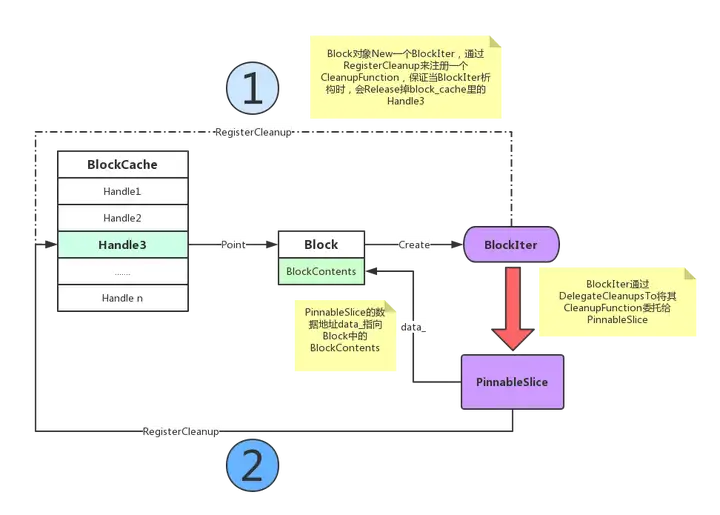

## memtable {#memtable}

## WAL {#wal}

### 介绍 {#介绍}

column family共享WAL文件

#### Life Cycle of a WAL {#life-cycle-of-a-wal}

##### 创建 {#创建}

只有两种情况会创建WAL文件

1.  打开一个新DB
2.  Flush

```c++
DB* db;
std::vector<ColumnFamilyDescriptor> column_families;
column_families.push_back(ColumnFamilyDescriptor(
    kDefaultColumnFamilyName, ColumnFamilyOptions()));
column_families.push_back(ColumnFamilyDescriptor(
    "new_cf", ColumnFamilyOptions()));
std::vector<ColumnFamilyHandle*> handles;
s = DB::Open(DBOptions(), kDBPath, column_families, &handles, &db);

db->Put(WriteOptions(), handles[1], Slice("key1"), Slice("value1"));
db->Put(WriteOptions(), handles[0], Slice("key2"), Slice("value2"));
db->Put(WriteOptions(), handles[1], Slice("key3"), Slice("value3"));
db->Put(WriteOptions(), handles[0], Slice("key4"), Slice("value4"));
```

WAL文件此时只有一个，并保持open状态持续记录log，直到大小超过DBOptions::max_total_wal_size(DBImpl::PreprocessWrite里面会检查)。

##### Flush和删除 {#flush和删除}

```c++
db->Flush(FlushOptions(), handles[1]);
// key5 and key6 will appear in a new WAL
db->Put(WriteOptions(), handles[1], Slice("key5"), Slice("value5"));
db->Put(WriteOptions(), handles[0], Slice("key6"), Slice("value6"));
```

在`new_cf`Flush的时候会创建一个新的WAL文件，此时旧的WAL文件不会被删除，因为里面还保存默认cf里面的log。

```c++
db->Flush(FlushOptions(), handles[0]);
// The older WAL will be archived and purged separately
```

只有当`default_cf`Flush的时候，旧的WAL文件才会被删除。

### WAL configuration {#wal-configuration}

- DBOptions::wal_dir WAL目录位置
- DBOptions::WAL_ttl_seconds, DBOptions::WAL_size_limit_MB archive和purge的时间和大小限制
- DBOptions::max_total_wal_size 设置当前WAL的最大大小，超过就flush。这会让我们不必跟踪非常久远的WAL文件。
- WriteOptions::disableWAL 禁用WAL

### DBImpl::log_mutex {#dbimpllog_mutex}

所有的cf共享WAL文件于是理所当然同步所需的锁应该由DBImpl来持有，实际上DBImpl使用了两个锁来实现复杂的同步机制。

#### 1. DBImpl::mutex\_ 用来同步log相关的变量 {#1-dbimplmutex_-用来同步log相关的变量}

```c++
  // State below is protected by mutex_
  // With two_write_queues enabled, some of the variables that accessed during
  // WriteToWAL need different synchronization: log_empty_, alive_log_files_,
  // logs_, logfile_number_. Refer to the definition of each variable below for
  // more description.
```

#### 2. DBImpl::log_write_mutex\_ 用来同步log的写入 {#2-dbimpllog_write_mutex_-用来同步log的写入}

```c++
  // In addition to mutex_, log_write_mutex_ protects writes to logs_ and
  // logfile_number_. With two_write_queues it also protects alive_log_files_,
  // and log_empty_. Refer to the definition of each variable below for more
  // details.
  // Note: to avoid deadlock, if needed to acquire both log_write_mutex_ and
  // mutex_, the order should be first mutex_ and then log_write_mutex_.
```

具体对某个变量如何进行加锁和释放需要看具体的代码。

### SwitchWAL {#switchwal}

对应上面说的切换WAL文件

代码中主要对应得是DBImpl::SwitchWAL，这是一个重要的函数，接下来让我们看下

```c++


Status DBImpl::SwitchWAL(WriteContext* write_context) {
    //首先确保mutex_是被持有的，DBImpl::mutex_是用来实现log的一些变量的同步的

}
```

### WAL写入 {#wal写入}

在写入的时候（PUT）有两种情况：

#### LEADER {#leader}

LEADER在WriteImpl的时候首先会做一个preprocess

```c++
    //::WriteImpl
    //记录此次的log_Context
    status = PreprocessWrite(write_options, &log_context, &write_context);
```

```c++
    //这个函数主要是在Leader写之前将比较大的memtable变成immutable和把WAL文件刷到磁盘上
    Status DBImpl::PreprocessWrite(const WriteOptions& write_options,
                               LogContext* log_context,
                               WriteContext* write_context) {
        //主要是对各个情况进行分析

        if (UNLIKELY(status.ok() && total_log_size_ > GetMaxTotalWalSize())) {
            //WAL大小超过了max_total_wal_size，需要创建新的WAL文件
            assert(versions_);
            InstrumentedMutexLock l(&mutex_);
            //对column_family不熟悉的可以看源码解析第三章
            const ColumnFamilySet* const column_families =
                versions_->GetColumnFamilySet();
            assert(column_families);
            size_t num_cfs = column_families->NumberOfColumnFamilies();
            assert(num_cfs >= 1);
            if (num_cfs > 1) {
                //说明这个WAL文件包含多个cf
                //WaitForFlushes会等待所有的写memtable完成，包括pipeline被设置时的Memtable_write队列和
                //要切换memtable的写
                WaitForPendingWrites();
                //这个函数会创建新的WAL文件，详情看上面
                status = SwitchWAL(write_context);
            }
        }


    }
```

### 格式 {#格式}

### 创建: {#创建-1}

1.  rocksdb::DB::Open(options, “./db/”, &db);
2.  db-\>Flush(rocksdb::FlushOptions(), handles\[1\]);
3.  在Write的时候检查WAl大小超过了max_total_wal_size的时候，会创建新的wal。

## memtable {#memtable-1}

### 写入 {#写入}

## slice.h {#sliceh}

### Slice {#slice}

- 主要是对字符串的封装，包括了字符串的长度和指针。

### pinnableslice {#pinnableslice}

- 主要是对Slice的封装，继承于slice和cleanable，主要是避免memcpy，可以注册clean函数，当slice不再使用的时候，会调用clean函数。

- 读时优化 

记得每次使用过后需要reset，否则会出现内存泄漏。

## customizable.h {#customizableh}

```
看不下去
```

## Configurable.h {#configurableh}

```
Configurable类
也看不下去
```

参考:

[official blog](https://rocksdb.org/blog/2017/08/24/pinnableslice.html)

[这个讲的比较好](https://zhuanlan.zhihu.com/p/30807728)

### SliceParts {#sliceparts}

- 表示slice数组。

参考:

[Rocksdb WAL实现及源码详解](https://zhuanlan.zhihu.com/p/343323703) [official blog](https://github.com/facebook/rocksdb/wiki/Write-Ahead-Log-%28WAL%29) [数据库月报RocksDB · Memtable flush分析](http://mysql.taobao.org/monthly/2018/09/04/)
