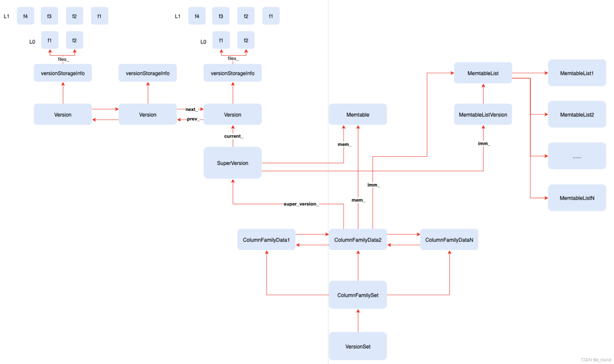

## column family {#column-family}

### 介绍 {#介绍}

是用来做逻辑隔离的，不同的column family可以有不同的配置，比如不同的compaction策略，不同的压缩策略等等。而且不同的column family 对应不同的memtable，但是共享同一个wal文件

rocksdb根据注释给出的结构示意

```c++
//       +----------------------+    +----------------------+   +--------+
//   +---+ ColumnFamilyHandle 1 | +--+ ColumnFamilyHandle 2 |   | DBImpl |
//   |   +----------------------+ |  +----------------------+   +----+---+
//   | +--------------------------+                                  |
//   | |                               +-----------------------------+
//   | |                               |
//   | | +-----------------------------v-------------------------------+
//   | | |                                                             |
//   | | |                      ColumnFamilySet                        |
//   | | |                                                             |
//   | | +-------------+--------------------------+----------------+---+
//   | |               |                          |                |
//   | +-------------------------------------+    |                |
//   |                 |                     |    |                v
//   |   +-------------v-------------+ +-----v----v---------+
//   |   |                           | |                    |
//   |   |     ColumnFamilyData 1    | | ColumnFamilyData 2 |    ......
//   |   |                           | |                    |
//   +--->                           | |                    |
//       |                 +---------+ |                    |
//       |                 | MemTable| |                    |
//       |                 |  List   | |                    |
//       +--------+---+--+-+----+----+ +--------------------++
//                |   |  |      |
//                |   |  |      |
//                |   |  |      +-----------------------+
//                |   |  +-----------+                  |
//                v   +--------+     |                  |
//       +--------+--------+   |     |                  |
//       |                 |   |     |       +----------v----------+
// +---> |SuperVersion 1.a +----------------->                     |
//       |                 +------+  |       | MemTableListVersion |
//       +---+-------------+   |  |  |       |                     |
//           |                 |  |  |       +----+------------+---+
//           |      current    |  |  |            |            |
//           |   +-------------+  |  |mem         |            |
//           |   |                |  |            |            |
//         +-v---v-------+    +---v--v---+  +-----v----+  +----v-----+
//         |             |    |          |  |          |  |          |
//         | Version 1.a |    | memtable |  | memtable |  | memtable |
//         |             |    |   1.a    |  |   1.b    |  |   1.c    |
//         +-------------+    |          |  |          |  |          |
//                            +----------+  +----------+  +----------+
//
// DBImpl keeps a ColumnFamilySet, which references to all column families by
// pointing to respective ColumnFamilyData object of each column family.
// This is how DBImpl can list and operate on all the column families.
// ColumnFamilyHandle also points to ColumnFamilyData directly, so that
// when a user executes a query, it can directly find memtables and Version
// as well as SuperVersion to the column family, without going through
// ColumnFamilySet.
//
// ColumnFamilySet points to the latest view of the LSM-tree (list of memtables
// and SST files) indirectly, while ongoing operations may hold references
// to a current or an out-of-date SuperVersion, which in turn points to a
// point-in-time view of the LSM-tree. This guarantees the memtables and SST
// files being operated on will not go away, until the SuperVersion is
// unreferenced to 0 and destoryed.
//
// The following graph illustrates a possible referencing relationships:
//
// Column       +--------------+      current       +-----------+
// Family +---->+              +------------------->+           |
//  Data        | SuperVersion +----------+         | Version A |
//              |      3       |   imm    |         |           |
// Iter2 +----->+              |  +-------v------+  +-----------+
//              +-----+--------+  | MemtableList +----------------> Empty
//                    |           |   Version r  |  +-----------+
//                    |           +--------------+  |           |
//                    +------------------+   current| Version B |
//              +--------------+         |   +----->+           |
//              |              |         |   |      +-----+-----+
// Compaction +>+ SuperVersion +-------------+            ^
//    Job       |      2       +------+  |                |current
//              |              +----+ |  |     mem        |    +------------+
//              +--------------+    | |  +--------------------->            |
//                                  | +------------------------> MemTable a |
//                                  |          mem        |    |            |
//              +--------------+    |                     |    +------------+
//              |              +--------------------------+
//  Iter1 +-----> SuperVersion |    |                          +------------+
//              |      1       +------------------------------>+            |
//              |              +-+  |        mem               | MemTable b |
//              +--------------+ |  |                          |            |
//                               |  |    +--------------+      +-----^------+
//                               |  |imm | MemtableList |            |
//                               |  +--->+   Version s  +------------+
//                               |       +--------------+
//                               |       +--------------+
//                               |       | MemtableList |
//                               +------>+   Version t  +-------->  Empty
//                                 imm   +--------------+
//
// In this example, even if the current LSM-tree consists of Version A and
// memtable a, which is also referenced by SuperVersion, two older SuperVersion
// SuperVersion2 and Superversion1 still exist, and are referenced by a
// compaction job and an old iterator Iter1, respectively. SuperVersion2
// contains Version B, memtable a and memtable b; SuperVersion1 contains
// Version B and memtable b (mutable). As a result, Version B and memtable b
// are prevented from being destroyed or deleted.                        
```



其实细看会发现其实是DBImpl会有一个VersionSet的unique_ptr，然后VersionSet会有一个ColumnFamilySet的unique_ptr

- 版本(Version)：这个是RocksDB内部概念。一个版本包含某个时间点的所有存活SST文件。一旦一个落盘或者压缩完成，由于存活SST文件发生了变化，一个新的“版本”会被创建。一个旧的“版本”还会被仍在进行的读请求或者压缩工作使用。旧的版本最终会被回收。

- 超级版本(super version)：RocksDB的内部概念。一个超级版本包含一个特定时间的 的 一个SST文件列表（一个“版本”）以及一个存活memtable的列表。不管是压缩还是落盘，抑或是一个memtable切换，都会生成一个新的“超级版本”。一个旧的“超级版本”会被继续用于正在进行的读请求。旧的超级版本最终会在不再需要的时候被回收掉。

### reference {#reference}

[columnfamily](http://mysql.taobao.org/monthly/2018/06/09/#:~:text=Column%20Family%E4%B8%BB%E8%A6%81%E6%98%AF%E6%8F%90%E4%BE%9B,%E5%88%A0%E9%99%A4%E5%AF%B9%E5%BA%94%E7%9A%84Column%20Family.)

[读流程](https://blog.csdn.net/Z_Stand/article/details/120425532)
