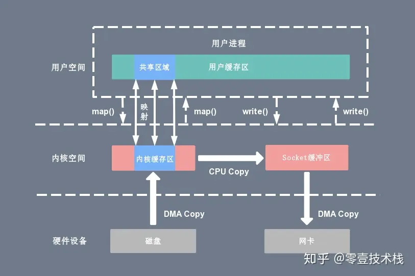
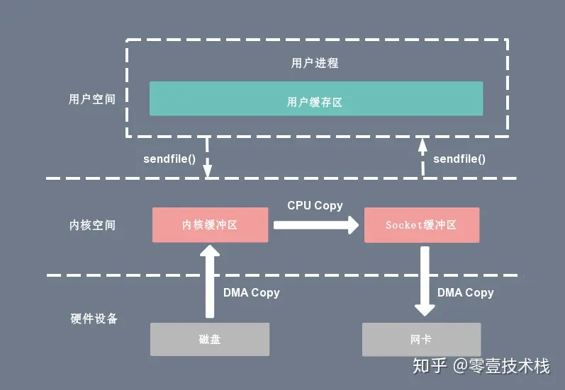
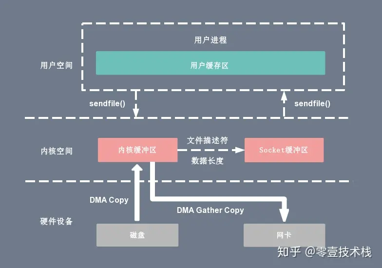
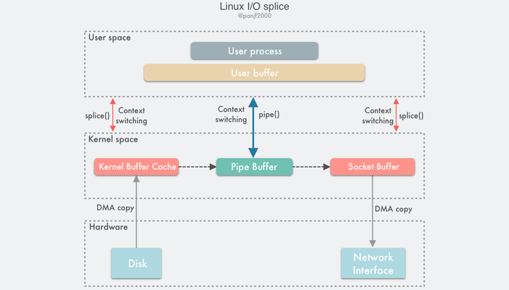
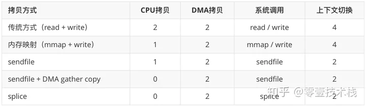

## 零拷贝 {#零拷贝}

广义上来说有三种实现思路：

- 用户态直接 I/O：应用程序可以直接访问硬件存储，操作系统内核只是辅助数据传输。这种方式依旧存在用户空间和内核空间的上下文切换，硬件上的数据直接拷贝至了用户空间，不经过内核空间。因此，直接 I/O 不存在内核空间缓冲区和用户空间缓冲区之间的数据拷贝。
- 减少数据拷贝次数：在数据传输过程中，避免数据在用户空间缓冲区和系统内核空间缓冲区之间的CPU拷贝，以及数据在系统内核空间内的CPU拷贝，这也是当前主流零拷贝技术的实现思路。
- 写时复制技术：写时复制指的是当多个进程共享同一块数据时，如果其中一个进程需要对这份数据进行修改，那么将其拷贝到自己的进程地址空间中，如果只是数据读取操作则不需要进行拷贝操作。

## linux i/o && zero-copy {#linux-io--zero-copy}

在linux下有三种零拷贝实现(用户态直接IO)

1.  mmap+Write
2.  sendfile
3.  splice

> 学到一个观测系统调用的方法，**strace -c ./a.out**

### mmap {#mmap}

> mmap的作用，在应用这一层，是让你把文件的某一段，当作内存一样来访问。将文件映射到物理内存，将进程虚拟空间映射到那块内存。这样，进程不仅能像访问内存一样读写文件，多个进程映射同一文件，还能保证虚拟空间映射到同一块物理内存，达到内存共享的作用。

注意mmap和shmget共享内存方式的不同，后者请看interview/Linux.md



#### 原理 {#原理}

##### 进程启动映射过程，并在虚拟地址空间中为映射创建虚拟映射区域； {#进程启动映射过程并在虚拟地址空间中为映射创建虚拟映射区域}

- 进程在用户空间调用库函数mmap，原型：void \*mmap(void \*start, size_t length, int prot, int flags, int fd, off_t offset);
- 在当前进程的虚拟地址空间中，寻找一段空闲的满足要求的连续的虚拟地址
- 为此虚拟区分配一个vm_area_struct结构，接着对这个结构的各个域进行了初始化
- 将新建的虚拟区结构（vm_area_struct）插入进程的虚拟地址区域链表或树中

##### 调用内核空间的系统调用函数mmap（不同于用户空间函数），实现文件物理地址和进程虚拟地址的一一映射关系 {#调用内核空间的系统调用函数mmap不同于用户空间函数实现文件物理地址和进程虚拟地址的一一映射关系}

- 为映射分配了新的虚拟地址区域后，通过待映射的文件指针，在文件描述符表中找到对应的文件描述符，通过文件描述符，链接到内核“已打开文件集”中该文件的文件结构体（struct file），每个文件结构体维护着和这个已打开文件相关各项信息；
- 通过该文件的文件结构体，链接到file_operations模块，调用内核函数mmap，其原型为：int mmap(struct file \*filp, struct vm_area_struct \*vma)，不同于用户空间库函数；
- 内核mmap函数通过虚拟文件系统inode模块定位到文件磁盘物理地址；
- 通过remap_pfn_range函数建立页表，即实现了文件地址和虚拟地址区域的映射关系。此时，这片虚拟地址并没有任何数据关联到主存中；

##### 进程发起对这片映射空间的访问，引发缺页异常，实现文件内容到物理内存（主存）的拷贝 {#进程发起对这片映射空间的访问引发缺页异常实现文件内容到物理内存主存的拷贝}

- 前两个阶段仅在于创建虚拟区间并完成地址映射，但是并没有将任何文件数据的拷贝至主存。真正的文件读取是当进程发起读或写操作时；
- 进程的读或写操作访问虚拟地址空间这一段映射地址，通过查询页表，发现这一段地址并不在物理页面上。因为目前只建立了地址映射，真正的硬盘数据还没有拷贝到内存中，因此引发缺页异常；
- 缺页异常进行一系列判断，确定无非法操作后，内核发起请求调页过程。
- 调页过程先在交换缓存空间（swap cache）中寻找需要访问的内存页，如果没有则调用nopage函数把所缺的页从磁盘装入到主存中；
- 1之后进程即可对这片主存进行读或者写的操作，如果写操作改变了其内容，一定时间后系统会自动回写脏页面到对应磁盘地址，也即完成了写入到文件的过程；
- 修改过的脏页面并不会立即更新回文件中，而是有一段时间的延迟，可以调用msync()来强制同步, 这样所写的内容就能立即保存到文件里了；

#### 分析函数 {#分析函数}

##### 用户空间mmap函数 {#用户空间mmap函数}

```c++
/*
 * addr 指定映射的起始地址，通常设为NULL，由内核来分配
 * length 代表将文件中映射到内存的部分的长度。
 * prot 映射区域的保护方式: 
 *  PROT_EXEC 映射区域可被执行
 *  PROT_READ 映射区域可被读取
 *  PROT_WRITE 映射区域可被写入
 *  PROT_NONE 映射区域不能存取
 * flags 要映射到内存中的文件描述符，有open函数打开文件时返回的值。
 * offset：文件映射的偏移量，通常设置为0，代表从文件最前方开始对应，offset必须是分页大小的整数倍。
 */
void *mmap(void *addr, size_t len, int prot, int flags, int fd, off_t offset);
```

两个优点：

- 一是节省内存空间，因为用户进程上的这一段内存是虚拟的，并不真正占据物理内存，只是映射到文件所在的内核缓冲区上，因此可以节省一半的内存占用；
- 二是省去了一次 CPU 拷贝，对比传统的 Linux I/O 读写，数据不需要再经过用户进程进行转发了，而是直接在内核里就完成了拷贝。

问题:

1.  设置一个信号处理器，专门用来处理 SIGBUS 信号，这个处理器直接返回， write() 就可以正常返回已写入的字节数而不会被 SIGBUS 中断，errno 错误码也会被设置成 success。然而这实际上是一个掩耳盗铃的解决方案，因为 BIGBUS 信号的带来的信息是系统发生了一些很严重的错误，而我们却选择忽略掉它，一般不建议采用这种方式。
2.  通过内核的文件租借锁（这是 Linux 的叫法，Windows 上称之为机会锁）来解决这个问题，这种方法相对来说更好一些。我们可以通过内核对文件描述符上读/写的租借锁，当另外一个进程尝试对当前用户进程正在进行传输的文件进行截断的时候，内核会发送给用户一个实时信号：RT_SIGNAL_LEASE 信号，这个信号会告诉用户内核正在破坏你加在那个文件上的读/写租借锁，这时 write() 系统调用会被中断，并且当前用户进程会被 SIGBUS 信号杀死，返回值则是中断前写的字节数，errno 同样会被设置为 success。文件租借锁需要在对文件进行内存映射之前设置，最后在用户进程结束之前释放掉。

### sendfile {#sendfile}



#### sendfile gather {#sendfile-gather}

当然有！通过引入一个新硬件上的支持，我们可以把这个仅剩的一次 CPU 拷贝也给抹掉：Linux 在内核 2.4 版本里引入了 DMA 的 scatter/gather – 分散/收集功能，并修改了 sendfile() 的代码使之和 DMA 适配。scatter 使得 DMA 拷贝可以不再需要把数据存储在一片连续的内存空间上，而是允许离散存储，gather 则能够让 DMA 控制器根据少量的元信息：一个包含了内存地址和数据大小的缓冲区描述符，收集存储在各处的数据，最终还原成一个完整的网络包，直接拷贝到网卡而非套接字缓冲区，避免了最后一次的 CPU 拷贝：



可以减少内核空间（CPU）的拷贝

### Splice {#splice}

splice 系统调用可以在内核空间的读缓冲区（read buffer）和网络缓冲区（socket buffer）之间建立管道（pipeline），从而避免了两者之间的 CPU 拷贝操作。

```c
ssize_t splice(int fd_in, loff_t *off_in, int fd_out, loff_t *off_out, size_t len, unsigned int flags);
```

flag的取值：

- SPLICE_F_MOVE：指示 splice() 尝试仅仅是移动内存页面而不是复制，设置了这个值不代表就一定不会复制内存页面，复制还是移动取决于内核能否从管道中移动内存页面，或者管道中的内存页面是否是完整的；这个标记的初始实现有很多 bug，所以从 Linux 2.6.21 版本开始就已经无效了，但还是保留了下来，因为在未来的版本里可能会重新被实现。
- SPLICE_F_NONBLOCK：指示 splice() 不要阻塞 I/O，也就是使得 splice() 调用成为一个非阻塞调用，可以用来实现异步数据传输，不过需要注意的是，数据传输的两个文件描述符也最好是预先通过 O_NONBLOCK 标记成非阻塞 I/O，不然 splice() 调用还是有可能被阻塞。
- SPLICE_F_MORE：通知内核下一个 splice() 系统调用将会有更多的数据传输过来，这个标记对于输出端是 socket 的场景非常有用。

经典用法：

```c
int pfd[2];

pipe(pfd);

ssize_t bytes = splice(file_fd, NULL, pfd[1], NULL, 4096, SPLICE_F_MOVE);
assert(bytes != -1);

bytes = splice(pfd[0], NULL, socket_fd, NULL, bytes, SPLICE_F_MOVE | SPLICE_F_MORE);
assert(bytes != -1);
```



1.  用户进程调用 pipe()，从用户态陷入内核态，创建匿名单向管道，pipe() 返回，上下文从内核态切换回用户态；
2.  用户进程调用 splice()，从用户态陷入内核态；
3.  DMA 控制器将数据从硬盘拷贝到内核缓冲区，从管道的写入端"拷贝"进管道，splice() 返回，上下文从内核态回到用户态；
4.  用户进程再次调用 splice()，从用户态陷入内核态；
5.  内核把数据从管道的读取端"拷贝"到套接字缓冲区，DMA 控制器将数据从套接字缓冲区拷贝到网卡；
6.  splice() 返回，上下文从内核态切换回用户态。

### 对比 {#对比}



### send() with MSG_ZEROCOPY {#send-with-msg_zerocopy}

TODO

### 绕过内核 {#绕过内核}

1.  用户直接访问硬件
2.  内核控制访问硬件

### 内核缓冲区和用户缓冲区之间的传输优化 {#内核缓冲区和用户缓冲区之间的传输优化}

#### COW {#cow}

## reference: {#reference}

[Linux I/O 原理和 Zero-copy 技术全面揭秘](https://zhuanlan.zhihu.com/p/308054212)

[深入剖析Linux IO原理和几种零拷贝机制的实现](https://zhuanlan.zhihu.com/p/83398714#:~:text=%E9%9B%B6%E6%8B%B7%E8%B4%9D%EF%BC%88Zero-copy%EF%BC%89,%E5%9C%A8%E8%BF%99%E6%96%B9%E9%9D%A2%E7%9A%84%E8%B4%9F%E8%BD%BD%E3%80%82)

[mmap](https://zhuanlan.zhihu.com/p/610566047)
