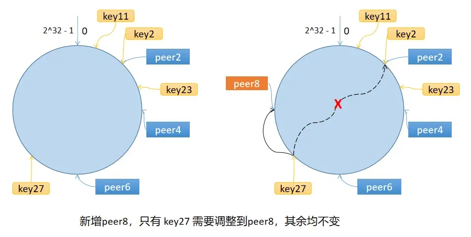

### gee {#gee}

本项目模仿极客兔兔的7天项目进行学习

### gee-web {#gee-web}

#### 简介 {#简介}

这是一个简单的web框架，实现了路由、中间件、静态文件服务、模板渲染等功能。主要是模仿gin框架进行实现，下面就来说说从中学到的东西。

##### context {#context}

1.  每次请求都会创建一个context，所以在context中存储一些请求相关的信息是很有必要的，比如说请求的method、path、响应的writer等等，这些信息都是在请求过程中会用到的，所以在context中存储这些信息是很有必要的。

2.  比如restful接口的构建，如果每次都要json然后encode会有很多重复代码。

实现上

```go
type Context struct {
	// origin objects
	Writer http.ResponseWriter
	Req    *http.Request
	// request info
	Path   string
	Method string
	// response info
	StatusCode int
}
```

基本就是把Writer req Path Method 等常用属性封装，然后提供一些常用的方法，比如说PostForm、Query、Status、SetHeader、String、JSON等等。

##### router {#router}

基于前缀树实现，

```go

type router struct {
	roots    map[string]*node
	handlers map[string]HandlerFunc
}


type node struct {
	pattern  string
	part     string
	children []*node
	isWild   bool
}
```

注意每个方法(GET POST)都有对应Node 根节点，然后看node的结构，包含pattern part children isWild，pattern是完整的路径，part是当前节点的路径，children是子节点，isWild表示是否精确匹配。

搜索时通过Path找到节点，然后根据patten来找到对应handler。

##### group {#group}

分组这个功能还是很有用的

1.  提供了逻辑上的隔离，使得每个分组中的路由都有相同的前缀，这样就可以提取公共的前缀，减少冗余代码。
2.  中间件可以基于组来设置，这样就可以对某个组的路由设置中间件，而不是每个路由都设置中间件。

```go
RouterGroup struct {
		prefix      string
		middlewares []HandlerFunc // support middleware
		parent      *RouterGroup  // support nesting
		engine      *Engine       // all groups share a Engine instance
	}

	Engine struct {
		*RouterGroup
		router *router
		groups []*RouterGroup // store all groups
	}
```

实现就有点意思了，每个分组为了保持对engine的可见性(可能表述有问题),需要有一个engine的引用这样添加路由时才能添加到engine中，所以每个分组都有一个engine的引用，然后engine中有一个groups的属性，用来存储所有的分组，这样就可以通过engine来访问所有的分组了。

##### middleware {#middleware}

中间件的设计也很精巧

它是基于这样一种情景:

```go
func A(c *Context) {
    part1
    c.Next()
    part2
}
func B(c *Context) {
    part3
    c.Next()
    part4
}
```

所以context需要添加一个index属性，用来记录当前执行到哪个中间件了，然后在Next方法中，先把index加1，然后执行中间件，然后再执行Next方法，这样就可以实现中间件的执行了。

```go
func (c *Context) Next() {
	c.index++
	s := len(c.handlers)
	for ; c.index < s; c.index++ {
		c.handlers[c.index](c)
	}
}
```

这个next设计很有意思，这个是从当前中间件的下一个进行遍历操作，而不是只执行下一个。这是因为有些中间件的操作是不调用next的，比如说logger中间件，它只是打印日志，然后就不需要执行下一个中间件了，所以这样设计是很合理的。然后与之配套的Context.Fail方法，用来中断中间件的执行也很有意思。

```go
func (c *Context) Fail(code int, err string) {
	c.index = len(c.handlers)
	c.JSON(code, H{"message": err})
}
```

他这里会把index直接设置为最后，那么堆栈中嵌套调用的next都会立刻退出而不会继续执行下去。

差点漏说了，这个URL本身的Handler也被当成一个中间件放在最后，这样代码连贯性比较好。servehttp的时候就是调用next就开始执行了。

##### panic-recover {#panic-recover}

这个也是http框架必不可少的，因为http框架是一个长期运行的服务，所以必须要有panic-recover机制，不然一旦出现panic，整个服务就会挂掉，这是不允许的。

这gee(gin)中这是通过设置recover中间件来实现的也是一种很不错的方法。

### gee-cache {#gee-cache}

#### Day1 LRU {#day1-lru}

基本上是用Map和list.List来实现LRU，要注意的是链表里面不止存value，还要存key因为这样删除的时候才可以O(1)删除map

#### Day2 {#day2}

1.  byteview: 一个只读的数据结构，实现了查询长度和拷贝的功能。
2.  回调 Getter，这一部分是为了实现缓存中找不到去更深层的数据源查找的功能。

有意思的是这里用了一个Getter接口，然后用GetterFunc来实现这个接口，这样就可以用函数来实现这个接口了，这样就可以不用每次都实现一个结构体了(当然实现结构体也可以)。

```go
// A Getter loads data for a key.
type Getter interface {
	Get(key string) ([]byte, error)
}

// A GetterFunc implements Getter with a function.
type GetterFunc func(key string) ([]byte, error)

// Get implements Getter interface function
func (f GetterFunc) Get(key string) ([]byte, error) {
	return f(key)
}
```

3.  Group

group可以看成是命名空间，每个group有一个名字，然后每个group有一个cache，然后每个group有一个getter，这样就可以实现不同的group有不同的cache和getter了。

#### Day3 HTTP 服务端 {#day3-http-服务端}

其实比较简单，就是写了一个HTTPPool的结构体，实现ServeHttp方法。要注意现在的HTTPPool是一个单机的，所以只能用来做单机的缓存。

#### 一致性哈希 {#一致性哈希}



避免数据倾斜，一个真实节点可能对应多个缓存节点。

#### 实现 {#实现}

首先就是节点的添加，主要就是用一个数组有序存放各个虚拟节点hash值，再用一个hashmap存虚拟节点和真实节点的对应关系。 在根据key获取节点的时候就把key的hash值用来二分查找，然后找到第一个大于等于key的hash值，然后就可以找到对应的节点了。

#### 分布式节点 {#分布式节点}

1.  定义接口

```go
// PeerPicker is the interface that must be implemented to locate
// the peer that owns a specific key.
type PeerPicker interface {
	PickPeer(key string) (peer PeerGetter, ok bool)
}

// PeerGetter is the interface that must be implemented by a peer.
type PeerGetter interface {
	Get(group string, key string) ([]byte, error)
}
```

2.  由httppool实现peerPicker接口，利用其内部的一致性哈希模块选择真实节点。
3.  httpgetter实现peergetter接口，利用http客户端从远程节点获取缓存值(其实就是封装了http请求)。
4.  集成httppool到group中，就是修改一下load方法使其先pick再get。

#### day6 {#day6}

防止缓存击穿：

```go
package singleflight

import "sync"

type call struct {
	wg  sync.WaitGroup
	val interface{}
	err error
}

type Group struct {
	mu sync.Mutex       // protects m
	m  map[string]*call
}
```

- call 代表正在进行中，或已经结束的请求。使用 sync.WaitGroup 锁避免重入。
- Group 是 singleflight 的主数据结构，管理不同 key 的请求(call)。

```go
func (g *Group) Do(key string, fn func() (interface{}, error)) (interface{}, error) {
	g.mu.Lock()
	if g.m == nil {
		g.m = make(map[string]*call)
	}
	if c, ok := g.m[key]; ok {
		g.mu.Unlock()
		c.wg.Wait()
		//提前返回结果
		return c.val, c.err
	}
	c := new(call)
	c.wg.Add(1)
	g.m[key] = c
	g.mu.Unlock()
	//唯一一次调用fn
	c.val, c.err = fn()
	c.wg.Done()

	g.mu.Lock()
	delete(g.m, key)
	g.mu.Unlock()

	return c.val, c.err
}
```
