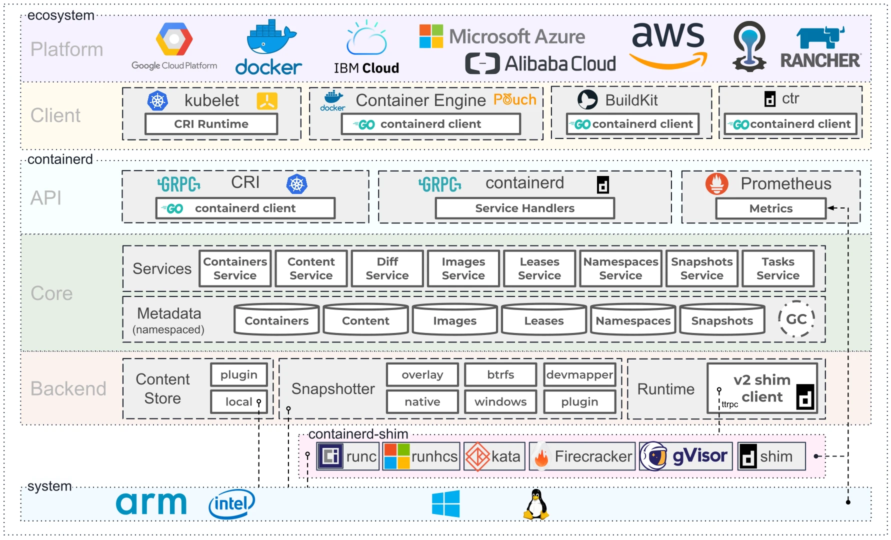
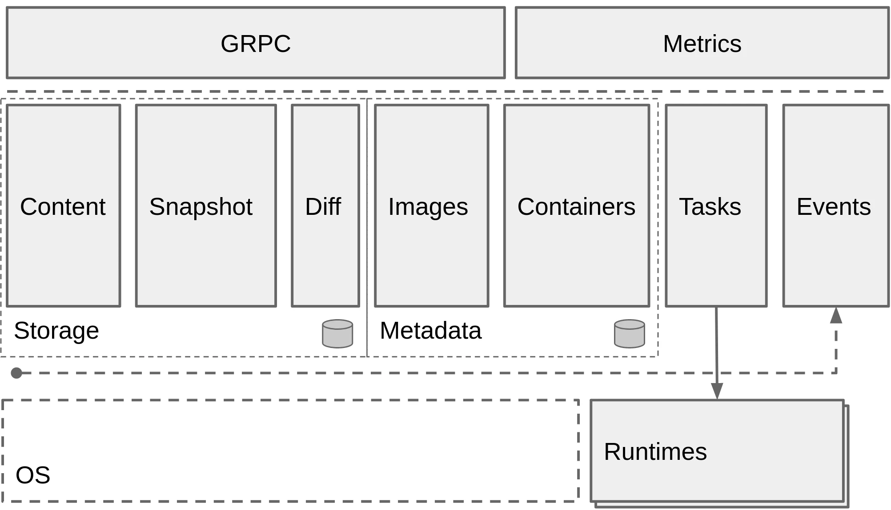

## Containerd {#containerd}

可以做什么

- 管理容器的生命周期（从创建容器到销毁容器）
- 拉取/推送容器镜像
- 存储管理（管理镜像及容器数据的存储）
- 调用 runc 运行容器（与 runc 等容器运行时交互）
- 管理容器网络接口及网络

## Reference {#reference}

[容器运行时 containerd 学习笔记](https://www.aneasystone.com/archives/2023/06/containerd-notes.html)
