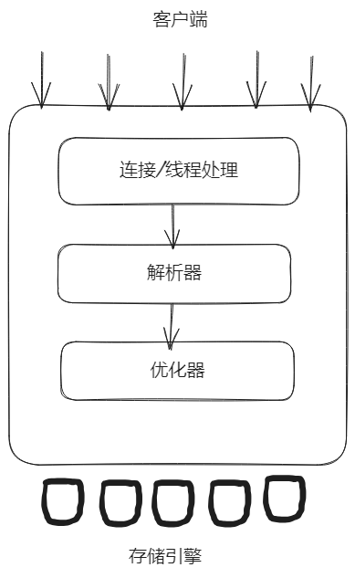

## 高性能Mysql {#高性能mysql}

该系列主要是记录阅读高性能Mysql的一些笔记。

### Mysql架构 {#mysql架构}

#### 架构的逻辑视图 {#架构的逻辑视图}

#### 连接管理和安全 {#连接管理和安全}

每个客户端连接都会有一个线程，连接时会有身份验证，连接成功后还会验证用户是否具有执行每个查询的权限。

#### 优化和执行 {#优化和执行}

优化器不关心存储引擎的具体实现，但是存储引擎的确影响优化(Innodb和myisam在索引上的不同),优化器会向存储引擎查询他的一些功能和表的统计信息。

#### 锁的粒度 {#锁的粒度}

1.  表锁 锁定整张表
2.  行锁 但是会有更多开销(跟踪拥有锁的用户，多久释放)

#### 事务 {#事务}

主要就是ACID特性，这些在DB课上都学过，在此回顾一遍

1.  Atomicity

原子性，事务内的语句不可分割，要么全执行，要么都不执行。

2.  Consistency

事务完成前后都处于一致性状态，e.g 钱的总数不变

3.  Isolation

一个事务在最终提交之前，其他的事务对其做出的修改不可见。

4.  Durability

事务提交后数据被持久化下来。

#### 隔离级别 {#隔离级别}

这也是很重要的概念

1.  (READ UNCOMMITTED)未提交读

    A事务可以读B事务修改但未提交的数据(脏读)

    - 性能：没好很多
    - 缺点：很多很多(主要是不一致)
    - 几乎不使用

2.  (READ COMMITTED)提交读

    大部分数据库系统使用这个隔离级别(但是Mysql不是),这会有个问题就是在A事务对某行的两次查询之间会有一个事务提交，导致不可重复读(两次读的结果不同)。

3.  (REPEATABLE READ)可重复读

    解决不可重复读问题，保证在同一个事务中多次读取相同行的结果是一样的。但是幻行(Phantom row)无法解决，也就在事务过程中会有新的记录被插入。

4.  (SERIALIZABLE) 可串行化

    每行数据都加锁(慢)

| 隔离级别         | 脏读 | 不可重复读 | 幻读(幻行) | 加锁读 |
|------------------|------|------------|------------|--------|
| READ UNCOMMITTED | 是   | 是         | 是         | 否     |
| READ COMMITTED   | 否   | 是         | 是         | 否     |
| REPEATABLE READ  | 否   | 否         | 是         | 否     |
| SERIALIZABLE     | 否   | 否         | 否         | 是     |

#### MVCC(多版本并发控制) {#mvcc多版本并发控制}

推荐看

1.  Jeremy 大神的文章[The basics of the InnoDB undo logging and history system](https://blog.jcole.us/2014/04/16/the-basics-of-the-innodb-undo-logging-and-history-system/)
2.  中文比较好的文章[数据库基础（四）Innodb MVCC实现原理](https://zhuanlan.zhihu.com/p/52977862)
3.  这个也不错[一文搞懂InnoDB MVCC机制](https://zhuanlan.zhihu.com/p/231947511)

总结一下：

1.  **Undo logging** and **InnoDB’s “history” system** are the mechanisms that underly its implementation of MVCC, but the way this works is generally very poorly understood.

2.  

####  {#heading}
