## 设计原则 {#设计原则}

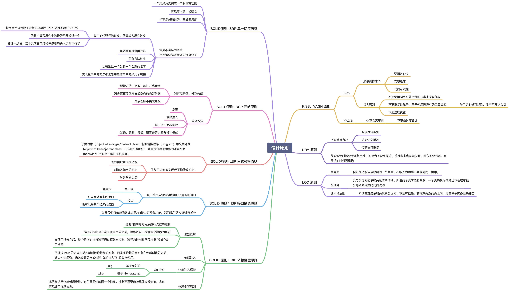

## 设计模式的golang实现 {#设计模式的golang实现}

### 单例模式 {#单例模式}

#### 饿汉模式 {#饿汉模式}

就是应用开始的时候就初始化

#### 懒汉模式 {#懒汉模式}

这个是带双重检查的，不用每次都调用once的那个，我看osproxy的也是这样写的。

```go
package singleton

import "sync"

var (
	lazySingleton *Singleton
	once          = &sync.Once{}
)

// GetLazyInstance 懒汉式
func GetLazyInstance() *Singleton {
	if lazySingleton == nil {
		once.Do(func() {
			lazySingleton = &Singleton{}
		})
	}
	return lazySingleton
}
```

### 工厂模式 {#工厂模式}

#### 简单工厂 {#简单工厂}

其实就是只能生产一种对象的工厂。比如在go中自定义一个简单的NewXXX函数

#### 普通工厂 {#普通工厂}

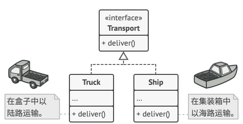

```go
// IRuleConfigParserFactory 工厂方法接口
type IRuleConfigParserFactory interface {
	CreateParser() IRuleConfigParser
}

// yamlRuleConfigParserFactory yamlRuleConfigParser 的工厂类
type yamlRuleConfigParserFactory struct {
}

// CreateParser CreateParser
func (y yamlRuleConfigParserFactory) CreateParser() IRuleConfigParser {
	return yamlRuleConfigParser{}
}

// jsonRuleConfigParserFactory jsonRuleConfigParser 的工厂类
type jsonRuleConfigParserFactory struct {
}

// CreateParser CreateParser
func (j jsonRuleConfigParserFactory) CreateParser() IRuleConfigParser {
	return jsonRuleConfigParser{}
}

// NewIRuleConfigParserFactory 用一个简单工厂封装工厂方法
func NewIRuleConfigParserFactory(t string) IRuleConfigParserFactory {
	switch t {
	case "json":
		return jsonRuleConfigParserFactory{}
	case "yaml":
		return yamlRuleConfigParserFactory{}
	}
	return nil
}
```

#### 抽象工厂 {#抽象工厂}

这是比较难理解的，但是可以举一个例子就是：

简单工厂有两个实现：生产狗和生产猫

但是如果这个时候来了一个区分性别的要求，如果还是按照简单工厂的方法的话需要将性别和产品进行组合，那就是两倍的工厂，但是如果使用抽象工厂，可以把产品分成两类：雄&雌，然后再在这两类工厂中调用特定的工厂。

下图的例子是建造不同风格的家具

每种家具都要有两种接口

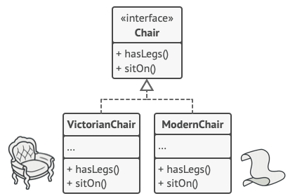

抽象工厂

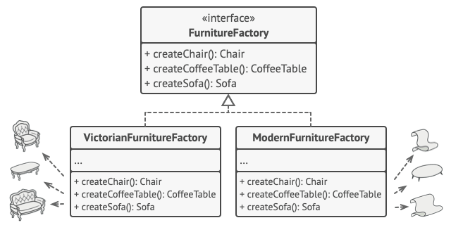

### creator {#creator}

一图以蔽之 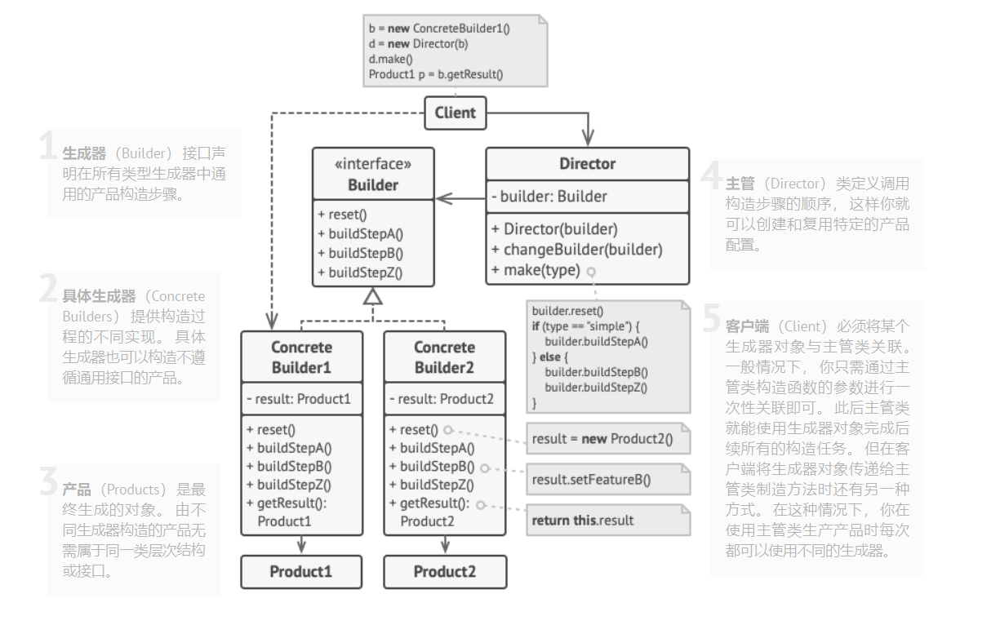

但是值得注意的是：

在golang中一般不这么使用，而是通过可变长参数来传递option这在很多框架中见到

```go
package builder

import "fmt"

// ResourcePoolConfigOption option
type ResourcePoolConfigOption struct {
	maxTotal int
	maxIdle  int
	minIdle  int
}

// ResourcePoolConfigOptFunc to set option
type ResourcePoolConfigOptFunc func(option *ResourcePoolConfigOption)

// NewResourcePoolConfig NewResourcePoolConfig
func NewResourcePoolConfig(name string, opts ...ResourcePoolConfigOptFunc) (*ResourcePoolConfig, error) {
	if name == "" {
		return nil, fmt.Errorf("name can not be empty")
	}

	option := &ResourcePoolConfigOption{
		maxTotal: 10,
		maxIdle:  9,
		minIdle:  1,
	}

	for _, opt := range opts {
		opt(option)
	}

	if option.maxTotal < 0 || option.maxIdle < 0 || option.minIdle < 0 {
		return nil, fmt.Errorf("args err, option: %v", option)
	}

	if option.maxTotal < option.maxIdle || option.minIdle > option.maxIdle {
		return nil, fmt.Errorf("args err, option: %v", option)
	}

	return &ResourcePoolConfig{
		name:     name,
		maxTotal: option.maxTotal,
		maxIdle:  option.maxIdle,
		minIdle:  option.minIdle,
	}, nil
}
```

### 原型模式 {#原型模式}

其实就是克隆，类比java里面的cloneable接口

### 适配器模式 {#适配器模式}

这个还是比较常见

比如json和xml的适配器

### 桥接模式 {#桥接模式}

其实就是将一些属性从类中剥离，用组合的方式来解耦

抽象与实现分离，并且可以独立变化

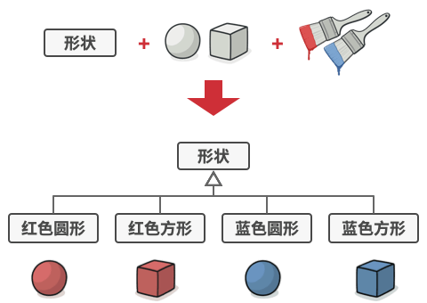 变成-》

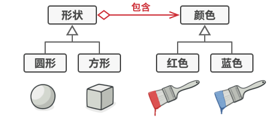

### 组合模式 {#组合模式}

组合模式就是用树状结构组织对象，让调用者可以统一看待单一和组合，最经典的就是打折策略的组合

实现起来就是，一些打折的子类会有一个children数组保存打折类，然后遍历打折。 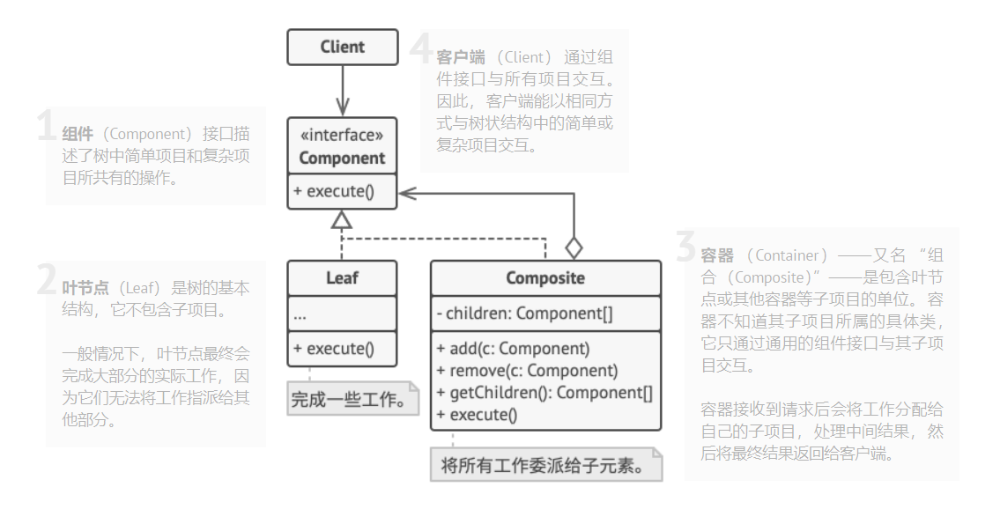

### 装饰模式 {#装饰模式}

装饰模式是一种结构型设计模式， 允许你通过将对象放入包含行为的特殊封装对象中来为原对象绑定新的行为。

也就是说不通过所有属性组合来实现组合，而是通过不断包含（装饰）来实现组合

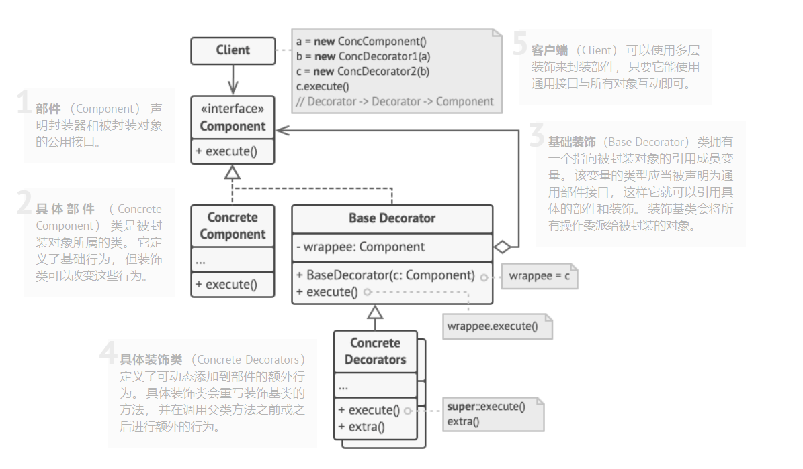

这个在Python还是蛮常见的（@cache）

```go
package decorator

// IDraw IDraw
type IDraw interface {
	Draw() string
}

// Square 正方形
type Square struct{}

// Draw Draw
func (s Square) Draw() string {
	return "this is a square"
}

// ColorSquare 有颜色的正方形
type ColorSquare struct {
	square IDraw
	color  string
}

// NewColorSquare NewColorSquare
func NewColorSquare(square IDraw, color string) ColorSquare {
	return ColorSquare{color: color, square: square}
}

// Draw Draw
func (c ColorSquare) Draw() string {
	return c.square.Draw() + ", color is " + c.color
}
```

### 外观模式 {#外观模式}

比如一个第三方库，实现一个功能可能需要这个第三方库的很多组件一起联动，但是可以为这个功能创建一个方法，在这个方法内部进行这个组件的初始化和调用

> 例如， 上传猫咪搞笑短视频到社交媒体网站的应用可能会用到专业的视频转换库， 但它只需使用一个包含 encode­(filename, format)方法 （以文件名与文件格式为参数进行编码的方法） 的类即可。 在创建这个类并将其连接到视频转换库后， 你就拥有了自己的第一个外观。

> 当你通过电话给商店下达订单时， 接线员就是该商店的所有服务和部门的外观。 接线员为你提供了一个同购物系统、 支付网关和各种送货服务进行互动的简单语音接口。

### 享元模式 {#享元模式}

其实就是共享对象，而非复制

经典的就是java的String和go 的string，这两个都是不可变的共享的。

### 代理模式 {#代理模式}

代理和外观和装饰模式差不多

区别：

1.  外观 代理模式是创建一个与目标类有个同样接口的类
2.  装饰 代理模式会管理类的生命周期，但是装饰的话是由客户端管理的。

### 责任链模式 {#责任链模式}

责任链模式是一种行为设计模式， 允许你将请求沿着处理者链进行发送。 收到请求后， 每个处理者均可对请求进行处理， 或将其传递给链上的下个处理者。 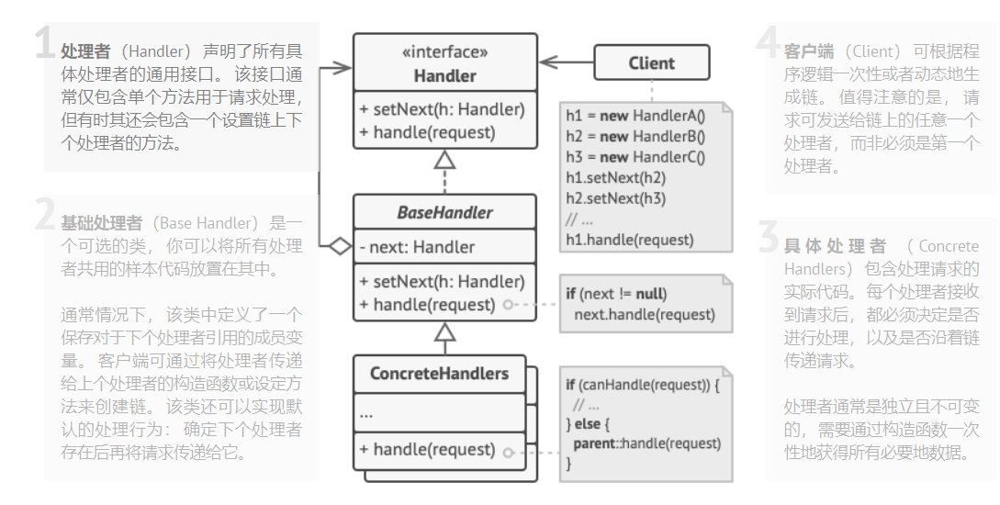

和装饰模式很像，区别点在于责任链模式可以在某个节点中终止不再传递。

经典的例子就是GIN中中间件的设计

### 命令模式 {#命令模式}

命令模式是一种行为设计模式， 它可将请求转换为一个包含与请求相关的所有信息的独立对象。 该转换让你能根据不同的请求将方法参数化、 延迟请求执行或将其放入队列中， 且能实现可撤销操作。

其实也是内聚的表现，就拿按钮来说，具体命令的执行和按钮应该是分开的，按钮只应该用来发送命令

就比如说游戏的三个按钮，设置，开始，退出。 他们都是按钮对象，只是在初始化的时候为其设置了不同的事件（命令）

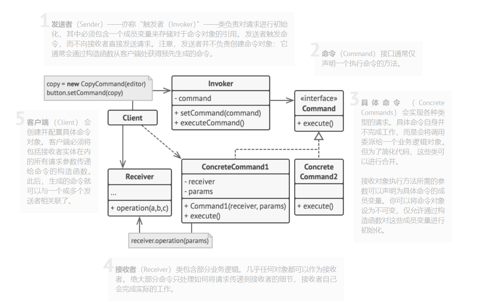

### 迭代器模式 {#迭代器模式}

迭代器模式是一种行为设计模式， 让你能在不暴露集合底层表现形式 （列表、 栈和树等） 的情况下遍历集合中所有的元素。

其实就是封装了一个遍历的接口

### 中介者模式 {#中介者模式}

其实和代理或者适配器有点像，但是这个强调的是模块之前的通信，应该解耦不应该直接调用。（修改困难，中介者模式还可以用来提高测试性（mock测试））和可修改性

类比消息队列

### 备忘录模式（快照） {#备忘录模式快照}

备忘录模式是一种行为设计模式， 允许在不暴露对象实现细节的情况下保存和恢复对象之前的状态。

就是现在有一个需求是保存状态（编辑器撤回）

实现起来就是需要保存状态的对象自身实现保存和读取文本序列化自己的方法。

类比824里面的snapshot的实现

### 观察者模式 {#观察者模式}

这个还是比较熟悉的

### 状态模式 {#状态模式}

状态模式是一种行为设计模式， 让你能在一个对象的内部状态变化时改变其行为， 使其看上去就像改变了自身所属的类一样。

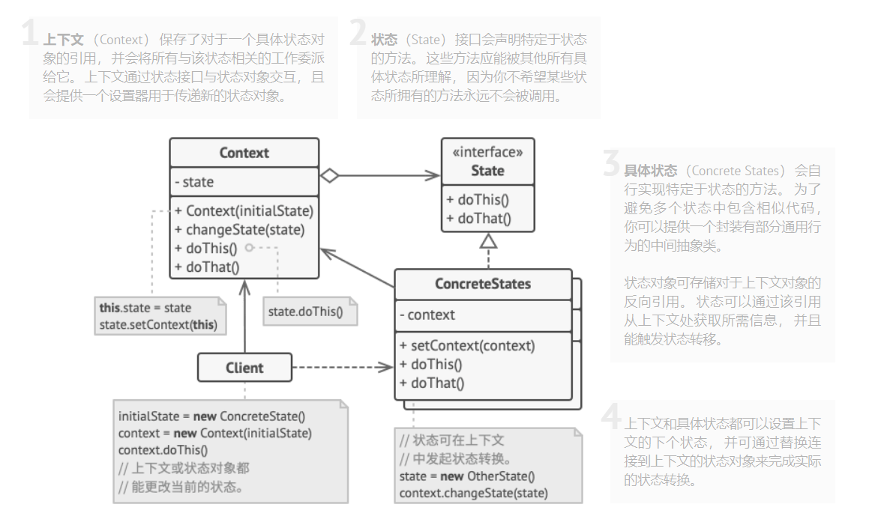

实现上用多个状态类来实现context的接口，然后就好像context有多个状态一样，状态内部还可以通过引用context来改变状态

### 策略模式 {#策略模式}

就是通过上下文来选择实际应该执行的类

这可以用来大大减少if else switch

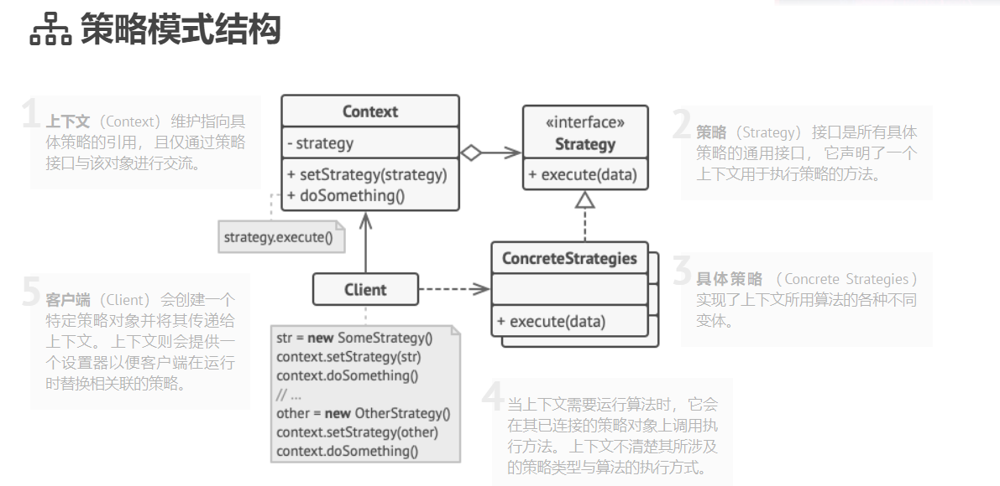

### 模板模式 {#模板模式}

参考mapreduce，通过实现一套流程但是具体的方法可以通过参数传入，实现了模板方法

这样可以去除很多重复代码提高代码重用

## 参考 {#参考}

[go-design-pattern](https://github.com/mohuishou/go-design-pattern)
