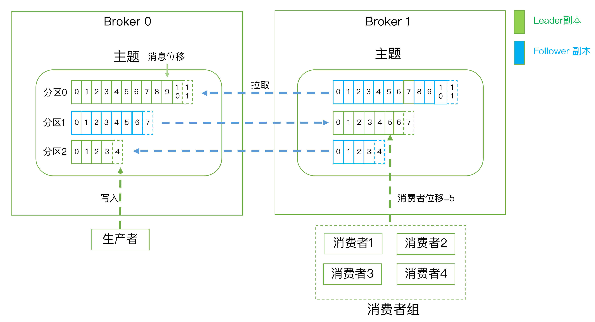
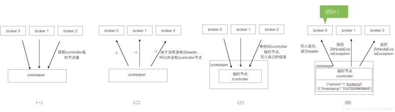
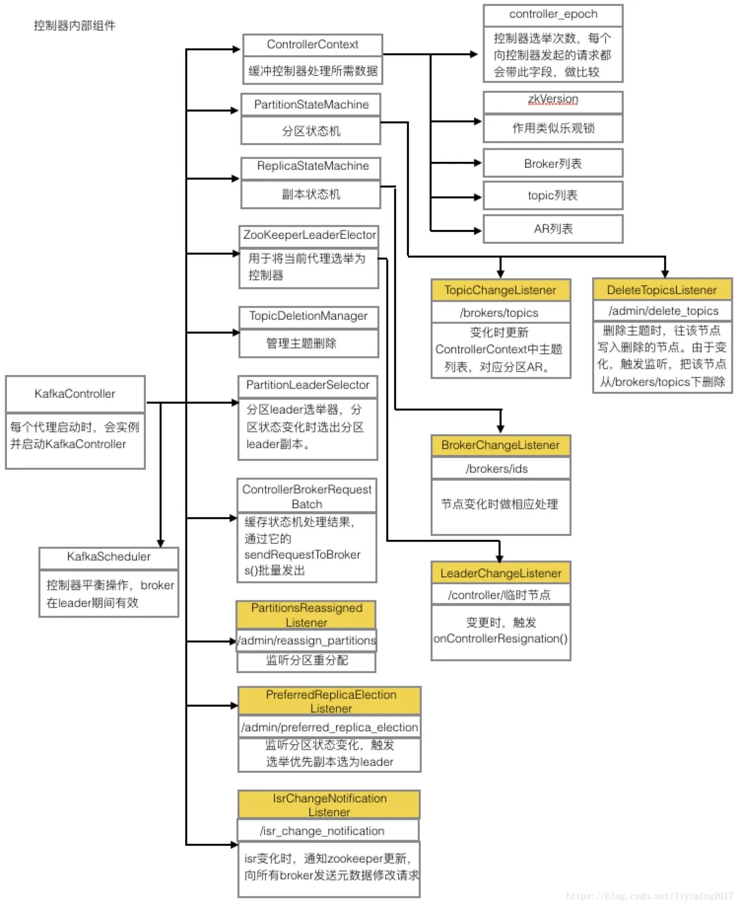

## Kafka入门 {#kafka入门}

### 基本概念 {#基本概念}

### Apache Kafka 核心组件和流程 {#apache-kafka-核心组件和流程}

#### 控制器 {#控制器}

控制器也叫leader broker,负责分区leader的选取,也就是负责选举partition的leader replica.

##### 控制器选举 {#控制器选举}

实际上就是借助Zookeeper分布式锁实现选主。

包括集群启动在内，有三种情况触发控制器选举：

1.  集群启动

2.  控制器所在代理发生故障

3.  zookeeper心跳感知，控制器与自己的session过期

假设此集群有三个broker，同时启动。

（一）3个broker从zookeeper获取/controller临时节点信息。/controller存储的是选举出来的leader信息。此举是为了确认是否已经存在leader。

（二）如果还没有选举出leader，那么此节点是不存在的，返回-1。如果返回的不是-1，而是leader的json数据，那么说明已经有leader存在，选举结束。

（三）三个broker发现返回-1，了解到目前没有leader，于是均会触发向临时节点/controller写入自己的信息。最先写入的就会成为leader。

（四）假设broker 0的速度最快，他先写入了/controller节点，那么他就成为了leader。而broker1、broker2很不幸，因为晚了一步，他们在写/controller的过程中会抛出ZkNodeExistsException，也就是zk告诉他们，此节点已经存在了。

经过以上四步，broker 0成功写入/controller节点，其它broker写入失败了，所以broker 0成功当选leader。

##### 控制器初始化 {#控制器初始化}

### Reference {#reference}

[一篇并不起眼的 Kafka 面试题](https://xie.infoq.cn/article/06024c2b556636be0e57fe1ed) [Kafka面试，看这一篇就够了](https://blog.nowcoder.net/n/802b6a3bbcb2486b9c74dca048bd720b) [《面试八股文》之 Kafka 21卷](https://cloud.tencent.com/developer/article/1853417) [华为云kafka入门教学](https://bbs.huaweicloud.com/blogs/302496)
