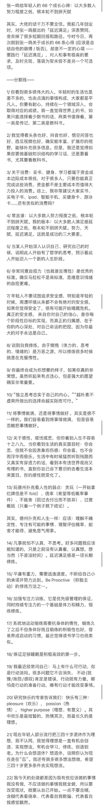
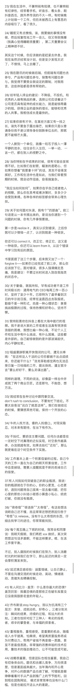
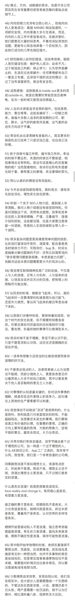

[网易云音乐播放器](https://music.163.com/outchain/player?type=2&id=484056998&auto=1&height=66)

## 周记 {#周记}

实际上已经很久没有写过周记了，上学期学业压力比较大，暑假又去广发实习了一个月，感觉生活总是很匆忙。这个学期课比较少，又有一些ZBH的PM这种课，所以逐渐松弛了下来，是时候静下来写点东西和自己对话了。

### 人 {#人}

社交范围越来越小了，近半年来几乎没有认识什么人(这里的认识是至少加了微信)，但是在人际关系上却不能说没有收获。自从暑假和秋科，郭老师他们一起去潮汕玩了之后，我和正平交流逐渐多了起来，如果说李佳琪是我交友的模版标准，正平就是让我在大学里第一次感觉到势均力敌的友谊。首先，他为人真诚，待人处事都颇为细心，也会照顾到别人的情绪。我和他的很多想法类似，甚至我开学想送他的一套书他刚好也看过，然后我向他推荐我看过的书他目前也在看hhhh。

> 女朋友还在来的路上。

### 事 {#事}

####  {#heading}

####  {#heading-1}

### 思 {#思}

努力修炼吧！

这几天(11.07)在学习BIT（树状数组）的时候偶然发现一个[博主](https://halfrost.com/)只能说牛大了，（急着上厕所，下次写）（回来了，但是想了想，几年后再写吧）

### 书 {#书}

### 影 {#影}

[(500) Days of Summer](https://movie.douban.com/subject/3072086/)
