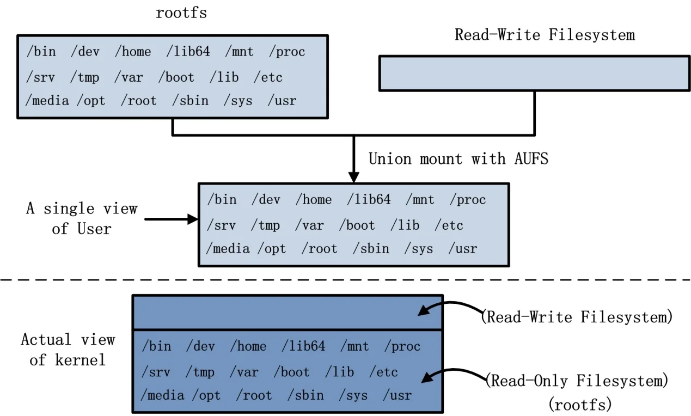

## 几个概念 {#几个概念}

### rootfs {#rootfs}

在linux的视角下，这是指第一个挂载的文件系统，这个文件系统是基于内存的，而且其包括了/Sbin /etc等重要目录,在挂载后其会将rootfs改成read-write模式

在docker的视角下所有的镜像最底层都是rootfs,但是挂载后不会将其改成read-write模式，而是在其上面在挂载一个文件系统

### union mount {#union-mount}

> Union mount：代表一种文件系统挂载的方式，允许同一时刻多种文件系统挂载在一起，并以一种文件系统的形式，呈现多种文件系统内容合并后的目录。

Union Mount 的实现方式可以有不同的方法，其中最常见的方式是使用联合文件系统（Union File System）。联合文件系统通过将多个文件系统的目录层次结构合并在一起，并按照一定的规则进行文件查找和访问。

在联合文件系统中，通常有一个顶层的读写文件系统（称为写入层），以及一个或多个只读文件系统（称为读取层）。写入层用于存储所有的写操作，而读取层则用于存储只读的文件和目录。

docker使用AUFS

其中COW技术也起到了很大的作用，比如用户需要修改/etc目录下的内容，docker不会直接修改rootfs下的内容，而是复制一份到read-write filesystem然后再修改

[介绍容器和镜像](https://www.cnblogs.com/koktlzz/p/14365025.html)
