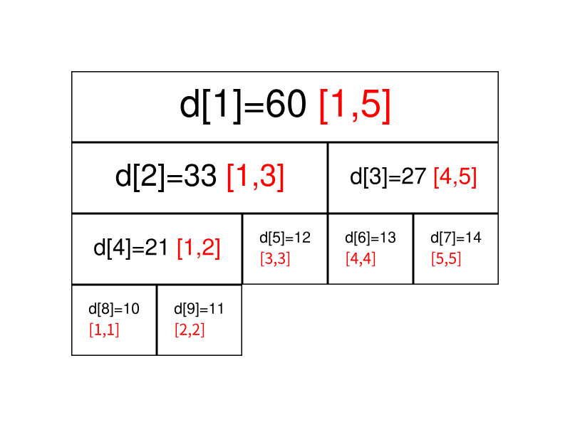
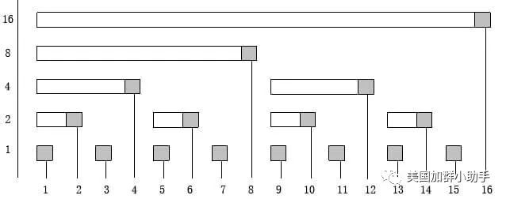
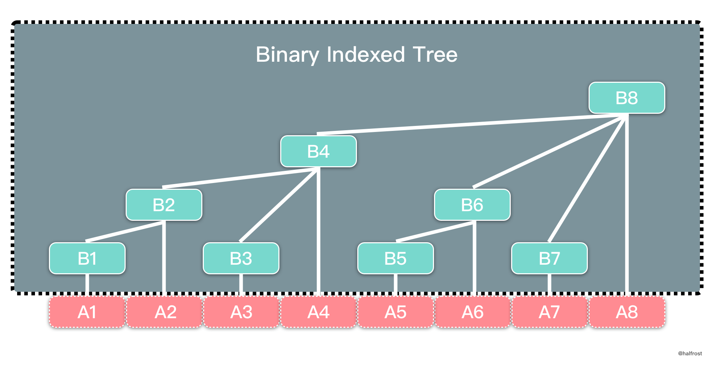

#### [2003. 每棵子树内缺失的最小基因值](https://leetcode.cn/problems/smallest-missing-genetic-value-in-each-subtree/description/?envType=daily-question&envId=2023-10-31) {#2003-每棵子树内缺失的最小基因值httpsleetcodecnproblemssmallest-missing-genetic-value-in-each-subtreedescriptionenvtypedaily-questionenvid2023-10-31}

这题只给了parent数组，不像以往的题目给了根节点，以及对应的树结构。所以首先就是要建树，后面才好后序遍历。

然后就是怎么保存子树信息，并结合到父节点上。这里用到了一个unordered_set，保存子树中出现的基因值，然后从2开始遍历，找到第一个不在子树中的基因值，就是当前节点的答案。

然后有意思的点在于，实际上只需要从基因值为1的节点开始向上遍历到根就可以了。

有点巧妙了

```c++
class Solution {
public:
    vector<int> smallestMissingValueSubtree(vector<int> &parents, vector<int> &nums) {
        int n = parents.size();
        vector<int> ans(n, 1);
        auto it = find(nums.begin(), nums.end(), 1);
        if (it == nums.end()) { // 不存在基因值为 1 的点
            return ans;
        }

        // 建树
        vector<vector<int>> g(n);
        for (int i = 1; i < n; i++) {
            g[parents[i]].push_back(i);
        }

        unordered_set<int> vis;
        function<void(int)> dfs = [&](int x) -> void {
            vis.insert(nums[x]); // 标记基因值
            for (int son: g[x]) {
                if (!vis.count(nums[son])) {
                    dfs(son);
                }
            }
        };

        int mex = 2; // 缺失的最小基因值
        int node = it - nums.begin();
        while (node >= 0) {
            dfs(node);
            while (vis.count(mex)) { // node 子树包含这个基因值
                mex++;
            }
            ans[node] = mex; // 缺失的最小基因值
            node = parents[node]; // 往上走
        }
        return ans;
    }
};

// 作者：灵茶山艾府
// 链接：https://leetcode.cn/problems/smallest-missing-genetic-value-in-each-subtree/
// 来源：力扣（LeetCode）
// 著作权归作者所有。商业转载请联系作者获得授权，非商业转载请注明出处。
```

#### [2926. 平衡子序列的最大和](https://leetcode.cn/problems/maximum-balanced-subsequence-sum/description/) {#2926-平衡子序列的最大和httpsleetcodecnproblemsmaximum-balanced-subsequence-sumdescription}

以前就听说过线段树的威名，这次终于见到了，打算做几道题彻底吃透。

##### 首先看点参考资料： {#首先看点参考资料}

1.  [硅谷面试经典算法之-线段树、树状数组](https://jogchat.com/shuati/%E7%A1%85%E8%B0%B7%E9%9D%A2%E8%AF%95%E7%BB%8F%E5%85%B8%E7%AE%97%E6%B3%95%E4%B9%8B-%E7%BA%BF%E6%AE%B5%E6%A0%91%E3%80%81%E6%A0%91%E7%8A%B6%E6%95%B0%E7%BB%84.php)

2.  [线段树](https://oi-wiki.org/ds/seg/) 

看到一个有趣的trick：

定义lowbit(x)为x的二进制表达式中最右边的1所对应的值。

比如，1234的二进制是0100 1101 0010 lowbit(1234)=2，在程序的实现中，

Lowbit(x)=x&-x;（为什么这样写呢？因为计算机内部采用补码表示，-x是x按位取反，尾数+1的结果）

这和计算一个数中1的个数有异曲同工之妙！！！(赞)

##### 建立 {#建立}

代码：

###### 大致建立（递归） {#大致建立递归}

```c++
class Solution {
public:
    /**
     *@param start, end: Denote an segment / interval
     *@return: The root of Segment Tree
     */
    SegmentTreeNode * build(int start, int end) {
        if (start > end) return NULL;
        SegmentTreeNode *node = new SegmentTreeNode(start, end);
        if (start < end) {
            node->left = build(start, (start + end) / 2);
            node->right = build((start + end) / 2 + 1, end);
        }
        return node;
    }
};
```

###### 例题 {#例题}

> Range Sum Query - Mutable

> Given an integer array nums, find the sum of the elements between indices i and j (i ≤ j), inclusive.

> The update(i, val) function modifies nums by updating the element at index i to val.

> Example:

> Given nums = \[1, 3, 5\]

> sumRange(0, 2) -\> 9 update(1, 2) sumRange(0, 2) -\> 8

线段树代码

```java
public class NumArray {
    private class SegmentTreeNode {
        public int start;
        public int end;
        public int sum;
        public SegmentTreeNode left, right;
        public SegmentTreeNode(int start, int end) {
            this.start = start;
            this.end = end;
            this.sum = 0;
        }
    }

    private SegmentTreeNode root;

    public NumArray(int[] nums) {
        this.root = buildTree(nums, 0, nums.length - 1);    
    }

    public void update(int i, int val) {
        update(root, i, val);
    }

    private void update(SegmentTreeNode node, int position, int val) {
        if(node.start == position && node.end == position) {
            node.sum = val;
            return;
        }
        int mid = node.start + (node.end - node.start) / 2;
        if(position <= mid) {
            update(node.left, position, val);
        } else {
            update(node.right, position, val);
        }
        node.sum = node.left.sum + node.right.sum;
    }

    public int sumRange(int i, int j) {
        return sumRange(root, i, j);
    }

    private int sumRange(SegmentTreeNode node, int lo, int hi) {
        if(node.start == lo && node.end == hi) {
            return node.sum;
        }
        int mid = node.start + (node.end - node.start) / 2;
        if(hi <= mid) {
            return sumRange(node.left, lo, hi);
        } else if (lo > mid) {
            return sumRange(node.right, lo, hi);
        } else {
            return sumRange(node.left, lo, mid) + sumRange(node.right, mid + 1, hi);
        }
    }

    private SegmentTreeNode buildTree(int[] nums, int lo, int hi) {
        if(lo > hi) {
            return null;
        } else {
            SegmentTreeNode node = new SegmentTreeNode(lo, hi);
            if(lo == hi) {
                node.sum = nums[lo];
            } else {
                int mid = lo + (hi - lo) / 2;
                node.left = buildTree(nums, lo, mid);
                node.right = buildTree(nums, mid + 1, hi);
                node.sum = node.left.sum + node.right.sum;
            }
            return node;
        }
    }
}

// Your NumArray object will be instantiated and called as such:
// NumArray numArray = new NumArray(nums);
// numArray.sumRange(0, 1);
// numArray.update(1, 10);
// numArray.sumRange(1, 2);
```

然而实际上，由于值域一般都很大，所以需要动态开点的技术。

```java
/**
 * @Description: 线段树（动态开点）
 * @Author: LFool
 * @Date 2022/6/7 09:15
 **/
public class SegmentTreeDynamic {
    class Node {
        Node left, right;
        int val, add;
    }
    private int N = (int) 1e9;
    private Node root = new Node();
    public void update(Node node, int start, int end, int l, int r, int val) {
        if (l <= start && end <= r) {
            node.val += (end - start + 1) * val;
            node.add += val;
            return ;
        }
        int mid = (start + end) >> 1;
        pushDown(node, mid - start + 1, end - mid);
        if (l <= mid) update(node.left, start, mid, l, r, val);
        if (r > mid) update(node.right, mid + 1, end, l, r, val);
        pushUp(node);
    }
    public int query(Node node, int start, int end, int l, int r) {
        if (l <= start && end <= r) return node.val;
        int mid = (start + end) >> 1, ans = 0;
        pushDown(node, mid - start + 1, end - mid);
        if (l <= mid) ans += query(node.left, start, mid, l, r);
        if (r > mid) ans += query(node.right, mid + 1, end, l, r);
        return ans;
    }
    private void pushUp(Node node) {
        node.val = node.left.val + node.right.val;
    }
    private void pushDown(Node node, int leftNum, int rightNum) {
        if (node.left == null) node.left = new Node();
        if (node.right == null) node.right = new Node();
        if (node.add == 0) return ;
        node.left.val += node.add * leftNum;
        node.right.val += node.add * rightNum;
        // 对区间进行「加减」的更新操作，下推懒惰标记时需要累加起来，不能直接覆盖
        node.left.add += node.add;
        node.right.add += node.add;
        node.add = 0;
    }
}

// 作者：LFool⚡
// 链接：https://leetcode.cn/problems/range-module/
// 来源：力扣（LeetCode）
// 著作权归作者所有。商业转载请联系作者获得授权，非商业转载请注明出处。
```

特别的，c++里面new操作比较重，所以一般会有一个这个板子来管理内存

```c++

//arraylist 以SIZE为周期分配内存，delete的内存也可以被回收有点牛的
template <class T>
class CachedObj {
public:
    void* operator new(size_t s) {
        if (!head) {
            T* a = new T[SIZE];
            for (size_t i = 0; i < SIZE; ++i)
                add(a + i);
        }
        T* p = head;
        head = head->CachedObj<T>::next;
        return p;
    }
    void operator delete(void* p, size_t) {
        if (p) add(static_cast<T*>(p));
    }
    virtual ~CachedObj() {}

protected:
    T* next;

private:
    static T* head;
    static const size_t SIZE;
    static void add(T* p) {
        p->CachedObj<T>::next = head;
        head = p;
    }
};
template <class T>
T* CachedObj<T>::head = 0;
template <class T>
const size_t CachedObj<T>::SIZE = 10000;
class Node : public CachedObj<Node> {
public:
    Node* left;
    Node* right;
    int add;
    bool v;
};
```

##### 例题 {#例题-1}

[线段树例题](https://leetcode.cn/problems/range-module/solutions/1612955/by-lfool-eo50/?envType=daily-question&envId=2023-11-12)

##### BIT 树状数组 Binary Indexed Tree {#bit-树状数组-binary-indexed-tree}

###### 引入 {#引入}

利用数组实现前缀和，查询本来是 O(1)，但是对于频繁更新的数组，每次重新计算前缀和，时间复杂度 O(n)。此时树状数组的优势便立即显现。

 

例如上图中 A 和 B 都是数组。A 数组正常存储数据，B 数组是树状数组。

1.  节点意义

在树状数组中，所有的奇数下标的节点的含义是叶子节点，表示单点，它存的值是原数组相同下标存的值。例如上图中 B1，B3，B5，B7 分别存的值是 A1，A3，A5，A7。所有的偶数下标的节点均是父节点。父节点内存的是区间和。例如 B4 内存的是 B1 + B2 + B3 + A4 = A1 + A2 + A3 + A4。这个区间的左边界是该父节点最左边叶子节点对应的下标，右边界就是自己的下标。例如 B8 表示的区间左边界是 B1，右边界是 B8，所以它表示的区间和是 A1 + A2 + …… + A8。

2.  代码

**全是字字珠玑**

x如果为左子结点，则父结点的编号是x+lowbit(x)，

x如果为右子结点，则父结点的编号是x-lowbit(x)

Time Complexity - O(nlogn) build， O(logn) update， O(logn) rangeSum， Space Complexity - O(n)

很 有意思的构建，以数组nums = {1, 2, 3, 4, 5, 6, 7, 8}为例，这个数组长度为8。 跟dynamic programming的预处理很像，我们先建立一个长度为nums.length + 1 = 9的数组BIT。接下来遍历数组nums，对BIT数组进行update(i + 1, nums\[i\])。这里BIT数组每个值BIT\[i\]代表nums数组里在i之前的部分元素和。原理是像自然数可以被表示为2n的和一样，把nums数组 里到0到i的sum表示成2n的和，从而导致update和rangeSum都可以用O(logn)的时间求出来。这里构建的时候可以有几种写法，主要就 是利用当前i的least significante 1来确定到底BIT\[i\]要保存多少原数组的值。这里借用algorithmist的原话”Every index in the cumulative sum array, say i, is responsible for the cumulative sum from the index i to (i - (1«r) + 1)。” 构建过程中可以用 (i & -i)来找到least significate 1，之后来进行i = i + (i & -i)来尝试从小到大计算下一个BIT数组中被影响的元素。 而rangeSum的时候则使用i = i - (i & -i)来从大到小查找从0到i - 1的sum。

```java
public class NumArray {
    private int BIT[];               // Binary Indexed Tree = Fenwick Tree
    private int[] nums;

    public NumArray(int[] nums) {
        BIT = new int[nums.length + 1];
        for(int i = 0; i < nums.length; i++) {
            init(i + 1, nums[i]);
        }
        this.nums = nums;
    }

    private void init(int i, int val) {
        while(i < BIT.length) {
            BIT[i] += val;
            i = i + (i & -i);
        }
    }

    public void update(int i, int val) {
        int delta = val - nums[i];
        nums[i] = val;
        init(i + 1, delta);
    }

    public int sumRange(int i, int j) {
        return getSum(j + 1) - getSum(i);
    }

    private int getSum(int i) {
        int sum = 0;
        while(i > 0) {
            sum += BIT[i];
            i = i - (i & -i);
        }
        return sum;
    }
}
```

###### 参考 {#参考}

1.  [聊聊树状数组 Binary Indexed Tree](https://halfrost.com/binary_indexed_tree/)

##### 回到这个题 {#回到这个题}

```c++
// 树状数组模板（维护前缀最大值）
class BIT {
    vector<long long> tree;
public:
    BIT(int n) : tree(n, LLONG_MIN) {}

    void update(int i, long long val) {
        while (i < tree.size()) {
            tree[i] = max(tree[i], val);
            i += i & -i;
        }
    }

    long long pre_max(int i) {
        long long res = LLONG_MIN;
        while (i > 0) {
            res = max(res, tree[i]);
            i &= i - 1;
        }
        return res;
    }
};

class Solution {
public:
    long long maxBalancedSubsequenceSum(vector<int> &nums) {
        int n = nums.size();
        // 离散化 nums[i]-i
        auto b = nums;
        for (int i = 0; i < n; i++) {
            b[i] -= i;
        }
        sort(b.begin(), b.end());
        b.erase(unique(b.begin(), b.end()), b.end()); // 去重

        BIT t = BIT(b.size() + 1);
        for (int i = 0; i < n; i++) {
            // j 为 nums[i]-i 离散化后的值（从 1 开始）
            int j = lower_bound(b.begin(), b.end(), nums[i] - i) - b.begin() + 1;
            long long f = max(t.pre_max(j), 0LL) + nums[i];
            t.update(j, f);
        }
        return t.pre_max(b.size());
    }
};
```

他其实是用dp的思想，但是用树状数组来维护前缀最大值，这样就可以在O(logn)的时间内求出前缀最大值，而不用每次都遍历一遍。

这个思路其实和逆序对差不多（逆序对也是BIT的经典题目，通过逆序来找小一个数的前缀和，就能找到比目前这个数小的数目[可以看这个](https://www.cnblogs.com/COLIN-LIGHTNING/p/8621294.html)）

这题的话通过正序dp来累积最大值，每次在状态转移的时候可以在logn时间找到前面的最大值来更新现在的。

还要学一下这个离散化的写法，复制-\>排序-\>去重。然后用下标来表示原来的值。

只能说太亏贼了

##### 差分数组 {#差分数组}

上面的两个都是单点更新，区间查询。但是有时候我们需要区间更新，单点查询。这时候就需要差分数组了。

其实原理很简单，更新的区间就是在开始和结尾记录一下，然后查单点的话就是一次遍历就能获取所有点的值。

这个也常要用到离散化，可以用map记录index，val，然后把index存到一个slice，然后排序。查询的时候查比要查的id小的sum就可以。

#### LRU和LFU {#lru和lfu}

其实这两个之前都写过

LRU：双向列表加map

LFU：两个map加多个双向列表

但是还是看看这个：[究极顶级的LRU&LFU](https://halfrost.com/lru_lfu_interview/)

#### Floyd {#floyd}

floyd算法用于计算图中两点之间的最短路径

核心思想就dp

```sh
dfs(k,i,j)=min(dfs(k−1,i,j),dfs(k−1,i,k)+dfs(k−1,k,j))
```

#### 分组循环 {#分组循环}

每日一题遇到的[2760. 最长奇偶子数组](https://leetcode.cn/problems/longest-even-odd-subarray-with-threshold/description/?envType=daily-question&envId=2023-11-16)

我的代码：

```c++
class Solution {
public:
    int longestAlternatingSubarray(vector<int>& nums, int threshold) {
        int l =0;
        int r= 0;
        int res=0;
        while(true){
            while(l<nums.size()){
                if(nums[l]%2==0&&nums[l]<=threshold){
                    break;
                }else{
                    l++;
                }
            }
            if(l>=nums.size()) break;
            r=l;
            while(r+1<nums.size()){
                if(nums[r+1]%2!=nums[r]%2&&nums[r+1]<=threshold){
                    r++;
                }else{
                    break;
                }
            }
            
            res = max(res,r-l+1);
            l=r+1;
            if(r>=nums.size()-1){
                break;
            }
        }
        return res;
    }
};
```

优雅的代码：

```c++
class Solution {
public:
    int longestAlternatingSubarray(vector<int> &nums, int threshold) {
        int n = nums.size();
        int ans = 0, i = 0;
        while (i < n) {
            if (nums[i] > threshold || nums[i] % 2) {
                i++; // 直接跳过
                continue;
            }
            int start = i; // 记录这一组的开始位置
            i++; // 开始位置已经满足要求，从下一个位置开始判断
            while (i < n && nums[i] <= threshold && nums[i] % 2 != nums[i - 1] % 2) {
                i++;
            }
            // 从 start 到 i-1 是满足题目要求的子数组
            ans = max(ans, i - start);
        }
        return ans; 
    }
};

作者：灵茶山艾府
链接：https://leetcode.cn/problems/longest-even-odd-subarray-with-threshold/
来源：力扣（LeetCode）
著作权归作者所有。商业转载请联系作者获得授权，非商业转载请注明出处。
```

模板：

```c++
n = len(nums)
i = 0
while i < n:
    start = i
    while i < n and ...:
        i += 1
    # 从 start 到 i-1 是一组
    # 下一组从 i 开始，无需 i += 1

作者：灵茶山艾府
链接：https://leetcode.cn/problems/longest-even-odd-subarray-with-threshold/
来源：力扣（LeetCode）
著作权归作者所有。商业转载请联系作者获得授权，非商业转载请注明出处。
```

#### [689. 三个无重叠子数组的最大和](https://leetcode.cn/problems/maximum-sum-of-3-non-overlapping-subarrays/description/?envType=daily-question&envId=2023-11-19) {#689-三个无重叠子数组的最大和httpsleetcodecnproblemsmaximum-sum-of-3-non-overlapping-subarraysdescriptionenvtypedaily-questionenvid2023-11-19}

算最大和其实很简单，但是推算位置还是没见过的。其实说难也不难，就是通过dp最大值往后倒推，看这个值是前面那个值推过来的。如果说字典序的话，就是看dp的顺序。
