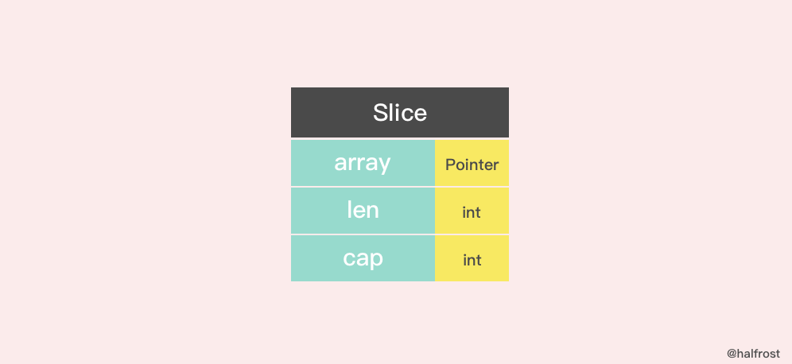
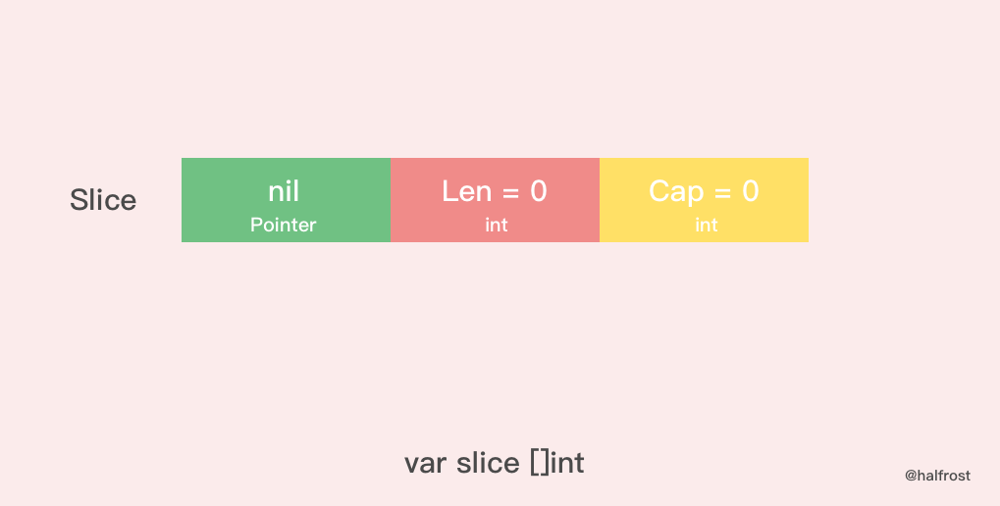
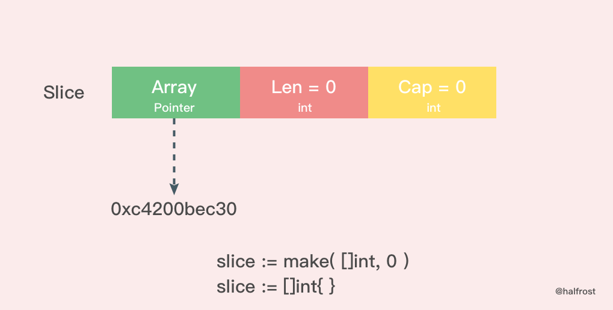

# 记录golang中的底层数据结构 {#记录golang中的底层数据结构}

## slice {#slice}

基础的东西比如len，cap，ptr这些东西就不说了 

### 从slice中获取内存地址和从内存中构造slice {#从slice中获取内存地址和从内存中构造slice}

#### 从slice中获取内存地址 {#从slice中获取内存地址}

```go
s := make([]byte, 200)
ptr := unsafe.Pointer(&s[0])
```

#### 从内存中构造slice {#从内存中构造slice}

```go
var ptr unsafe.Pointer
var s1 = struct {
    addr uintptr
    len int
    cap int
}{ptr, length, length}
s := *(*[]byte)(unsafe.Pointer(&s1))
```

或者使用go的反射包中的SliceHeader

```go
var o []byte
sliceHeader := (*reflect.SliceHeader)((unsafe.Pointer(&o)))
sliceHeader.Cap = length
sliceHeader.Len = length
sliceHeader.Data = uintptr(ptr)
```

> BTW 为了看懂上面的代码我还去学了下unsafe包(还是蛮简单的)

值得注意的是reflect.SliceHeader已经被弃用了，下面是go的官方解释

> SliceHeader is the runtime representation of a slice. It cannot be used safely or portably and its representation may change in a later release. Moreover, the Data field is not sufficient to guarantee the data it references will not be garbage collected, so programs must keep a separate, correctly typed pointer to the underlying data.

其实就是uintptr是不能保证数据不被GC掉，然后SliceHeader已经被移到unsafe里面去了。

### 空切片和nil切片的区别 {#空切片和nil切片的区别}

空切片 

nil切片 

一个是指向一个空的数组，一个是指向nil

Go 中切片扩容的策略是这样的：

- 首先判断，如果新申请容量（cap）大于2倍的旧容量（old.cap），最终容量（newcap）就是新申请的容量（cap）
- 否则判断，如果旧切片的长度小于1024，则最终容量(newcap)就是旧容量(old.cap)的两倍，即（newcap=doublecap）
- 否则判断，如果旧切片长度大于等于1024，则最终容量（newcap）从旧容量（old.cap）开始循环增加原来的 1/4，即（newcap=old.cap,for {newcap += newcap/4}）直到最终容量（newcap）大于等于新申请的容量(cap)，即（newcap \>= cap）
- 如果最终容量（cap）计算值溢出，则最终容量（cap）就是新申请容量（cap）

## map {#map}

比较复杂，见另一篇文章。

### 参考 {#参考}

1.  [Go 为什么不在语言层面支持 map 并发？](https://eddycjy.com/posts/go/map-con/)

## sync.map {#syncmap}

为了并发的map而被设计出来，在两种情况下他的性能是最好的

1.  when the entry for a given key is only ever written once but read many times, as in caches that only grow.
2.  when multiple goroutines read, write, and overwrite entries for disjoint sets of keys.

同时定义了两大类操作：

1.  Load, LoadAndDelete, LoadOrStore, Swap, CompareAndSwap, and CompareAndDelete are read operations;
2.  Delete, LoadAndDelete, Store, and Swap are write operations;

而且**LoadOrStore is a write operation when it returns loaded set to false; CompareAndSwap is a write operation when it returns swapped set to true; and CompareAndDelete is a write operation when it returns deleted set to true.**

在go的内存模型中*Map arranges that a write operation “synchronizes before” any read operation that observes the effect of the write*

```go
//即使old设成nil也不能判断空的是删除成功，所以返回true的语义很强（本身存在key，并且和old一样）
//CompareAndDelete deletes the entry for key if its value is equal to old. The old value must be of a comparable type.
//If there is no current value for key in the map, CompareAndDelete returns false (even if the old value is the nil interface value).
func (m *Map) CompareAndDelete(key, old any) (deleted bool)

//nil是不可比较的，所以同样不可以把 old设成nil
//CompareAndSwap swaps the old and new values for key if the value stored in the map is equal to old. The old value must be of a comparable type.
func (m *Map) CompareAndSwap(key, old, new any) bool

//无法从返回值中得到信息
func (m *Map) Delete(key any)

//这个倒是和普通map挺像的
//Load returns the value stored in the map for a key, or nil if no value is present. The ok result indicates whether value was found in the map.
func (m *Map) Load(key any) (value any, ok bool)

//本来在单线程的话是可以分两个操作的，但是在并发场景下就只能合在一起形成新的primitive
//LoadAndDelete deletes the value for a key, returning the previous value if any. The loaded result reports whether the key was present.
func (m *Map) LoadAndDelete(key any) (value any, loaded bool)

//和上面差不多
//LoadOrStore returns the existing value for the key if present. Otherwise, it stores and returns the given value. The loaded result is true if the value was loaded, false if stored.
func (m *Map) LoadOrStore(key, value any) (actual any, loaded bool)

//遍历的方式，可以在其中删除map中的元素
func (m *Map) Range(f func(key, value any) bool)

//常规
func (m *Map) Store(key, value any)

//
func (m *Map) Swap(key, value any) (previous any, loaded bool)
```

## channel {#channel}

### 数据结构 {#数据结构}

### 参考 {#参考-1}

1.  [go channel视频](https://www.bilibili.com/video/BV1uv4y187p6/?spm_id_from=333.337.search-card.all.click&vd_source=7d9aad84add3e8bea9beb1d04c53f57e)
