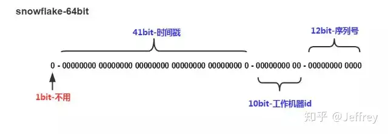

# 雪花算法 {#雪花算法}



1.第一位 占用1bit，其值始终是0，没有实际作用。 2.时间戳 占用41bit，精确到毫秒，总共可以容纳约69年的时间。 3.工作机器id 占用10bit，其中高位5bit是数据中心ID，低位5bit是工作节点ID，做多可以容纳1024个节点。 4.序列号 占用12bit，每个节点每毫秒0开始不断累加，最多可以累加到4095，一共可以产生4096个ID。

> SnowFlake算法在同一毫秒内最多可以生成多少个全局唯一ID呢：： 同一毫秒的ID数量 = 1024 X 4096 = 4194304

## 这里的代码实现是基于osproxy的 {#这里的代码实现是基于osproxy的}

### 变量和类型 {#变量和类型}

```go
var (
	snowFlake *Snowflake
	once      sync.Once
)

const (
	twepoch            = int64(1417937700000) // Unix纪元时间戳
	workerIdBits       = uint(5)              // 机器ID所占位数
	datacenterBits     = uint(5)              // 数据中心ID所占位数
	maxWorkerId        = int64(-1) ^ (int64(-1) << workerIdBits)
	maxDatacenterId    = int64(-1) ^ (int64(-1) << datacenterBits)
	sequenceBits       = uint(12) // 序列号所占位数
	workerIdShift      = sequenceBits
	datacenterIdShift  = sequenceBits + workerIdBits
	timestampLeftShift = sequenceBits + workerIdBits + datacenterBits
	sequenceMask       = int64(-1) ^ (int64(-1) << sequenceBits)
)

type Snowflake struct {
	mu            sync.Mutex
	lastTimestamp int64
	workerId      int64
	datacenterId  int64
	sequence      int64
}
```

### 初始化 {#初始化}

```go
func InitSnowFlake() {
    //这里只有一个数据中心
    //使用ip来标识每台机器，可能可以根据mac地址来表示，然后通过网关ip来标识数据中心
	// get local ip
	ip, err := GetOutBoundIP()
	if err != nil {
		panic(err)
	}

	// get workId from redis
	var workId int64
	ctx := context.Background()
	lgRedis := new(plugins.LangGoRedis).NewRedis()

	ipExist := lgRedis.Exists(ctx, ip).Val()
	if ipExist == 1 {
		curWorkId, err := lgRedis.Get(ctx, ip).Result()
		if err != nil {
			panic(err)
		}
		workId, err = strconv.ParseInt(curWorkId, 10, 64)
		if err != nil {
			panic(err)
		}
	} else {
        //在redis中存{ip:workerID}
        //而且记录workerID的key是一个自增的值
		newWorkId, err := lgRedis.Incr(ctx, utils.WorkID).Result()
		if err != nil {
			panic(err)
		}
		lgRedis.Set(ctx, ip, newWorkId, -1)
		workId = newWorkId
	}
	once.Do(func() {
		res, err := newSnowFlake(workId, 0)
		if err != nil {
			panic(err)
		}
		snowFlake = res
	})
}

func newSnowFlake(workerId, datacenterId int64) (*Snowflake, error) {
	if workerId < 0 || workerId > maxWorkerId {
		return nil, errors.New("worker id out of range")
	}
	if datacenterId < 0 || datacenterId > maxDatacenterId {
		return nil, errors.New("datacenter id out of range")
	}
	return &Snowflake{
		lastTimestamp: 0,
		workerId:      workerId,
		datacenterId:  datacenterId,
		sequence:      0,
	}, nil
}
```

### 生成 {#生成}

```go
// NextId .
func (sf *Snowflake) NextId() (int64, error) {
	sf.mu.Lock()
	defer sf.mu.Unlock()
    //毫秒级
	timestamp := time.Now().UnixNano() / 1000000
    //时钟回拨，在用雪花算法的id作为递增主键的时候是一个严重的错误
	if timestamp < sf.lastTimestamp {
		return 0, errors.New("clock moved backwards")
	}
    //同一时间就用sequence来区分
	if timestamp == sf.lastTimestamp {
		sf.sequence = (sf.sequence + 1) & sequenceMask
        //如果sequence用完了，就等待下一毫秒
		if sf.sequence == 0 {
			// 时钟回拨
			for timestamp <= sf.lastTimestamp {
				timestamp = time.Now().UnixNano() / 1000000
			}
		}
	} else {
		sf.sequence = 0
	}

	sf.lastTimestamp = timestamp
    //拼接
	// 相当于
	id := ((timestamp - twepoch) << timestampLeftShift) | (sf.datacenterId << datacenterIdShift) | (sf.workerId << workerIdShift) | sf.sequence

	return id, nil
}
```

### 总结 {#总结}

实现得还是很精巧的，而且在初始化其实也有合理的入参，配合redis的自增来实现全局唯一id。

## 参考 {#参考}

[osproxy](https://github.com/qinguoyi/osproxy#%E5%A6%82%E4%BD%95%E6%8E%A5%E5%85%A5osproxy)
