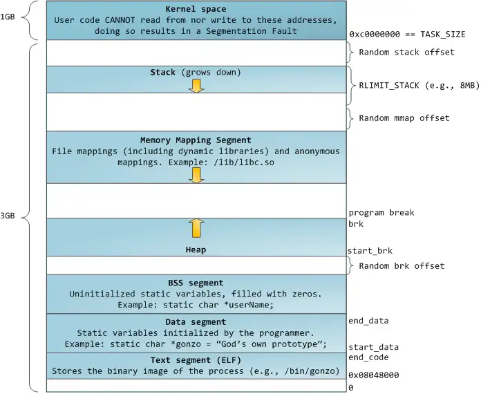
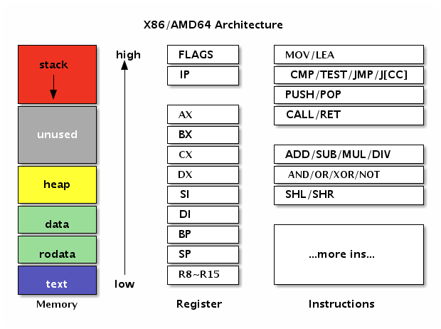
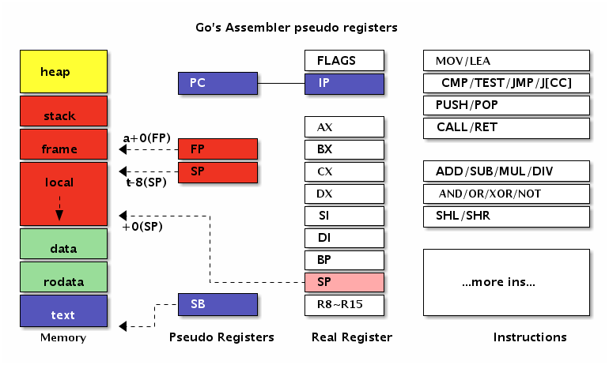

# plan9 {#plan9}

本文记录plan9汇编的学习过程，sorry全是抄的，只能说抄一遍印象深一点而且好复盘。

 

## 基本指令 {#基本指令}

### 栈调整 {#栈调整}

```assembly
SUBQ $0x18, SP // 对 SP 做减法，为函数分配函数栈帧
...               // 省略无用代码
ADDQ $0x18, SP // 对 SP 做加法，清除函数栈帧
```

### 数据 {#数据}

常数在 plan9 汇编用 \$num 表示，可以为负数，默认情况下为十进制。可以用 \$0x123 的形式来表示十六进制数。

```assembly
MOVB $1, DI      // 1 byte
MOVW $0x10, BX   // 2 bytes
MOVD $1, DX      // 4 bytes
MOVQ $-10, AX     // 8 bytes
```

搬运的长度是由 MOV 的后缀决定

### 条件跳转/无条件跳转 {#条件跳转无条件跳转}

```assembly
// 无条件跳转
JMP addr   // 跳转到地址，地址可为代码中的地址，不过实际上手写不会出现这种东西
JMP label  // 跳转到标签，可以跳转到同一函数内的标签位置
JMP 2(PC)  // 以当前指令为基础，向前/后跳转 x 行
JMP -2(PC) // 同上

// 有条件跳转
JNZ target // 如果 zero flag 被 set 过，则跳转
```

### 寄存器 {#寄存器}

IA64 rax rbx rcx rdx rdi rsi rbp rsp r8 r9 r10 r11 r12 r13 r14 rip

Plan9 AX BX CX DX DI SI BP SP R8 R9 R10 R11 R12 R13 R14 PC

在 plan9 汇编里都是可以使用的，应用代码层面会用到的通用寄存器主要是: rax, rbx, rcx, rdx, rdi, rsi, r8\~r15 这 14 个寄存器，虽然 rbp 和 rsp 也可以用，不过 bp 和 sp 会被用来管理栈顶和栈底，最好不要拿来进行运算。

### 伪寄存器 {#伪寄存器}

> - FP: Frame pointer: arguments and locals.
> - PC: Program counter: jumps and branches.
> - SB: Static base pointer: global symbols.
> - SP: Stack pointer: top of stack.

- FP: 使用形如 symbol+offset(FP) 的方式，引用函数的输入参数。例如 arg0+0(FP)，arg1+8(FP)，使用 FP 不加 symbol 时，无法通过编译，在汇编层面来讲，symbol 并没有什么用，加 symbol 主要是为了提升代码可读性。另外，官方文档虽然将伪寄存器 FP 称之为 frame pointer，实际上它根本不是 frame pointer，按照传统的 x86 的习惯来讲，frame pointer 是指向整个 stack frame 底部的 BP 寄存器。假如当前的 callee 函数是 add，在 add 的代码中引用 FP，该 FP 指向的位置不在 callee 的 stack frame 之内，而是在 caller 的 stack frame 上。具体可参见之后的 栈结构 一章。
- PC: 实际上就是在体系结构的知识中常见的 pc 寄存器，在 x86 平台下对应 ip 寄存器，amd64 上则是 rip。除了个别跳转之外，手写 plan9 代码与 PC 寄存器打交道的情况较少。
- SB: 全局静态基指针，一般用来声明函数或全局变量，在之后的函数知识和示例部分会看到具体用法。
- SP: plan9 的这个 SP 寄存器指向当前栈帧的局部变量的开始位置，使用形如 symbol+offset(SP) 的方式，引用函数的局部变量。offset 的合法取值是 \[-framesize, 0)，注意是个左闭右开的区间。假如局部变量都是 8 字节，那么第一个局部变量就可以用 localvar0-8(SP) 来表示。这也是一个词不表意的寄存器。与硬件寄存器 SP 是两个不同的东西，在栈帧 size 为 0 的情况下，伪寄存器 SP 和硬件寄存器 SP 指向同一位置。手写汇编代码时，如果是 symbol+offset(SP) 形式，则表示伪寄存器 SP。如果是 offset(SP) 则表示硬件寄存器 SP。务必注意。对于编译输出(go tool compile -S / go tool objdump)的代码来讲，目前所有的 SP 都是硬件寄存器 SP，无论是否带 symbol。

### 变量声明 {#变量声明}

在汇编里所谓的变量，一般是存储在 .rodata 或者 .data 段中的只读值。对应到应用层的话，就是已初始化过的全局的 const、var、static 变量/常量。

使用 DATA 结合 GLOBL 来定义一个变量。DATA 的用法为:

DATA symbol+offset(SB)/width, value

使用 GLOBL 指令将变量声明为 global，额外接收两个参数，一个是 flag，另一个是变量的总大小。

GLOBL divtab(SB), RODATA, \$64

GLOBL 必须跟在 DATA 指令之后，下面是一个定义了多个 readonly 的全局变量的完整例子:

```sh
DATA age+0x00(SB)/4, $18  // forever 18
GLOBL age(SB), RODATA, $4

DATA pi+0(SB)/8, $3.1415926
GLOBL pi(SB), RODATA, $8

DATA birthYear+0(SB)/4, $1988
GLOBL birthYear(SB), RODATA, $4
```

有时也可能会想在全局变量中定义数组，或字符串，这时候就需要用上非 0 的 offset 了，例如:

```sh
DATA bio<>+0(SB)/8, $"oh yes i"
DATA bio<>+8(SB)/8, $"am here "
GLOBL bio<>(SB), RODATA, $16
```

大部分都比较好理解，不过这里我们又引入了新的标记 \<\>，这个跟在符号名之后，表示该全局变量只在当前文件中生效，类似于 C 语言中的 static。如果在另外文件中引用该变量的话，会报 relocation target not found 的错误。

flag的其他取值

> NOPROF = 1 (For TEXT items.) Don’t profile the marked function. This flag is deprecated.

> DUPOK = 2 It is legal to have multiple instances of this symbol in a single binary. The linker will choose one of the duplicates to use.

> NOSPLIT = 4 (For TEXT items.) Don’t insert the preamble to check if the stack must be split. The frame for the routine, plus anything it calls, must fit in the spare space at the top of the stack segment. Used to protect routines such as the stack splitting code itself.

> RODATA = 8 (For DATA and GLOBL items.) Put this data in a read-only section.

> NOPTR = 16 (For DATA and GLOBL items.) This data contains no pointers and therefore does not need to be scanned by the garbage collector.

> WRAPPER = 32 (For TEXT items.) This is a wrapper function and should not count as disabling recover.

> NEEDCTXT = 64 (For TEXT items.) This function is a closure so it uses its incoming context register.

### 函数声明 {#函数声明}

```
// func add(a, b int) int
//   => 该声明定义在同一个 package 下的任意 .go 文件中
//   => 只有函数头，没有实现
TEXT pkgname·add(SB), NOSPLIT, $0-8
    MOVQ a+0(FP), AX
    MOVQ a+8(FP), BX
    ADDQ AX, BX
    MOVQ BX, ret+16(FP)
    RET
```

```

                              参数及返回值大小
                                  | 
 TEXT pkgname·add(SB),NOSPLIT,$32-32
       |        |               |
      包名     函数名         栈帧大小(局部变量+可能需要的额外调用函数的参数空间的总大小，但不包括调用其它函数时的 ret address 的大小)
```

为什么要叫 TEXT ？如果对程序数据在文件中和内存中的分段稍有了解的同学应该知道，我们的代码在二进制文件中，是存储在 .text 段中的，这里也就是一种约定俗成的起名方式。实际上在 plan9 中 TEXT 是一个指令，用来定义一个函数。除了 TEXT 之外还有前面变量声明说到的 DATA/GLOBL。

### 栈结构 {#栈结构}



在 AMD64 环境，伪 PC 寄存器其实是 IP 指令计数器寄存器的别名。伪 FP 寄存器对应的是函数的帧指针，一般用来访问函数的参数和返回值。伪 SP 栈指针对应的是当前函数栈帧的底部（不包括参数和返回值部分），一般用于定位局部变量。伪 SP 是一个比较特殊的寄存器，因为还存在一个同名的 SP 真寄存器。真 SP 寄存器对应的是栈的顶部，一般用于定位调用其它函数的参数和返回值。

当需要区分伪寄存器和真寄存器的时候只需要记住一点：伪寄存器一般需要一个标识符和偏移量为前缀，如果没有标识符前缀则是真寄存器。比如 (SP)、+8(SP) 没有标识符前缀为真 SP 寄存器，而 a(SP)、b+8(SP) 有标识符为前缀表示伪寄存器。

```sh
                                                                                   
                       -----------------                                           
                       current func arg0                                           
                       ----------------- <----------- FP(pseudo FP)                
                        caller ret addr                                            
                       +---------------+                                           
                       | caller BP(*)  |                                           
                       ----------------- <----------- SP(pseudo SP，实际上是当前栈帧的 BP 位置)
                       |   Local Var0  |                                           
                       -----------------                                           
                       |   Local Var1  |                                           
                       -----------------                                           
                       |   Local Var2  |                                           
                       -----------------                -                          
                       |   ........    |                                           
                       -----------------                                           
                       |   Local VarN  |                                           
                       -----------------                                           
                       |               |                                           
                       |               |                                           
                       |  temporarily  |                                           
                       |  unused space |                                           
                       |               |                                           
                       |               |                                           
                       -----------------                                           
                       |  call retn    |                                           
                       -----------------                                           
                       |  call ret(n-1)|                                           
                       -----------------                                           
                       |  ..........   |                                           
                       -----------------                                           
                       |  call ret1    |                                           
                       -----------------                                           
                       |  call argn    |                                           
                       -----------------                                           
                       |   .....       |                                           
                       -----------------                                           
                       |  call arg3    |                                           
                       -----------------                                           
                       |  call arg2    |                                           
                       |---------------|                                           
                       |  call arg1    |                                           
                       -----------------   <------------  hardware SP 位置           
                       | return addr   |                                           
                       +---------------+                                           
                                                                                   
```

```sh
                                                                                                                              
                                       caller                                                                                 
                                 +------------------+                                                                         
                                 |                  |                                                                         
       +---------------------->  --------------------                                                                         
       |                         |                  |                                                                         
       |                         | caller parent BP |                                                                         
       |           BP(pseudo SP) --------------------                                                                         
       |                         |                  |                                                                         
       |                         |   Local Var0     |                                                                         
       |                         --------------------                                                                         
       |                         |                  |                                                                         
       |                         |   .......        |                                                                         
       |                         --------------------                                                                         
       |                         |                  |                                                                         
       |                         |   Local VarN     |                                                                         
                                 --------------------                                                                         
 caller stack frame              |                  |                                                                         
                                 |   callee arg2    |                                                                         
       |                         |------------------|                                                                         
       |                         |                  |                                                                         
       |                         |   callee arg1    |                                                                         
       |                         |------------------|                                                                         
       |                         |                  |                                                                         
       |                         |   callee arg0    |                                                                         
       |                         ----------------------------------------------+   FP(virtual register)                       
       |                         |                  |                          |                                              
       |                         |   return addr    |  parent return address   |                                              
       +---------------------->  +------------------+---------------------------    <-------------------------------+         
                                                    |  caller BP               |                                    |         
                                                    |  (caller frame pointer)  |                                    |         
                                     BP(pseudo SP)  ----------------------------                                    |         
                                                    |                          |                                    |         
                                                    |     Local Var0           |                                    |         
                                                    ----------------------------                                    |         
                                                    |                          |                                              
                                                    |     Local Var1           |                                              
                                                    ----------------------------                            callee stack frame
                                                    |                          |                                              
                                                    |       .....              |                                              
                                                    ----------------------------                                    |         
                                                    |                          |                                    |         
                                                    |     Local VarN           |                                    |         
                                  SP(Real Register) ----------------------------                                    |         
                                                    |                          |                                    |         
                                                    |                          |                                    |         
                                                    |                          |                                    |         
                                                    |                          |                                    |         
                                                    |                          |                                    |         
                                                    +--------------------------+    <-------------------------------+         
                                                                                                                              
                                                              callee
```

### argsize {#argsize}

函数声明

```sh
 TEXT pkgname·add(SB),NOSPLIT,$16-32
```

前面已经说过 \$16-32 表示 \$framesize-argsize。Go 在函数调用时，参数和返回值都需要由 caller 在其栈帧上备好空间。callee 在声明时仍然需要知道这个 argsize。argsize 的计算方法是，参数大小求和+返回值大小求和，例如入参是 3 个 int64 类型，返回值是 1 个 int64 类型，那么这里的 argsize = sizeof(int64) \* 4。

### framesize {#framesize}

函数的 framesize 就稍微复杂一些了，手写代码的 framesize 不需要考虑由编译器插入的 caller BP，要考虑：

1.  局部变量，及其每个变量的 size。
2.  在函数中是否有对其它函数调用时，如果有的话，调用时需要将 callee 的参数、返回值考虑在内。虽然 return address(rip)的值也是存储在 caller 的 stack frame 上的，但是这个过程是由 CALL 指令和 RET 指令完成 PC 寄存器的保存和恢复的，在手写汇编时，同样也是不需要考虑这个 PC 寄存器在栈上所需占用的 8 个字节的。
3.  原则上来说，调用函数时只要不把局部变量覆盖掉就可以了。稍微多分配几个字节的 framesize 也不会死。
4.  在确保逻辑没有问题的前提下，你愿意覆盖局部变量也没有问题。只要保证进入和退出汇编函数时的 caller 和 callee 能正确拿到返回值就可以。

## 官方文档学习 {#官方文档学习}

参考自[A Quick Guide to Go’s Assembler](https://go.dev/doc/asm)

## 实践 {#实践}

以下的内容基于自己的实践

### Command {#command}

```sh
go tool compile
```

可以通过 go doc cmd/compile 来查看该命令的文档

根据文档可以得知用法如下

go tool compile \[flags\] file…

flag：

- D 设置导入的相对位置
- I dir1 I dir2 设置导入包的位置
- S 输出汇编代码
- N 禁止优化

### 例子 {#例子}

```sh
.
├── compile
│   └── main.go
└── pkg
    ├── pkg_amd64.s
    └── var.go
```

main打印pkg中的Id变量，var.go声明，pkg_amd64.s实现

```
#include "textflag.h"

GLOBL ·Id(SB),NOPTR,$8

DATA ·Id+0(SB)/1,$0x37
DATA ·Id+1(SB)/1,$0x25
DATA ·Id+2(SB)/1,$0x00
DATA ·Id+3(SB)/1,$0x00
DATA ·Id+4(SB)/1,$0x00
DATA ·Id+5(SB)/1,$0x00
DATA ·Id+6(SB)/1,$0x00
DATA ·Id+7(SB)/1,$0x00
```

## Reference {#reference}

1.  [Plan9 汇编入门讲解](https://mioto.me/2021/01/plan9-assembly/)
2.  [Go 系列文章3 ：plan9 汇编入门](https://xargin.com/plan9-assembly/)
3.  [go高级编程](https://chai2010.cn/advanced-go-programming-book/ch3-asm/ch3-01-basic.html)
4.  [这个很好](https://segmentfault.com/a/1190000039753236)
