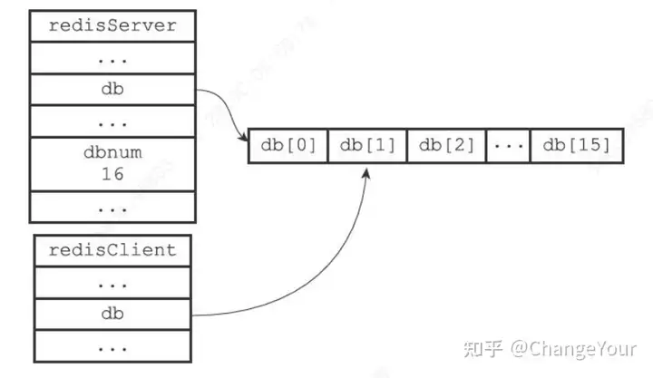
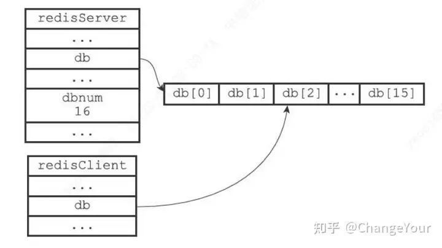
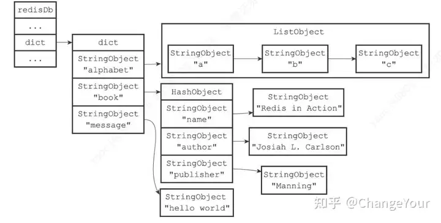
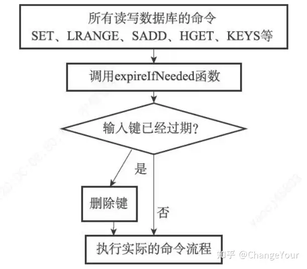
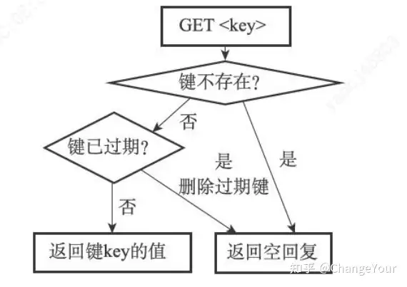

## redis单机数据库的实现 {#redis单机数据库的实现}

### 数据库 {#数据库}

服务端有一个结构体

```c
struct redisServer {
    char *configfile;             // 配置文件的绝对路径
    int hz;                       // serverCron() 每秒调用的次数
    redisDb *db;    // 数据库

};
```



#### 命令 {#命令}

切换数据库`SELECT ${dbnumber}` 

### 键空间 {#键空间}

```c
typedef struct redisDb {    
    // ...    
    // 数据库键空间，保存着数据库中的所有键值对    
    dict *dict;    
    // ...
} redisDb;
```



增删改查基本都和dict有关，还有一些其他操作比如FLUSHDB，RANDOMKEY，KEYS等等也都是对键值对进行操作得到的。

值得注意的是在读写键时redis会维护相关信息：

1.  记录hit&miss信息
2.  更新LRU时间
3.  如果过期则删除
4.  WATCH指令会记录并发送事件
5.  每次修改会incr dirty flag（影响持久化）

#### 键的过期或生存时间 {#键的过期或生存时间}

##### 命令 {#命令-1}

基本上就是EXPIRE，PEXPIRE，EXPIREAT，TTL，PERSIST这几个

##### 实现结构 {#实现结构}

```c
typedef struct redisDb {    
    // ...    
    // 数据库键空间，保存着数据库中的所有键值对    
    dict *dict;    
    dict *expires; // 过期字典，保存着键的过期时间
    // ...
} redisDb;
```

就是dict键值对字典差不多，区别在于值是 long long类型的而已。

##### 过期键的判定和删除 {#过期键的判定和删除}

判定：

先去expires字典找过期时间，然后和当前时间比较，如果过期则返回-1，否则返回剩余时间。

删除：

###### 1. 定时删除 {#1-定时删除}

内存友好（该删就删），cpu不友好（时间事件中断，查找时间事件的无序链表复杂度为O(N)）

创建KEY的时候创建一个timer.

###### 2. 惰性删除 {#2-惰性删除}

内存不友好 （只有要用到才删除） cpu友好

 

###### 3. 定期删除 {#3-定期删除}

在上面两个方案之间权衡，隔一段时间扫描一次，删除过期的键。

实现：

每次servercron执行的时候就会执行activeExpireCycle函数，这个函数会遍历所有db里的所有键（随机取出）执行一段时间。下次执行的时候会从上次停止的地方继续执行。

##### AOF和RDB对过期键的处理 {#aof和rdb对过期键的处理}

生成AOF和RDB的时候会检查键是否过期，如果过期则不会生成。

载入：

RDB：

主服务器不会载入过期键，从服务器会载入所有。

AOF：

删除过期键会在AOF中记录一条DEL命令。

### 持久化 {#持久化}

#### RDB {#rdb}

AOF优先级大于RDB，如果开启了AOF则RDB不会执行。

SAVE和BGSAVE：SAVE会阻塞，BGSAVE是fork一个子进程来执行，fork下的子进程会继承虚页表，写时复制，所以不会占用太多内存。当主进程进行写操作时，会把写操作涉及的物理内存页先拷贝一份，子进程的虚拟内存指向新的这个物理内存页，这也就是COW特性。

BGSAVE和BGWRITEAOF的冲突的，也就是不能同时执行。

配置：

```sh
# 900秒内如果有1个key被修改则执行BGSAVE
save 900 1
# 300秒内如果有10个key被修改则执行BGSAVE
save 300 10
# 60秒内如果有10000个key被修改则执行BGSAVE
save 60 10000
```

```c
struct redisServer{
    //...

    //修改计数器,之前说过每次对键的操作会记录dirty flag，此时可以用来判断是否需要BGSAVE
    long long dirty;

    //上一次执行保存的时间,和上面配合
    time_t lastsave;

    //记录保存条件的数组
    struct saveparam *saveparams;

    //...
};

struct saveparam{
    // 秒数
    time_t seconds;
    // 修改的key的个数
    int changes;
}
```

检查是否需要BGSAVE的判断是在serverCron里面的，每次执行都会检查是否需要执行BGSAVE，如果需要则执行。

##### RDB文件结构 {#rdb文件结构}


可以有多个database，每个database里面是\[SELECT,db_number,key_value_pairs\]

key_value_pairs里面是\[TYPE,key,value\],如果是带过期时间的话\[EXPIRETIME_MS,ms,TYPE,Key,Value\]

#### AOF {#aof}

#### 实现 {#实现}

```c
struct redisServer{
    //...

    //AOF缓冲区
    sds aof_buf;

    //...
}
```

命令追加：

客户端发出的命令会追加到aof_buf后。

AOF文件的写入和同步

AOF文件的写入判断是在事件处理循环中的flushAppendOnlyFile函数中。

flushAppendOnlyFile根据服务器配置的appendfsync来决定是否需要同步。

- always： 每次都把aof_buf缓冲区里面的内容写入并同步到AOF文件
- everysec：写入到AOF文件，如果距离上次同步超过1sec就同步(syscall fsync)
- no： 写入AOF文件，但是不同步

##### 载入 {#载入}

虚拟出一个不带网络连接的客户端一条条指令读取执行。

##### 重写 {#重写}

其实就和rocksdb的compaction差不多

值得注意的是后台重写，子进程fork之后会有一个AOF重写缓冲区，在重写过程中命令会被同时写到AOF缓冲和AOF重写缓冲区。在子进程重写完后会给父进程发送一个信号，父进程接受到信号后会把AOF重写缓冲区的内容写到AOF文件中并替换旧的。

### 事件 {#事件}

事件分为文件事件（fd）和时间事件

#### 文件事件 {#文件事件}

i/o多路复用处理事件可以看我的另一篇文章\[interview-linux\]

##### 事件类型 {#事件类型}

1.  AE_READABLE 可读事件(优先级高)
2.  AE_WRITEABLE 可写事件

##### 文件事件处理器 {#文件事件处理器}

1.  连接应答处理器
2.  命令请求处理器
3.  命令回复处理器

完整流程：

服务器启动时将监听套接字的AE_READABLE的处理事件设为连接应答处理器…建立连接（创建客户端fd并将该fd的AE_READBABLE与应答处理器关联还有AE_WRITABLE同理），之后就可以正常处理对应事件了，注意当命令结果全部写回套接字时，AE_WRITABLE会被解除对应事件的关联。

#### 时间事件 {#时间事件}

主要有两类：

1.  定时事件

2.  周期事件

##### 实现 {#实现-1}

time_event包含3个属性：id(全局唯一)，when(毫秒)，timeProc(回调函数)

根据timeProc的返回值判断定时or定期

定时：返回ae.h/AE_NOMORE 定期：返回别的

所有time_event结构体包含在一个无序链表中（新事件插入到表头），每次都会遍历这个链表，如果when小于当前时间则执行对应的回调函数。

时间事件应用示例：serverCron函数

serverCron函数作用

- 更新统计信息
- 是否删除过期键值对
- 是否进行持久化
- 主从是否同步
- 是否关闭客户端连接

#### 事件调度 {#事件调度}

就是一个循环，先获取最近的一个事件（有可能已经过去），设置timeinterval（可能0），在这个time-interval里面找文件事件，然后分别处理这些事件。

### client&server {#clientserver}

#### client {#client}

CLIENT LIST来显示client信息

```c
typedef struct redisClient{
    //-1代表伪客户端
    int fd;
    //name 用CLIENT setname来设置
    int name;
    // 标记状态
    int flags;
    // 输入缓冲区
    sds querybuf;
    // 命令参数数组，每个都是一个字符串对象【set】 【key】 【"value"】
    robj **argv;
    // 命令参数数量
    int argc;
    // 指向当前正在执行的命令对象,是通过argv的第0个值在command字典里面找的
    struct redisCommand *cmd;
    // 固定输出缓冲区
    char buf[REDIS_REPLY_CHUNK_BYTES];
    //buf数组已使用字节数量
    int bufpos;

    //不固定输出缓冲区,多个字符串构成的链表
    list *reply;

    //身份验证 0 代表未通过，1代表通过。使用AUTH password 来验证
    int authenticated;

    //时间相关的记录

}
```

```c
struct redisServer{
    //伪客户端一直存在，直到server被关闭
    redisClient *lua_client;
}
```

##### 客户端的创建和关闭 {#客户端的创建和关闭}

###### 创建 {#创建}

如果是通过网络，那就会调用连接应答处理器来将一个CLient添加到redisServer的client链表末尾

###### 关闭 {#关闭}

关闭的原因有很多

1.  客户端主动退出
2.  被Client kill杀死
3.  timeout超时，但是主从复制，或者是pubsub的客户端不会超时
4.  输入输出缓冲区溢出

#### server {#server}

一个命令的执行流程

```c
struct redisCommand{
    char* name;
    // 函数指针
    redisCommmandProc* proc;
    //参数个数
    int arity;
    //字符串表示的FLAG
    char* sflags;
    //实际FLAG
    int flags;
    //...
}
```

1.  客户端键入` SET KEY VALUE`
2.  客户端翻译成协议格式
3.  发送到服务端，服务端解析到对应CLient结构的argv和argc
    1.  命令执行器(1)查找命令实现（在命令表字典里面找{“SET”,\*redisCommand}）
    2.  命令执行器(2) 执行预备操作
        - 检查cmd指针是不是NULL
        - 检查命令的参数个数是否正确
        - 检查身份验证
        - 等等
    3.  命令执行器(3) 执行命令
        - 读取键值对
        - 执行命令
        - 返回结果
    4.  命令执行器(4) 执行后续操作
        - AOF
        - 判断是否需要记录为慢查询

##### serverCron函数 {#servercron函数}

- 更新时间，redisServer结构中有两个属性分别是unixtime和mstime，分别记录了秒和毫秒，这是为了减少获取时间的系统调用次数。这两个值被用来操作时间精度要求不高的功能（LRU时间更新，打印日志）
- 更新统计信息，比如命中率，命中次数，miss次数，命令执行次数，命令执行耗时等等
- 是否删除过期键值对，这个在上面已经说过了
- 是否进行持久化，这个也在上面说过了
