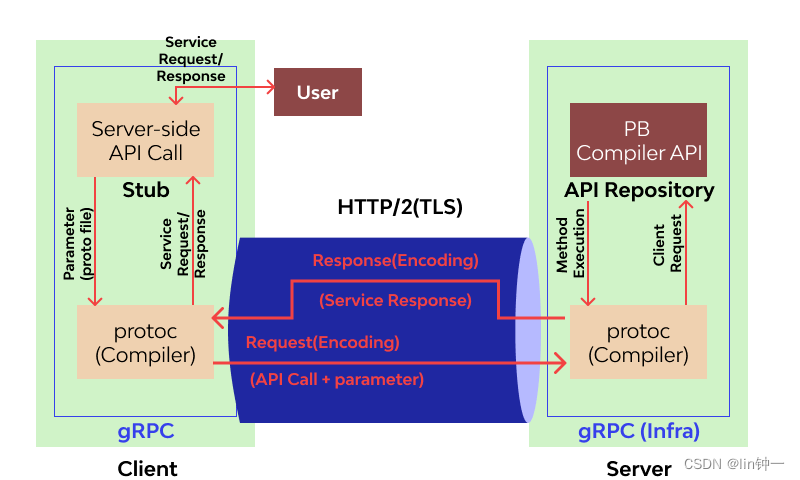

# grpc {#grpc}



## 简单使用 {#简单使用}

这次这次实践的目录

```sh
.
├── client
│   └── hello-client
│       └── client.go
├── go.mod
├── go.sum
├── proto
│   └── hello
│       ├── hello_grpc.pb.go
│       ├── hello.pb.go
│       └── hello.proto
└── server
    └── hello-server
        └── server.go
```

proto

```proto
syntax = "proto3";

// 定义go生成后的包名
option go_package = "./;hello";
package proto;

// 定义入参
message Request {
  string name =1;
}
// 定义返回
message Response {
  string result = 1;
}

// 定义接口
service UserService {
  rpc Say(Request) returns (Response);
}
```

### server {#server}

```go

type HelloService struct {
	// 必须嵌入UnimplementedUserServiceServer
	hello.UnimplementedUserServiceServer
}

// 实现SayHi方法
func (h *HelloService) Say(ctx context.Context, req *hello.Request) (res *hello.Response, err error) {
	format := time.Now().Format("2006-01-02 15:04:05")
	return &hello.Response{Result: "hi " + req.GetName() + "---" + format}, nil
}

const PORT = "8888"

func main() {
	// 创建grpc服务
	server := grpc.NewServer()
	// 注册服务
	hello.RegisterUserServiceServer(server, &HelloService{})

	// 监听端口
	lis, err := net.Listen("tcp", ":"+PORT)
	if err != nil {
		log.Fatalf("net.Listen err: %v", err)
	}

	server.Serve(lis)
}
```

分析上面的代码：

服务端需要实现在protobuf定义的函数，具体为定义一个结构体组合UnimplementedUserServiceServer,然后实现对应的方法。注意pb生成的golang函数与go本身的rpc不同的地方在于有一个context入参和返回值是通过返回来获取而不是作为一个参数的。

### client {#client}

```go

const PORT = "8888"

func main() {
	// 建立链接
	conn, err := grpc.Dial(":"+PORT, grpc.WithTransportCredentials(insecure.NewCredentials()))
	if err != nil {
		log.Fatalf("grpc.Dial err: %v", err)
	}
	// 一定要记得关闭链接
	defer conn.Close()

	// 实例化客户端
	client := hello.NewUserServiceClient(conn)
	// 发起请求
	response, err := client.Say(context.Background(), &hello.Request{Name: "lin钟一"})
	if err != nil {
		log.Fatalf("client.SayHi err: %v", err)
	}
	fmt.Printf("resp: %s", response.GetResult())
}
```

客户端代码也很简单，首先建立链接，然后实例化客户端，最后发起请求。

## gRPC Streaming, Client and Server {#grpc-streaming-client-and-server}

- Server-side streaming RPC—— 客户端向服务器发送单个请求并接收回数据序列流（读回一系列消息）。客户端从返回的流中读取，直到没有更多消息为止。
- Client-side streaming RPC—— 客户端向服务器发送数据序列流（写入一系列消息），一旦客户端完成了消息的写入，它会等待服务器读取所有消息并返回其响应结果。
- Bidirectional streaming RPC—— 它是双向流式传输，客户端和服务器使用读写流发送一系列消息。两个流独立运行；因此，因此客户端和服务器可以按照他们喜欢的任何顺序读取和写入。保留每个流中消息的顺序。例如，服务器可以在写入响应之前等待接收所有客户端消息，或者它可以交替读取消息然后写入消息，或其他一些读取和写入的组合。

### server stream {#server-stream}

这个是服务端发送stream类型的数据

#### proto {#proto}

```proto
service StreamService {
    rpc List(StreamRequest) returns (stream StreamResponse) {};
}
```

#### 服务端 {#服务端}

```go
/*
1. 建立连接 获取client
2. 通过 client 获取stream
3. for循环中通过stream.Recv()依次获取服务端推送的消息
4. err==io.EOF则表示服务端关闭stream了
*/
func (s *StreamService) List(r *pb.StreamRequest, stream pb.StreamService_ListServer) error {
    // 具体返回多少个response根据业务逻辑调整
    for n := 0; n <= 6; n++ {
        // 通过 send 方法不断推送数据
        err := stream.Send(&pb.StreamResponse{
            Pt: &pb.StreamPoint{
                Name:  r.Pt.Name,
                Value: r.Pt.Value + int32(n),
            },
        })
        if err != nil {
            return err
        }
        time.Sleep(time.Second)
    }
    // 返回nil表示已经完成响应
    return nil
}
```

StreamService_ListServer是pb-grpc为 stream 类型的生成的类型，他的公开函数为

```go
type StreamService_ListServer interface {
	Send(*StreamResponse) error
	grpc.ServerStream
}

//内部一般有一个私有结构体来实现这个Send，Send一般就是调用ServerStream的SendMsg方法

type streamServiceListServer struct {
	grpc.ServerStream
}

func (x *streamServiceListServer) Send(m *StreamResponse) error {
	return x.ServerStream.SendMsg(m)
}
```

#### 客户端 {#客户端}

```go
/*
1. 建立连接 获取client
2. 通过 client 获取stream
3. for循环中通过stream.Recv()依次获取服务端推送的消息
4. err==io.EOF则表示服务端关闭stream了
*/
func printLists(client pb.StreamServiceClient, r *pb.StreamRequest) error {
    // 调用获取stream
    stream, err := client.List(context.Background(), r)
    if err != nil {
        return err
    }
    // for循环获取服务端推送的消息
    for {
        // 通过 Recv() 不断获取服务端send()推送的消息
        resp, err := stream.Recv()
        // err==io.EOF则表示服务端关闭stream了
        if err == io.EOF {
            break
        }
        if err != nil {
            return err
        }
        log.Printf("resp: pj.name: %s, pt.value: %d", resp.Pt.Name, resp.Pt.Value)
    }
    return nil
}
```

### 探究生成的代码 {#探究生成的代码}

#### client {#client-1}

对于Client端来说，先生成一个xxxServiceClient实现pb中定义的函数。

```go
type StreamServiceClient interface {
	//List：服务器端流式 RPC
	List(ctx context.Context, in *StreamRequest, opts ...grpc.CallOption) (StreamService_ListClient, error)
	//Record：客户端流式 RPC
	Record(ctx context.Context, opts ...grpc.CallOption) (StreamService_RecordClient, error)
	//Route：双向流式 RPC
	Route(ctx context.Context, opts ...grpc.CallOption) (StreamService_RouteClient, error)
}
```

一旦有需要流式传输的都是通过返回一个xxx_funcClient结构体（实现了Recv或者Send+CloseAndRecv或者Send+Recv）而Send或者别的函数都是调用grpc.ClientStream.SendMsg或者RecvMsg。拦截器就是通过重写这两个函数来实现流式拦截

### Server {#server-1}

生成的xxxserver一般包括

```go
type UserServiceServer interface {
	Say(context.Context, *Request) (*Response, error)//用户定义的函数
	mustEmbedUnimplementedUserServiceServer()//检查是否嵌入
}
```

正常来说还是一样嵌入一个UnimplementedUserServiceServer，原理就是UnimplementedUserServiceServer定义了未实现的接口和一个mustEmbedUnimplementedUserServiceServer函数，通过嵌入这个结构体并重写用户定义函数来实现接口。

而对于流式传输

```go
type StreamServiceServer interface {
	//List：服务器端流式 RPC
	List(*StreamRequest, StreamService_ListServer) error
	//Record：客户端流式 RPC
	Record(StreamService_RecordServer) error
	//Route：双向流式 RPC
	Route(StreamService_RouteServer) error
	mustEmbedUnimplementedStreamServiceServer()
}
```

在这里流式传输的东西都是通过xxx_funcServer的参数来获得，要注意的是其实方法都差不多，然后如果有获取一次或者说发送一次就关闭的一般会变成xxxAndClose比如这里的RecordServer就是SendAndClose，Client的CloseAndRecv

## 参考 {#参考}

1.  [入门grpc非常好的文章](https://learnku.com/articles/73104)
