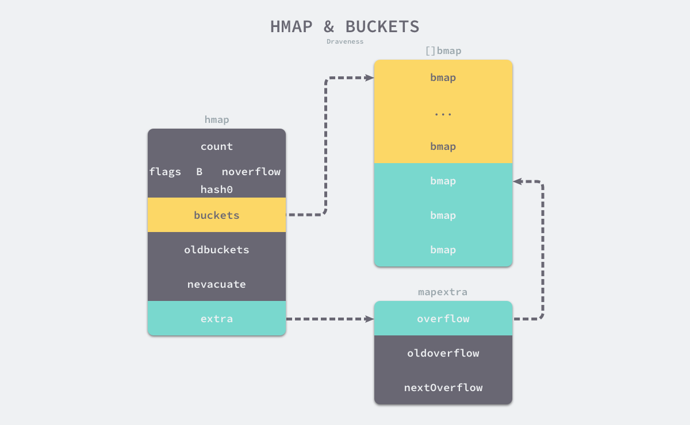
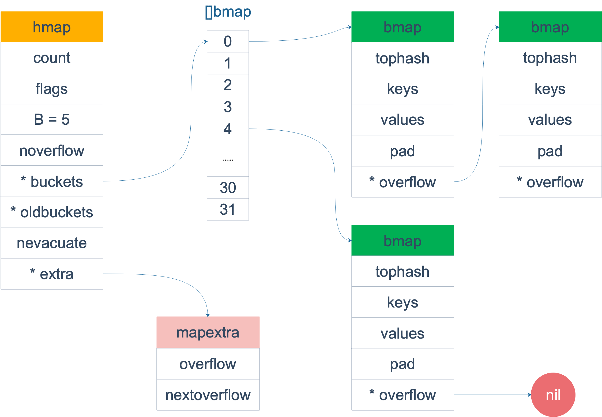

# map {#map}

map是一个很重要的数据结构，本篇文章记录学习golang中map源码的过程。

图多取自别人的博客，非原创请注意

基本的概念不在赘述了

以下分析来自go 1.21.0

## 使用 {#使用}

### 创建 {#创建}

```go
ageMp := make(map[string]int)
// 指定 map 长度
ageMp := make(map[string]int, 8)

// ageMp 为 nil，不能向其添加元素，会直接panic
var ageMp map[string]int
```

## 变量和类型 {#变量和类型}



> map是以bucket来组织键值对的，一个bucket最多8个键值对。

### 变量（常量） {#变量常量}

```go
const (
	// Maximum number of key/elem pairs a bucket can hold.
	bucketCntBits = abi.MapBucketCountBits //3
	bucketCnt     = abi.MapBucketCount //8

    // 用loadFactorNum/loadFactorDen来代表负载因子，用两个整数就可以进行整数运算
	// Maximum average load of a bucket that triggers growth is bucketCnt*13/16 (about 80% full)
	// Because of minimum alignment rules, bucketCnt is known to be at least 8.
	// Represent as loadFactorNum/loadFactorDen, to allow integer math.
	loadFactorDen = 2
	loadFactorNum = (bucketCnt * 13 / 16) * loadFactorDen

    // key和value size都是128（加起来不超过uint8）
	// Maximum key or elem size to keep inline (instead of mallocing per element).
	// Must fit in a uint8.
	// Fast versions cannot handle big elems - the cutoff size for
	// fast versions in cmd/compile/internal/gc/walk.go must be at most this elem.
	maxKeySize  = abi.MapMaxKeyBytes
	maxElemSize = abi.MapMaxElemBytes

    //其实就是bmap结构体的对齐大小（8字节即使是amd64p32）,注意这里是编译期前的，不包括那些奇奇怪怪的后面加的
	// data offset should be the size of the bmap struct, but needs to be
	// aligned correctly. For amd64p32 this means 64-bit alignment
	// even though pointers are 32 bit.
	dataOffset = unsafe.Offsetof(struct {
		b bmap
		v int64
	}{}.v)

	// Possible tophash values. We reserve a few possibilities for special marks.
	// Each bucket (including its overflow buckets, if any) will have either all or none of its
	// entries in the evacuated* states (except during the evacuate() method, which only happens
	// during map writes and thus no one else can observe the map during that time).
	emptyRest      = 0 // this cell is empty, and there are no more non-empty cells at higher indexes or overflows.
	emptyOne       = 1 // this cell is empty
	evacuatedX     = 2 // key/elem is valid.  Entry has been evacuated to first half of larger table.
	evacuatedY     = 3 // same as above, but evacuated to second half of larger table.
	evacuatedEmpty = 4 // cell is empty, bucket is evacuated.
	minTopHash     = 5 // minimum tophash for a normal filled cell.

	// flags
	iterator     = 1 // there may be an iterator using buckets
	oldIterator  = 2 // there may be an iterator using oldbuckets
	hashWriting  = 4 // a goroutine is writing to the map
	sameSizeGrow = 8 // the current map growth is to a new map of the same size

	// sentinel bucket ID for iterator checks
	noCheck = 1<<(8*goarch.PtrSize) - 1
)
```

### 类型 {#类型}

#### hmap {#hmap}

```go
// A header for a Go map.
type hmap struct {
	
	count     int // # live cells == size of map.  Must be first (used by len() builtin)

	flags     uint8
	B         uint8  // log_2 of # of buckets (can hold up to loadFactor * 2^B items)
	noverflow uint16 // approximate number of overflow buckets; see incrnoverflow for details


	hash0     uint32 // hash seed

	buckets    unsafe.Pointer // array of 2^B Buckets. may be nil if count==0.

	oldbuckets unsafe.Pointer // previous bucket array of half the size, non-nil only when growing
	
    // 指示扩容进度，小于此地址的 buckets 迁移完成
    nevacuate  uintptr        // progress counter for evacuation (buckets less than this have been evacuated)

	extra *mapextra // optional fields
}
```

mapextra

```go
// mapextra holds fields that are not present on all maps.
type mapextra struct {
	// If both key and elem do not contain pointers and are inline, then we mark bucket
	// type as containing no pointers. This avoids scanning such maps.
	// However, bmap.overflow is a pointer. In order to keep overflow buckets
	// alive, we store pointers to all overflow buckets in hmap.extra.overflow and hmap.extra.oldoverflow.
	// overflow and oldoverflow are only used if key and elem do not contain pointers.
	// overflow contains overflow buckets for hmap.buckets.
	// oldoverflow contains overflow buckets for hmap.oldbuckets.
	// The indirection allows to store a pointer to the slice in hiter.
	overflow    *[]*bmap
	oldoverflow *[]*bmap

	// nextOverflow holds a pointer to a free overflow bucket.
	nextOverflow *bmap
}
```

#### bmap {#bmap}

```go
// A bucket for a Go map.
type bmap struct {
	// tophash generally contains the top byte of the hash value
	// for each key in this bucket. If tophash[0] < minTopHash,
	// tophash[0] is a bucket evacuation state instead.
	tophash [bucketCnt]uint8
	// Followed by bucketCnt keys and then bucketCnt elems.
	// NOTE: packing all the keys together and then all the elems together makes the
	// code a bit more complicated than alternating key/elem/key/elem/... but it allows
	// us to eliminate padding which would be needed for, e.g., map[int64]int8.
	// Followed by an overflow pointer.
}
```

实际上，bmap不止这么简单的东西。bmap会在编译期生成其他东西，相关的东西和cmd/compile/internal/reflectdata有关

相关函数：cmd/compile/internal/reflectdata/reflect.go/MapBucketType

```go
type bmap struct {
    topbits  [8]uint8
    keys     [8]keytype
    values   [8]valuetype
	//曾经有padding，现在已经没有了
    overflow uintptr
}
```

 值得注意的是，当键或值的大小超过128字节时，会使用指针来存储，而不是直接存储在bmap中。而且当key和elme都没有指针类型的时候overflow会变成uintptr类型并且由hmap来管理overflow（不会被GC认为有指针）不然就是unsafe.pointer。

## 参考 {#参考}

1.  [Go 程序员面试笔试宝典](https://golang.design/go-questions/map/principal/)
2.  [golang设计与实现](https://draveness.me/golang/docs/part2-foundation/ch03-datastructure/golang-hashmap/#336-%E5%BB%B6%E4%BC%B8%E9%98%85%E8%AF%BB)
