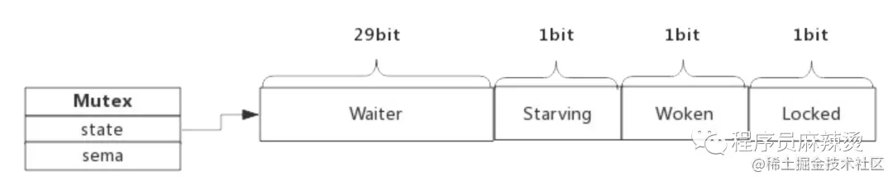

## 基本概念 {#基本概念}

互斥锁会将操作串行化，可以保证操作完全有序，适合资源只能由一个协程进行操作的情况，并发能力弱；

读写锁适合读多写少的情况，并发能有比较强。

使用信号量可以完成很多操作

1.  临界区互斥

单一互斥量mutex

2.  前驱

其实就是拓扑排序

## sync.Mutex {#syncmutex}

```go
type Mutex struct {
	state int32
	sema  uint32
}
```

### 加锁 {#加锁}

如果发现锁被持有，会自旋一会，避免频繁的信号量唤醒。但是如果很多个自旋的协程都在等待，会导致饥饿问题。所以通过添加饥饿标志使每次让出锁都要唤醒一个被阻塞的协程来解决。



Waiter: 表示阻塞等待锁的协程个数，协程解锁时根据此值来判断是否需要释放信号量

- Locked: 表示该Mutex是否已被锁定，0：没有锁定 1：已被锁定。
- Woken: 表示是否有协程已被唤醒，0：没有协程唤醒 1：已有协程唤醒，正在加锁过程中。释放锁时，如果正常模式下，不会再唤醒其它协程。
- Starving：表示该Mutex是否处理饥饿状态， 0：没有饥饿 1：饥饿状态，说明有协程阻塞了超过1ms。
- Waiter: 表示阻塞等待锁的协程个数，协程解锁时根据此值来判断是否需要释放信号量 协程之间抢锁实际上是抢给Locked赋值的权利，能给Locked域置1，就说明抢锁成功。抢不到的话就阻塞等待

Mutex.sema信号量，一旦持有锁的协程解锁，等待的协程会依次被唤醒。

互斥量有两种模式：正常模式和饥饿模式。

正常模式：正常模式下等待的协程按照先入先出排列，当一个协程被唤醒后并不是直接拥有锁，该协程需要和刚刚到达的协程一起竞争锁的所有权。新到的协程有个优势，那就是它已经在CPU上运行了，而且新到的协程可能有很多，所以被唤醒的协程极有可能抢占不到锁。在这种情况下，被唤醒的协程会被放置于等待队列的队头。如果等待的协程超过1ms内没有获取到锁，将会把锁置为饥饿模式。

饥饿模式：在饥饿模式下，解锁的协程会将锁的所有权直接交给等待队列中位于队头的协程。正好解锁的那一刻有新的协程到达，新到达的协程也不会尝试自旋获取锁。相反，他们会将自己置于等待队列的队尾。

如果等待队列中的协程获取到锁，它会查看

(1)自己是否是等待队列中最后一个协程

(2)自己等待的时间是否小于1ms

如果有任意一个条件满足，将会将锁改为普通模式。

代码解析：

```go
func (m *Mutex) lockSlow() {
	var waitStartTime int64
	starving := false
	awoke := false
	iter := 0
	old := m.state
	for {
		// Don't spin in starvation mode, ownership is handed off to waiters
		// so we won't be able to acquire the mutex anyway.
        // 如果是饥饿模式，直接阻塞等待
		if old&(mutexLocked|mutexStarving) == mutexLocked && runtime_canSpin(iter) {
			// Active spinning makes sense.
			// Try to set mutexWoken flag to inform Unlock
			// to not wake other blocked goroutines.
            //尝试把woken状态设为1，这样在拥有锁的协程解锁的时候就不会把久的协程唤醒，这样可以增加自己获得锁的几率
            //条件是，当前协程之前没有唤醒，woken没有被设为1，有在等待的协程，cas操作成功
			if !awoke && old&mutexWoken == 0 && old>>mutexWaiterShift != 0 &&
				atomic.CompareAndSwapInt32(&m.state, old, old|mutexWoken) {
				awoke = true
			}
			runtime_doSpin()
			iter++
			old = m.state
			continue
		}

        // 此处说明锁变为饥饿状态或者已经解锁了，或者不符合自旋条件了（仍为锁定状态）
      // 锁状态包含-饥饿锁定、饥饿未锁定、正常锁定、正常未锁定
      // 获取锁最新的状态
		new := old
		// Don't try to acquire starving mutex, new arriving goroutines must queue.
        // 如果是正常状态，尝试加锁。饥饿状态下要出让竞争权利，肯定不能加锁的
		if old&mutexStarving == 0 {
			new |= mutexLocked
		}
        // 如果锁还是被占用的或者锁是饥饿状态，只能将自己放到等待队列上
      // 到了这个阶段，遇到这些状态，协程只能躺平。饥饿状态要出让竞争权利
		if old&(mutexLocked|mutexStarving) != 0 {
			new += 1 << mutexWaiterShift
		}
		// The current goroutine switches mutex to starvation mode.
		// But if the mutex is currently unlocked, don't do the switch.
		// Unlock expects that starving mutex has waiters, which will not
		// be true in this case.
        //如果当前协程感到饥饿，并且锁是锁定状态，那么就把锁状态改为饥饿锁定
		if starving && old&mutexLocked != 0 {
			new |= mutexStarving
		}
        // 当前协程把woken设为真，卸载要设回去，因为要么得到锁，要么等待，两种情况都和唤醒没关系了
		if awoke {
			// The goroutine has been woken from sleep,
			// so we need to reset the flag in either case.
			if new&mutexWoken == 0 {
				throw("sync: inconsistent mutex state")
			}
			new &^= mutexWoken
		}
              // old  -> new
      // (0,1)正常且已锁定 -> (+1,1?,1) 等待加一，状态待定，加锁   ->  加到等待队列
      // (0,0)正常且未锁定 -> (+0,0 ,1) 等待不变，正常状态，加锁   ->  加锁成功
      // (1,1)饥饿且已锁定 -> (+1,1?,1) 等待加一，饥饿待定，加锁   ->  加到等待队列
      // (1,0)饥饿且未锁定 -> (+1,1 ,0) 等待加一，饥饿状态，不加锁  ->  加到等待队列

		if atomic.CompareAndSwapInt32(&m.state, old, new) {
            //加锁成功
			if old&(mutexLocked|mutexStarving) == 0 {
				break // locked the mutex with CAS
			}
			// If we were already waiting before, queue at the front of the queue.
			queueLifo := waitStartTime != 0
			if waitStartTime == 0 {
				waitStartTime = runtime_nanotime()
			}
                     // 走到此处，说明协程没有获取到锁，调用runtime_SemacquireMutex，将该协程挂起
         // waitStartTime能够判断该协程是新来的还是被唤醒的
         // 如果是新来的，则加入队列尾部，等待唤醒，queueLifo=false
         // 如果是从等待队列中唤醒的，则加入队列头部，queueLifo=true
         // 如果后面该协程被唤醒，就从该位置继续往下执行

			runtime_SemacquireMutex(&m.sema, queueLifo, 1)
                     // 此刻说明该协程被唤醒了
         // 判断该协程是否长时间没有获取到锁，如果是的话，就是饥饿的协程
			starving = starving || runtime_nanotime()-waitStartTime > starvationThresholdNs
			old = m.state
			if old&mutexStarving != 0 {
                //饥饿模式下被唤醒一定是队头的协程，所以直接把锁给它
				// If this goroutine was woken and mutex is in starvation mode,
				// ownership was handed off to us but mutex is in somewhat
				// inconsistent state: mutexLocked is not set and we are still
				// accounted as waiter. Fix that.
				if old&(mutexLocked|mutexWoken) != 0 || old>>mutexWaiterShift == 0 {
					throw("sync: inconsistent mutex state")
				}
				delta := int32(mutexLocked - 1<<mutexWaiterShift)
				if !starving || old>>mutexWaiterShift == 1 {
					// Exit starvation mode.
					// Critical to do it here and consider wait time.
					// Starvation mode is so inefficient, that two goroutines
					// can go lock-step infinitely once they switch mutex
					// to starvation mode.
					delta -= mutexStarving
				}
                //delta可以让waiting个数减一，还可以弄调饥饿标志，还可以加锁（亏贼）
				atomic.AddInt32(&m.state, delta)
				break
			}
			awoke = true
			iter = 0
		} else {
			old = m.state
		}
	}

	if race.Enabled {
		race.Acquire(unsafe.Pointer(m))
	}
}
```

```go
// Unlock unlocks m.
// It is a run-time error if m is not locked on entry to Unlock.
//
// A locked Mutex is not associated with a particular goroutine.
// It is allowed for one goroutine to lock a Mutex and then
// arrange for another goroutine to unlock it.
func (m *Mutex) Unlock() {
	if race.Enabled {
		_ = m.state
		race.Release(unsafe.Pointer(m))
	}

	// Fast path: drop lock bit.
	new := atomic.AddInt32(&m.state, -mutexLocked)
    //还有一些别的事情要处理，比如饥饿状态，要唤醒协程
	if new != 0 {
		// Outlined slow path to allow inlining the fast path.
		// To hide unlockSlow during tracing we skip one extra frame when tracing GoUnblock.
		m.unlockSlow(new)
	}
}

func (m *Mutex) unlockSlow(new int32) {
	if (new+mutexLocked)&mutexLocked == 0 {
		fatal("sync: unlock of unlocked mutex")
	}
	if new&mutexStarving == 0 {
        //无starving
		old := new
		for {
			// If there are no waiters or a goroutine has already
			// been woken or grabbed the lock, no need to wake anyone.
			// In starvation mode ownership is directly handed off from unlocking
			// goroutine to the next waiter. We are not part of this chain,
			// since we did not observe mutexStarving when we unlocked the mutex above.
			// So get off the way.
            // 没有要等待的协程或者已经有协程被唤醒或者已经有协程获取到锁了，就不需要唤醒任何人
			if old>>mutexWaiterShift == 0 || old&(mutexLocked|mutexWoken|mutexStarving) != 0 {
				return
			}
			// Grab the right to wake someone.
			new = (old - 1<<mutexWaiterShift) | mutexWoken
			if atomic.CompareAndSwapInt32(&m.state, old, new) {
				runtime_Semrelease(&m.sema, false, 1)
				return
			}
			old = m.state
		}
	} else {
		// Starving mode: handoff mutex ownership to the next waiter, and yield
		// our time slice so that the next waiter can start to run immediately.
		// Note: mutexLocked is not set, the waiter will set it after wakeup.
		// But mutex is still considered locked if mutexStarving is set,
		// so new coming goroutines won't acquire it.
        //直接唤醒一个协程并且让出时间片
		runtime_Semrelease(&m.sema, true, 1)
	}
}
```

[源代码的流程图](https://www.processon.com/view/link/60f4e1021e085376da5c05f8)

[信号量的原理](https://zhuanlan.zhihu.com/p/544161308)
