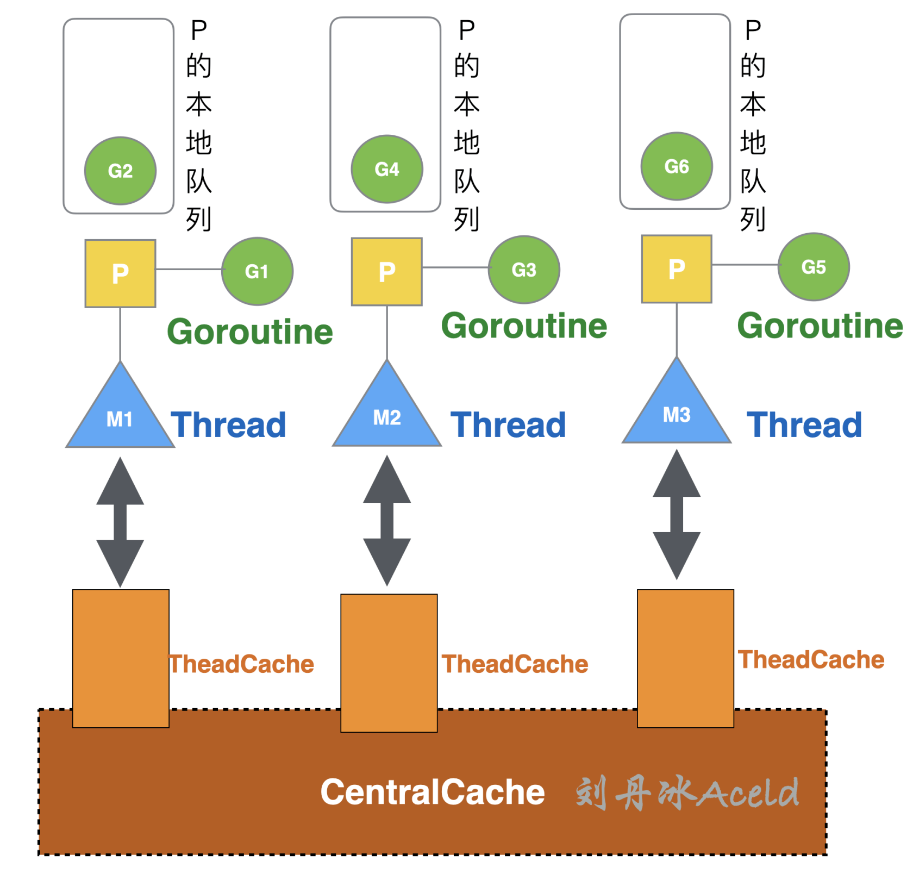
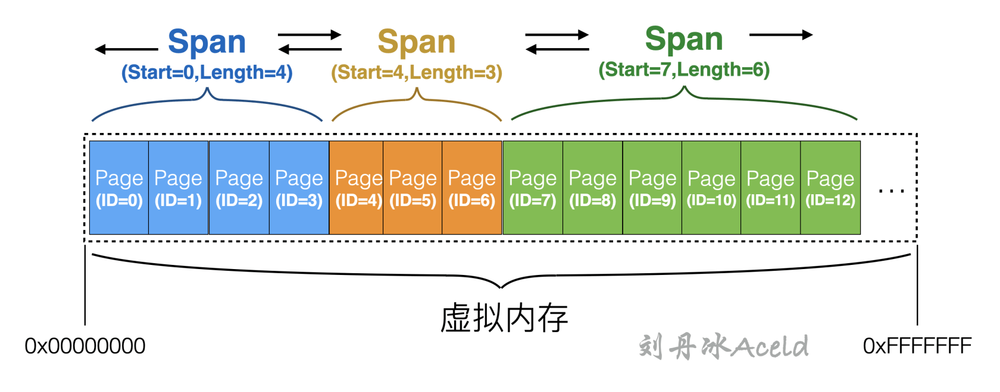
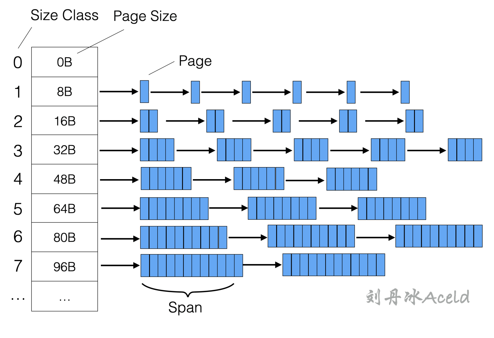
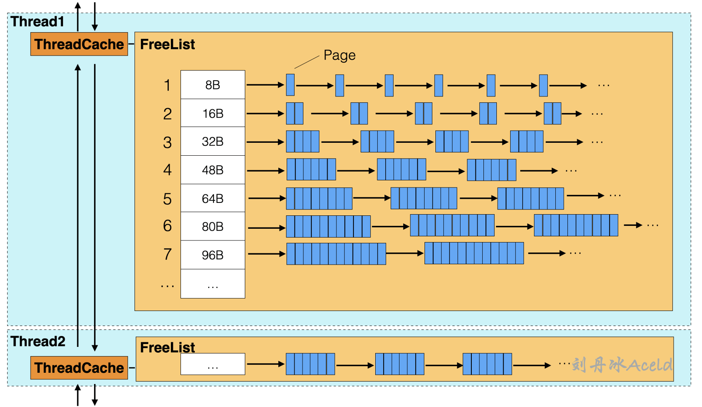

## TCmalloc {#tcmalloc}

为了解决中大对象的内存申请，TCmalloc有一个全局共享内存堆

### Page {#page}

每个 Page 默认是 8KB。这里的page就像是虚拟内存的page

### Span {#span}

Span是包含了不同数量的page的单位 

### Size Class {#size-class}

### ThreadCache {#threadcache}

每个线程有单独的缓存 

### 参考 {#参考}
