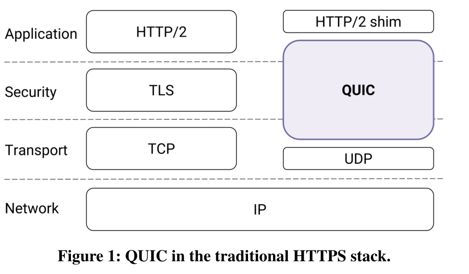
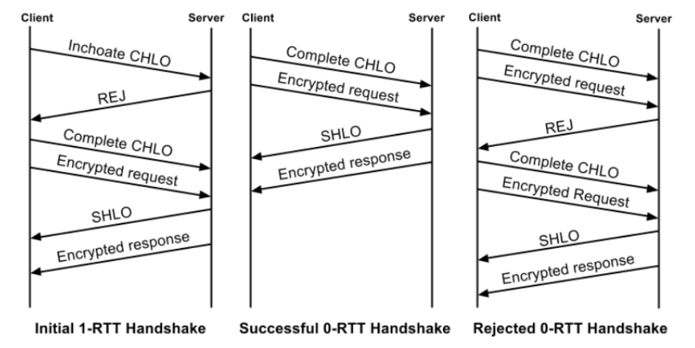
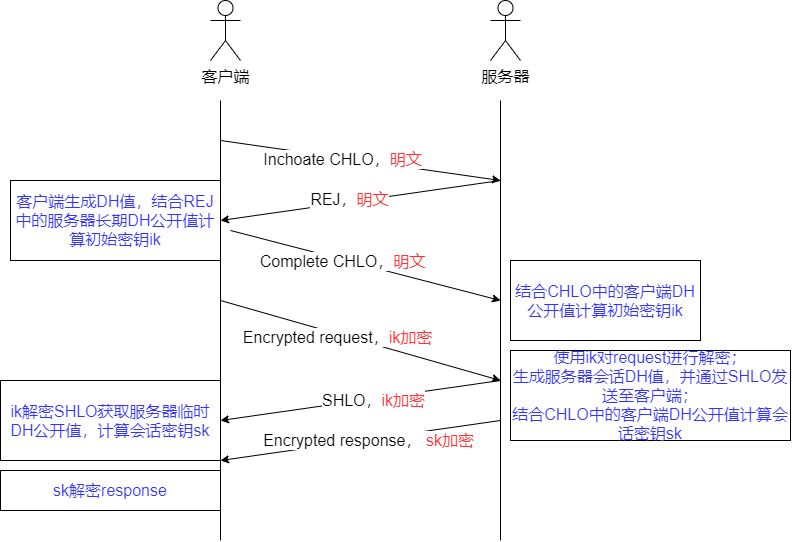
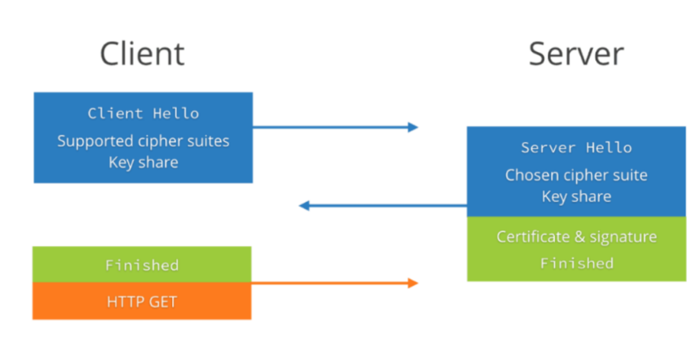
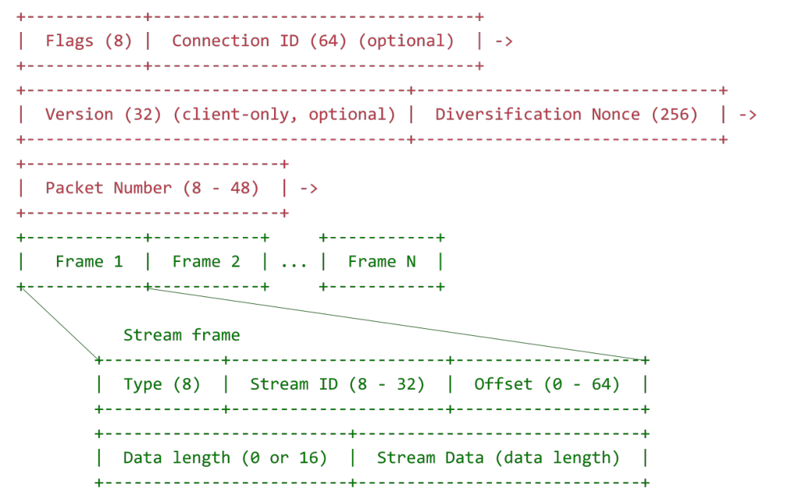

## QUIC {#quic}

QUIC在用户空间实现，tcp/udp在内核空间

## 优势 {#优势}

1.  减少了 TCP 三次握手及 TLS 握手时间。
2.  改进的拥塞控制。
3.  避免队头阻塞的多路复用。
4.  连接迁移。
5.  前向安全。

## 过程 {#过程}

传统需要TCP3握手，TLS4握手（一个用户空间一个内核无法合并）

### 1-RTT {#1-rtt}

第一次握手：

客户端主动向服务器发送Inchoate CHLO报文

服务器会向客户端发送REJ报文。REJ报文包含了服务器的配置信息，如长期的Diffie-Hellman值，服务器配置的签名，source-address-token(stk, 用于验证的加密块，包含有服务器看到的客户端的IP地址和服务器当前的时间戳，之后客户端会将该stk发回)等，为了进行身份证明还会使用私钥进行签名，同时也可以防篡改；

在收到服务器的配置信息后，客户端会通过证书链机制验签，并实现对服务器的身份认证。

第二次握手：

客户端在通过对服务器的验证之后，客户端会生成一个Diffie-Hellman值。此时客户端有了自身和对方的Diffie-Hellman值，就可以计算出初始密钥（initial key, ik）；

客户端将包含有DH公开之的明文Complete CHLO发送至服务器；

客户端使用ik对请求数据加密，发送至服务器；

服务器收到Complete CHLO之后就可以获得客户端的Diffie-Hellman的值，就可以计算出初始密钥。

服务器立即向客户端发送SHLO报文（ik加密的）。SHLO报文含有一个服务器临时Diffie-Hellman值，可以用于计算前向安全的密钥（会话密钥）；

服务器收到加密的请求数据，使用初始密钥进行解密； 服务器使用会话密钥对响应数据进行加密，发回给客户端。

客户端在收到SHLO之后使用初始密钥解密得到服务器的临时DH公开值，根据该临时值计算出会话密钥； 客户端收到加密的响应数据后，使用会话密钥进行解密。 整个握手过程会在2个RTT内完成。

### TLS1.3 {#tls13}

### 0-rtt {#0-rtt}

客户端在重连同一个服务器时，会使用已经缓存的服务器相关配置信息（stk，DH公开值等信息），并直接向服务器发送Complete CHLO报文，并使用ik对请求报文进行加密。但是服务器方面会标识相应的stk等信息已经过期，这时服务器会发送REJ信息，客户端需要重新与服务器进行连接。

如果没有过期的话，就可以直接建立连接，省下了重新建立连接的开销。

## 前向安全 {#前向安全}

在最后一次握手时，会生成一个会话密钥sk。这样即使服务器的长期DH值被破获，且生成了初始密钥ik，也无法对会话中的数据进行解密。

## 多路复用 {#多路复用}

可以在QUIC流上构建任意大小的应用程序报文，最多支持 2\^64的字节。并且stream的实现是轻量级的，即使消息报文很小也可以为它们使用单独的流。每一个Stream都有stream ID唯一标识。这些流ID由客户端/服务器进行静态分配。客户端主动发起的流的ID永远是奇数，服务器发起的流的ID是偶数。这样可以避免冲突。当在一个未使用过的流上发送数据时，流会自动创建；当需要关闭时，就会在最后一帧数据上设置一个FIN的标志指示接收方关闭流。如果发送方或接收方确定不再需要流上的数据，则可以取消流，而无需断开整个 QUIC 连接。尽管流是可靠的抽象，但 QUIC 不会为已取消的流重新传输数据。

## 重传 {#重传}

TCP 序列号有助于提高可靠性，并表示在接收方传送字节的顺序。这种混淆会导致“重传模糊”（retransmission ambiguity）问题，因为重传的 TCP 段携带与原始数据包相同的序列号 。 TCP ACK 的接收者无法确定 ACK 是为原始传输还是为重传而发送，并且通常通过昂贵的超时来检测重传段的丢失。每个 QUIC 数据包都携带一个新的数据包编号，包括那些携带重传数据的数据包。这种设计不需要单独的机制来区分重传的 ACK 和原始传输的 ACK，从而避免了 TCP 的重传模糊问题。流帧中的流偏移用于传递排序，数据包编号表示一个明确的时间顺序，这使得丢失检测比 TCP 更简单、更准确。

## 流量控制 {#流量控制}

QUIC在连接有流量控制，在流这个级别也有流量控制

## 拥塞控制 {#拥塞控制}

由于QUIC 通过 Packet Number 来标识包的序号，而且规定 Packet Number 只能单调递增，这也就解决了初始包和重传包的二义性。从而保证 RTT 的值是准确的。

## 连接迁移 {#连接迁移}

QUIC连接使用随机生成的64bit的cid唯一确定。cid允许客户机在网络之间漫游，而不受网络或传输层参数变化的影响。

cid使得客户端能够独立于网络地址转换（network address translation, NAT）之外。cid 在路由中起着重要作用，特别是用于连接标识的目的。此外，使用 cids 可以通过探测连接的新路径实现多路径。
