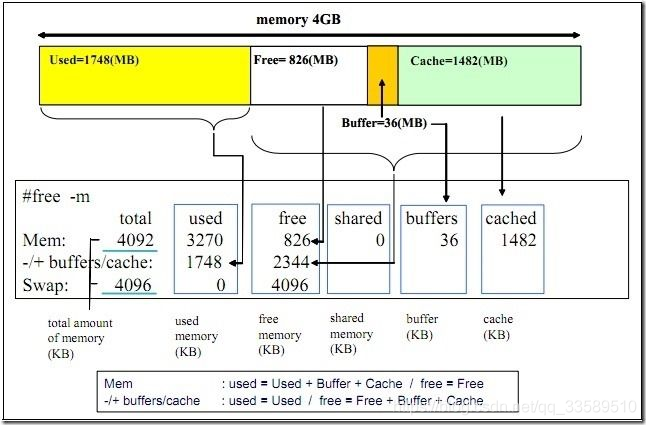
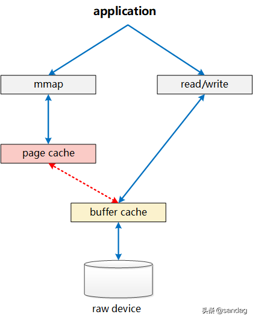
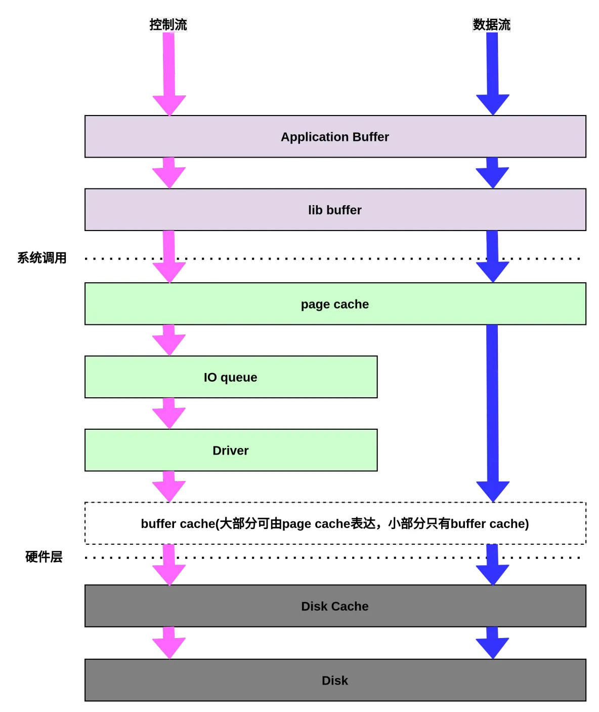
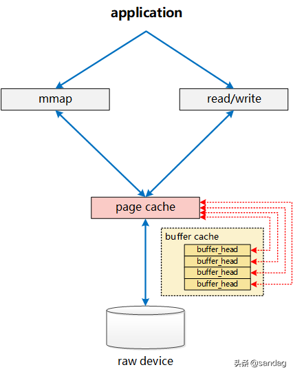
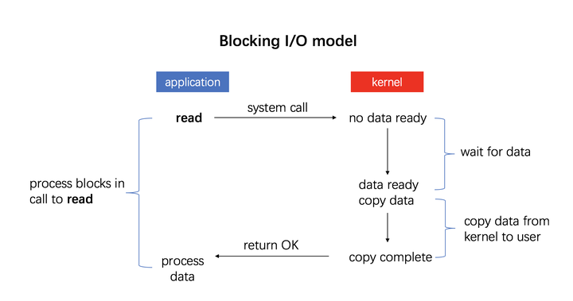
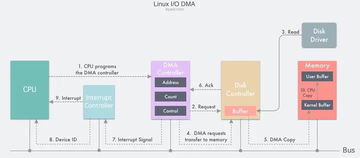

## 如何从磁盘读到内存 {#如何从磁盘读到内存}

主要就是三个步骤：

## cache {#cache}

page cache和buffer cache

- Mem：表示物理内存统计。
- total：表示物理内存总量(total = used + free)。
- used：表示总计分配给缓存（包含buffers 与cache ）使用的数量，但其中可能部分缓存并未实际使用。
- free：未被分配的内存。
- shared：共享内存。
- buffers：系统分配但未被使用的buffers数量。
- cached：系统分配但未被使用的cache数量。
- -/+ buffers/cache：表示物理内存的缓存统计。
- used2：也就是第一行中的used – buffers - cached也是实际使用的内存总量。 // used2为第二行
- free2 = buffers1 + cached1 + free1 // free2为第二行，buffers1等为第一行
- free2：未被使用的buffers与cache和未被分配的内存之和，这就是系统当前实际可用内存。
- Swap：当内存上放不下新加入的数据时,会将原有的部分资源交换到磁盘上,这块地方就叫swap,表示硬盘上交换分区的使用情况。

page cache:

页缓存或文件缓存，是由好几个磁盘块构成，大小通常为4k，在64位系统上为8k，构成的几个磁盘块在物理磁盘上不一定连续，文件的组织单位为一页， 也就是一个page cache大小，文件读取是由外存上不连续的几个磁盘块，到buffer cache，然后组成page cache，然后供给应用程序。

Page cache在linux读写文件时，它用于缓存文件的逻辑内容，从而加快对磁盘上映像和数据的访问。具体说是加速对文件内容的访问，buffer cache缓存文件的具体内容——物理磁盘上的磁盘块，这是加速对磁盘的访问。

buffer cache: 对物理磁盘上的一个磁盘块进行的缓冲，其大小为通常为**1k**，磁盘块也是磁盘的组织单位。

buffer cache: 目的是为在程序多次访问同一磁盘块时，减少访问时间。系统将磁盘块首先读入buffer cache，如果cache空间不够时，会通过一定的策略将一些过时或多次未被访问的buffer cache清空。程序在下一次访问磁盘时首先查看是否在buffer cache找到所需块，命中可减少访问磁盘时间。不命中时需重新读入buffer cache。

对buffer cache的写分为两种：

- 直接写:这是程序在写buffer cache后也写磁盘，要读时从buffer cache上读
- 后台写: 程序在写完buffer cache后并不立即写磁盘，因为有可能程序在很短时间内又需要写文件，如果直接写，就需多次写磁盘了。这样效率很低，而是过一段时间后由后台写，减少了多次访磁盘的时间。

Buffer cache是由物理内存分配，Linux系统为提高内存使用率，会将空闲内存全分给buffer cache ，当其他程序需要更多内存时，系统会减少cache大小。

### page cache VS buffer cache {#page-cache-vs-buffer-cache}

磁盘的操作有逻辑级（文件系统）和物理级（磁盘块），这两种Cache就是分别缓存逻辑和物理级数据的。

假设我们通过文件系统操作文件，那么文件将被缓存到Page Cache。 若需要刷新文件，Page Cache将交给Buffer Cache去完成，因为Buffer Cache就是缓存磁盘块的。

- 所以直接去操作文件，那就是Page Cache区缓存
- 用dd等命令直接操作磁盘块，就是Buffer Cache缓存的东西

Page cache实际上是针对文件系统的，是文件的缓存，在文件层面上的数据会缓存到page cache。文件的逻辑层需要映射到实际的物理磁盘，这种映射关系由文件系统来完成。当page cache的数据需要刷新时，page cache中的数据交给buffer cache，但是这种处理在2.6版本的内核之后就变的很简单了，没有真正意义上的cache操作。

Buffer cache是针对磁盘块的缓存，也就是在没有文件系统的情况下，直接对磁盘进行操作的数据会缓存到buffer cache中，例如，文件系统的元数据都会缓存到buffer cache中。

简单说来，page cache用来缓存文件数据，buffer cache用来缓存磁盘数据。在有文件系统的情况下，对文件操作，那么数据会缓存到page cache，如果直接采用dd等工具对磁盘进行读写，那么数据会缓存到buffer cache。

Buffer(Buffer Cache)以块形式缓冲了块设备的操作，定时或手动的同步到硬盘，它是为了缓冲写操作然后一次性将很多改动写入硬盘，避免频繁写硬盘，提高写入效率。

Cache(Page Cache)以页面形式缓存了文件系统的文件，给需要使用的程序读取，它是为了给读操作提供缓冲，避免频繁读硬盘，提高读取效率。

### 变化 {#变化}

linux kernel 2.4之前都是这样的，但是冗余。

在linux kernel 2.4之后，这两种caches统一了。虚拟内存子系统通过page cache驱动IO。如果数据同时在page cache和buffer cache中，buffer cache会简单的指向page cache，数据只会在内存中保有一份。Page cache就是你所知道的disk在内存中的缓存：它会加快文件访问速度。

### 参考 {#参考}

[Linux内核Page Cache和Buffer Cache关系及演化历史](https://cloud.tencent.com/developer/article/1844990)

## I/O模式 {#io模式}

### 程序控制（轮询） {#程序控制轮询}

### 中断 {#中断}

- 用户进程发起一个 read() 系统调用读取磁盘文件，陷入内核态并由其所在的 CPU 通过设备驱动程序向设备寄存器写入一个通知信号，告知设备控制器 (我们这里是磁盘控制器)要读取数据；
- 磁盘控制器启动磁盘读取的过程，把数据从磁盘拷贝到磁盘控制器缓冲区里；
- 完成拷贝之后磁盘控制器会通过总线发送一个中断信号到中断控制器，如果此时中断控制器手头还有正在处理的中断或者有一个和该中断信号同时到达的更高优先级的中断，则这个中断信号将被忽略，而磁盘控制器会在后面持续发送中断信号直至中断控制器受理；
- 中断控制器收到磁盘控制器的中断信号之后会通过地址总线存入一个磁盘设备的编号，表示这次中断需要关注的设备是磁盘；
- 中断控制器向 CPU 置起一个磁盘中断信号；
- CPU 收到中断信号之后停止当前的工作，把当前的 PC/PSW 等寄存器压入堆栈保存现场，然后从地址总线取出设备编号，通过编号找到中断向量所包含的中断服务的入口地址，压入 PC 寄存器，开始运行磁盘中断服务，把数据从磁盘控制器的缓冲区拷贝到主存里的内核缓冲区；
- 最后 CPU 再把数据从内核缓冲区拷贝到用户缓冲区，完成读取操作，read() 返回，切换回用户态。

### DMA {#dma}

并发系统的性能高低究其根本，是取决于如何对 CPU 资源的高效调度和使用，而回头看前面的中断驱动 I/O 模式的流程，可以发现第 6、7 步的数据拷贝工作都是由 CPU 亲自完成的，也就是在这两次数据拷贝阶段中 CPU 是完全被占用而不能处理其他工作的，那么这里明显是有优化空间的；第 7 步的数据拷贝是从内核缓冲区到用户缓冲区，都是在主存里，所以这一步只能由 CPU 亲自完成，但是第 6 步的数据拷贝，是从磁盘控制器的缓冲区到主存，是两个设备之间的数据传输，这一步并非一定要 CPU 来完成，可以借助 DMA 来完成，减轻 CPU 的负担。

- 用户进程发起一个 read() 系统调用读取磁盘文件，陷入内核态并由其所在的 CPU 通过设置 DMA 控制器的寄存器对它进行编程：把内核缓冲区和磁盘文件的地址分别写入 MAR 和 ADR 寄存器，然后把期望读取的字节数写入 WC 寄存器，启动 DMA 控制器；
- DMA 控制器根据 ADR 寄存器里的信息知道这次 I/O 需要读取的外设是磁盘的某个地址，便向磁盘控制器发出一个命令，通知它从磁盘读取数据到其内部的缓冲区里；
- 磁盘控制器启动磁盘读取的过程，把数据从磁盘拷贝到磁盘控制器缓冲区里，并对缓冲区内数据的校验和进行检验，如果数据是有效的，那么 DMA 就可以开始了；
- DMA 控制器通过总线向磁盘控制器发出一个读请求信号从而发起 DMA 传输，这个信号和前面的中断驱动 I/O 小节里 CPU 发给磁盘控制器的读请求是一样的，它并不知道或者并不关心这个读请求是来自 CPU 还是 DMA 控制器；
- 紧接着 DMA 控制器将引导磁盘控制器将数据传输到 MAR 寄存器里的地址，也就是内核缓冲区；
- 数据传输完成之后，返回一个 ack 给 DMA 控制器，WC 寄存器里的值会减去相应的数据长度，如果 WC 还不为 0，则重复第 4 步到第 6 步，一直到 WC 里的字节数等于 0；
- 收到 ack 信号的 DMA 控制器会通过总线发送一个中断信号到中断控制器，如果此时中断控制器手头还有正在处理的中断或者有一个和该中断信号同时到达的更高优先级的中断，则这个中断信号将被忽略，而 DMA 控制器会在后面持续发送中断信号直至中断控制器受理；
- 中断控制器收到磁盘控制器的中断信号之后会通过地址总线存入一个主存设备的编号，表示这次中断需要关注的设备是主存；
- 中断控制器向 CPU 置起一个 DMA 中断的信号；
- CPU 收到中断信号之后停止当前的工作，把当前的 PC/PSW 等寄存器压入堆栈保存现场，然后从地址总线取出设备编号，通过编号找到中断向量所包含的中断服务的入口地址，压入 PC 寄存器，开始运行 DMA 中断服务，把数据从内核缓冲区拷贝到用户缓冲区，完成读取操作，read() 返回，切换回用户态。

### 参考 {#参考-1}

[潘少的文章](https://zhuanlan.zhihu.com/p/308054212)
